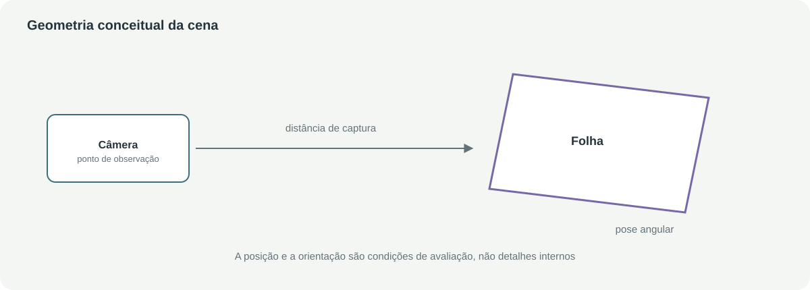
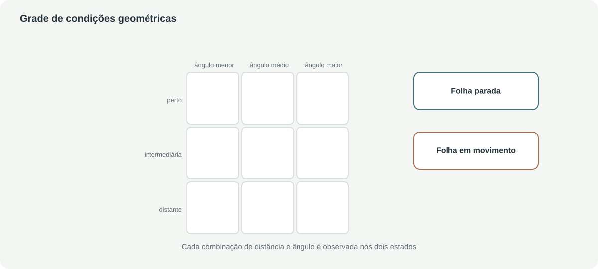
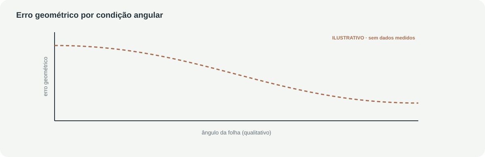

# Estabilidade geométrica de folhas em interação com desenho assistido por câmera

## Resumo

Mudanças na pose da folha alteram sua posição na imagem e podem deslocar a representação do traço em relação ao papel. Avaliar “estabilidade espacial” exige separar ângulo, distância e movimento, além de distinguir erro físico de erro relativo ao tamanho da página. Este artigo propõe um protocolo para medir essas grandezas em cenas capturadas por um sistema de desenho assistido por câmera, sem descrever como a pose é estimada. A proposta define deslocamento do traço, erro absoluto em milímetros, erro normalizado pela largura da folha, deriva temporal e falhas de correspondência. Uma grade cruza orientações, distâncias e estados parado ou em movimento, e uma linha de base geométrica clássica genérica fornece comparação sob as mesmas condições. O protocolo inclui referência independente, análise por sequência e incerteza instrumental. As figuras apresentam apenas esquemas conceituais; a curva não contém valores. Como não há medições, o artigo não atribui estabilidade ao sistema e deixa resultados pendentes até uma avaliação empírica.

**Palavras-chave:** geometria projetiva; homografia; calibração de câmera; rastreamento planar; erro geométrico

## Abstract

Changes in page pose alter its image position and may displace a drawing representation relative to the paper. Evaluating “spatial stability” requires separating angle, distance, and motion, as well as distinguishing physical error from error relative to page size. This article proposes a protocol to measure these quantities in scenes captured by a camera-assisted drawing system without describing how pose is estimated. The proposal defines stroke displacement, absolute error in millimeters, error normalized by page width, temporal drift, and correspondence failures. A grid crosses orientations, distances, and stationary or moving states, while a generic classical geometric baseline provides comparison under the same conditions. The protocol includes an independent reference, sequence-level analysis, and instrumental uncertainty. Figures present conceptual diagrams only; the curve contains no values. Since no measurements are available, the article makes no stability claim about the system and leaves results pending until an empirical evaluation.

**Keywords:** projective geometry; homography; camera calibration; planar tracking; geometric error

## 1. Introdução

A folha de papel muda de posição enquanto a pessoa escreve ou desenha. Ela pode girar, aproximar-se ou afastar-se da câmera e deslocar-se durante a captura. A tinta desenhada também ocupa posições relativas à folha que se deseja preservar. Uma avaliação geométrica precisa separar o movimento físico do papel de uma alteração indesejada na representação observada. Sem essa distinção, “estabilidade” pode significar que a página permaneceu imóvel, que o traço pareceu estável na imagem ou que sua posição relativa foi preservada; esses sentidos não são equivalentes.

A geometria de cenas planares oferece conceitos para descrever a relação entre uma superfície e sua imagem. Trabalhos de calibração, retificação de documentos e rastreamento planar examinam como posição e orientação afetam medidas em imagens. Entretanto, uma avaliação aplicada requer definir quais poses interessam, que deslocamento é considerado erro e como comparar condições paradas e em movimento. Um valor absoluto em pixels não é comparável entre imagens com resoluções diferentes. Uma medida em milímetros pode ser interpretável no espaço da folha, enquanto o erro normalizado pela largura ajuda a comparar escalas de papel distintas.

A lacuna deste artigo é uma formulação operacional de estabilidade espacial para uma folha usada durante desenho assistido por câmera. A pergunta proposta é: **como caracterizar o erro geométrico do traço relativo à folha sob diferentes ângulos, distâncias e estados de movimento?** O objetivo é estruturar um protocolo com referência independente e uma linha de base geométrica clássica genérica, sem descrever como o sistema avaliado estima pose ou mantém correspondência.

O artigo oferece três contribuições. Primeiro, define grandezas para pose da folha, deslocamento do traço e erro absoluto e relativo à largura da folha. Segundo, propõe uma grade de condições que cruza orientação, distância e movimento. Terceiro, especifica métricas e uma comparação com uma linha de base genérica sob condições idênticas. São contribuições para um estudo futuro; não há resultado geométrico apresentado.

A seção 2 revê geometria projetiva, calibração, retificação e rastreamento planar. A seção 3 define estabilidade e apresenta grandezas e unidades. A seção 4 propõe cenas, condições, métricas, análise e comparação. A seção 5 lista resultados pendentes. A seção 6 discute possíveis interpretações; a seção 7 trata ameaças à validade; e a seção 8 resume evidências que ainda faltam.

O protocolo considera que o papel tem dimensões físicas identificáveis para a finalidade da avaliação. Se a folha se dobra ou curva, a geometria deixa de ser bem descrita por um plano ideal. Essas situações podem ser excluídas do escopo, agrupadas como condição adicional ou avaliadas com referência apropriada, mas a decisão precisa ser explícita. A estabilidade também depende de quanto erro é importante para a tarefa. Um deslocamento pode ser tolerável para uma anotação livre e inaceitável para uma sobreposição precisa. A proposta separa mensuração de julgamento de utilidade, deixando que o estudo justifique margens com base no uso e na incerteza instrumental.

Uma avaliação não precisa exigir que o papel permaneça em uma pose ideal. O movimento faz parte do uso e deve ser representado como condição, não descartado automaticamente como ruído. A questão é se a relação entre traço e folha se mantém dentro de uma variação justificável para a finalidade declarada. Essa finalidade pode privilegiar preservação de posição, forma, continuidade ou legibilidade. O protocolo explicita essa escolha antes da coleta e evita interpretar uma única medida como qualidade geométrica completa.

Uma decisão metodológica central é escolher o referencial da afirmação. Se o estudo pergunta onde o traço aparece no quadro da câmera, a medida pertence ao plano da imagem. Se pergunta se o traço permanece sobre a mesma região do papel, a folha é o referencial de comparação. Uma terceira pergunta pode avaliar fidelidade depois de digitalizar o desenho final. As três perguntas podem ser úteis, mas respondem a objetivos diferentes. O artigo concentra-se na segunda e reporta unidades físicas quando a referência permite. Essa delimitação evita que a própria movimentação da folha seja contada como erro, ou que um erro relativo ao papel desapareça em uma medida global da imagem.

## 2. Trabalhos relacionados

### 2.1 Geometria projetiva e retificação planar

A geometria projetiva descreve relações entre coordenadas em planos e suas projeções em imagens. A homografia é uma representação matemática comum para relações projetivas entre planos, sendo utilizada em retificação de documentos, panoramas e alinhamento de superfícies. Hartley e Zisserman sistematizam conceitos e problemas de visão computacional geométrica [1–4]; textos de calibração explicam como propriedades da câmera afetam medidas e reconstrução. Esses fundamentos ajudam a definir a pose e a transformação entre referenciais, mas a proposta não assume uma transformação interna específica para o sistema avaliado.

Retificação de documentos fotografados concentra-se em recuperar uma vista de página que facilite leitura ou processamento posterior. Trabalhos de Liang, DeMenthon e Doermann estudam retificação geométrica de documentos capturados por câmera [11, 12]. Tsoi e Brown usam limites em múltiplas vistas para retificar documentos, e outros estudos tratam páginas planas e curvas, distorções de perspectiva e estruturas locais [13, 14, 21–23]. Esses métodos ilustram que fronteiras visíveis e forma do papel afetam a geometria estimada. Seu objetivo de saída pode diferir da estabilidade de traço em uma interação contínua, portanto métricas de retificação não são automaticamente métricas de preservação do desenho.

A literatura sobre documentos também destaca dificuldade sob sombras, iluminação não uniforme, baixo contraste e deformação. Uma folha que parece plana para leitura pode mover-se o suficiente para influenciar alinhamento do traço. A avaliação deve definir se considera apenas pose estática ou trajetória ao longo do tempo. O presente artigo trata ambas as situações como condições, mantendo distinta a geometria instantânea e a estabilidade temporal.

### 2.2 Calibração de câmera e rastreamento de planos

Calibração de câmera relaciona medidas na imagem a propriedades da projeção e pode incluir parâmetros intrínsecos ou a pose em relação à cena. Zhang descreve um método de calibração baseado em observações de um padrão plano em múltiplas orientações; outras abordagens usam geometrias conhecidas e restrições da lente [5–10]. Essas linhas são relevantes para definir unidade e incerteza, mas a proposta não especifica como o sistema estima a pose nem quais referências internas usa. O protocolo mede a saída observável e compara-a com uma referência experimental separada.

Rastreamento planar estuda a manutenção da correspondência de uma superfície ao longo de uma sequência. Trabalhos sobre reconstrução de documentos em múltiplas vistas, alinhamento e rastreamento de planos consideram alterações de escala, perspectiva, oclusão e movimento [15, 18, 20]. A estabilidade geométrica de uma folha tem relação com esses problemas, mas a unidade de interesse aqui é a posição do traço em relação à folha, e não a reconstrução da cena inteira. Esse recorte orienta a escolha das métricas e reduz a tentação de divulgar detalhes de implementação.

Estabilidade temporal e acurácia geométrica também não são sinônimos. Uma estimativa pode oscilar pouco, mas manter um deslocamento constante; outra pode ser correta em média e variar muito de quadro a quadro. Por isso, a literatura de rastreamento motiva reportar erro, dispersão e falhas, não somente uma medida média [4, 6, 22]. A trajetória da pose pode ainda ser comparada com o movimento físico medido externamente, quando o equipamento permitir uma referência com incerteza conhecida.

### 2.3 Avaliação geométrica em documentos capturados

Benchmarks de documentos capturados por câmera avaliam retificação, localização ou qualidade de imagem em condições variadas [16, 17, 19]. A métrica pode considerar distância entre cantos, erro de alinhamento, semelhança visual ou qualidade de OCR. A escolha depende da tarefa: um erro pequeno em um canto pode alterar a leitura de uma região, enquanto uma medida de similaridade global pode esconder distorção localizada. Para desenho, a comparação precisa focar a relação entre o traço digital e a página física.

Rastreamento e retificação também podem ser avaliados em sequência, relatando erros por quadro, falhas de acompanhamento e recuperação após oclusão. A avaliação por sequência não deve tratar quadros consecutivos como observações independentes. A dependência temporal reduz a informação efetiva e afeta intervalos de incerteza. Uma métrica acumulada pode descrever deriva ao longo da sessão, enquanto erros instantâneos descrevem discrepâncias pontuais.

A linha de base clássica genérica serve como referência para interpretar ganhos ou perdas em condições idênticas. Comparações de erro geométrico e de calibração também enfatizam a necessidade de declarar métrica e incerteza [3, 4]. Sua função é estabelecer um contraste reproduzível com uma prática geométrica tradicional, não afirmar que um método específico é superior. Ela deve receber as mesmas cenas, anotações e critérios e ter suas próprias falhas reportadas. A configuração da linha de base será descrita apenas o bastante para reproduzir sua avaliação, sem expor a implementação do sistema avaliado.

A lacuna permanece na definição conjunta de pose, deslocamento do traço e erro normalizado pela escala da folha para um protocolo de avaliação em movimento. Este artigo aproxima geometria projetiva, calibração e rastreamento, mas trata estabilidade como uma relação observável e orientada à tarefa. A proposta não reivindica novo estimador geométrico. Ela organiza grandezas, condições e comparações que permitam testar empiricamente essa relação.

A necessidade de uma referência independente aparece em diversas áreas da visão computacional. Erro de reprojeção, erro de correspondência e erro geométrico absoluto quantificam aspectos diferentes. Uma calibração pode parecer consistente segundo um critério e ainda produzir incerteza em uma tarefa a jusante. Por essa razão, a proposta informa o que cada métrica mede e não usa um único indicador como prova de correção. A linha de base e o método avaliado são julgados contra a mesma referência física, com incerteza reportada.

A literatura de calibração e visão geométrica também distingue incerteza de medição de erro sistemático. Uma incerteza ampla pode tornar dois métodos indistinguíveis, enquanto um viés consistente pode ser corrigível, mas ainda relevante. O protocolo não pressupõe que qualquer método de referência seja exato. Em vez disso, exige que a referência informe sua precisão e que a comparação considere esse limite. Quando essa informação não estiver disponível, os resultados serão descritos como aproximações e não como erro físico exato.

## 3. Enquadramento do problema

Pose da folha é a configuração espacial que descreve sua orientação e posição em relação à câmera durante uma observação. Para este protocolo, a pose é organizada por ângulo, distância e movimento. Ângulo descreve a inclinação da folha em relação à orientação frontal de referência. Distância descreve a separação entre a câmera e a superfície do papel, ou uma categoria de escala aparente quando a distância física não puder ser medida com precisão. Movimento descreve se a folha está parada, deslocando-se lentamente ou em movimento contínuo durante a observação. Essas dimensões são registradas externamente; o artigo não descreve como o sistema as estima.

O deslocamento do traço é a diferença de posição entre a localização correspondente na folha física e a representação observada. A referência pode ser obtida de uma digitalização independente ou de anotação manual sincronizada, desde que o método preserve identidade de pontos e a incerteza seja documentada. O artigo não prescreve marcas internas ou pontos utilizados pelo sistema. A referência experimental é separada da saída que será avaliada e serve apenas para quantificar a discrepância.

Erro absoluto é a distância, em milímetros na superfície da folha, entre a posição esperada do traço e a posição comparada. Erro relativo à largura da folha normaliza essa distância pela largura física da página. Se eᵢ for o erro absoluto de uma observação e W a largura da folha, o erro relativo pode ser escrito como rᵢ = eᵢ/W. Essa razão facilita comparação entre folhas de dimensões diferentes, mas não substitui o erro absoluto: a mesma fração pode corresponder a deslocamentos físicos diferentes.

A estabilidade espacial inclui tanto desvio médio quanto variação temporal. Viés geométrico é uma diferença persistente em uma direção; dispersão descreve a variação entre observações. Deriva é a mudança acumulada ao longo do tempo, que pode ser apresentada por trajetória do erro ou diferença entre início e fim. Falha de observação ocorre quando não há correspondência confiável entre a referência física e a saída por uma parte da sequência. Esses eventos não devem ser convertidos em erro zero nem omitidos sem explicação.

A Tabela 1 apresenta grandezas e unidades. Ângulo pode ser reportado em graus, distância em milímetros ou por classes de escala aparente, deslocamento e erro em milímetros, e erro relativo como razão adimensional. A definição de uma unidade pressupõe uma referência física ou um procedimento de normalização. Se a largura da folha não for conhecida, a razão não poderá ser calculada com segurança. O relatório distingue medições diretas, estimativas externas e categorias ordinais.

**Tabela 1.** Grandezas geométricas da folha e do traço, com definições, unidades e interpretações; o quadro separa pose, deslocamento, erro absoluto, erro relativo à largura e falha de observação.

| Grandeza | Definição operacional | Unidade | Interpretação |
|---|---|---|---|
| Ângulo da folha | Inclinação em relação à orientação frontal definida no protocolo | Graus ou classe qualitativa | Condição de pose; não descreve o método de estimação. |
| Distância de captura | Separação física entre câmera e plano do papel | Milímetros ou classe categórica | Afeta escala aparente e contexto de captura. |
| Estado de movimento | Folha parada, com movimento pequeno ou em movimento contínuo | Categoria ordinal definida no protocolo | Descreve condição temporal sem supor velocidade fixa. |
| Deslocamento do traço | Distância entre posição de referência e posição observada | Milímetros | Erro físico na superfície da folha. |
| Erro relativo à largura | Erro absoluto dividido pela largura da folha | Razão adimensional | Normaliza escala; requer largura conhecida. |
| Erro angular | Diferença entre ângulo de referência e condição observada | Graus | Caracteriza discrepância de orientação. |
| Deriva temporal | Mudança do erro ao longo da sequência | Milímetros ou razão normalizada por largura | Indica alteração acumulada, não causa interna. |
| Falha de correspondência | Observação sem referência confiável para comparação | Contagem e proporção | Ausência de medida; não equivale a erro nulo. |

O problema é, portanto, avaliar uma relação no referencial da folha sob variação de pose. Uma página que se desloca pode mudar de posição na imagem sem que o traço tenha se movido relativamente ao papel. Inversamente, a representação pode permanecer quase fixa na imagem e deslizar em relação à folha. Uma avaliação que compare apenas coordenadas da imagem confundiria esses casos. O protocolo relaciona observações à folha física e apresenta métricas em ambas as escalas quando possível.

A distinção entre parada e movimento também é necessária. Uma captura parada pode avaliar erro geométrico de pose, mas não revela instabilidade que surge durante deslocamento. Uma sequência em movimento pode acumular incerteza de sincronização e anotação. A avaliação informa o início e o fim da janela observada, classifica o movimento de maneira reproduzível e reporta casos em que a folha deixa de ser observável. Não se fixa uma velocidade ou ângulo máximo, pois tais limites dependem da tarefa e precisam de justificativa empírica.

A Figura 1 ilustra apenas relações geométricas entre câmera, folha, ângulo e distância. A Figura 2 organiza cruzamentos de ângulo e distância nos estados parado e em movimento. A Figura 3 oferece uma curva sem dados para mostrar como resultados poderiam ser visualizados; sua forma não é uma previsão quantitativa. Esses diagramas não revelam como o sistema representa ou calcula a pose.

## 4. Protocolo de avaliação proposto

O protocolo reúne cenas estáticas e sequências em movimento, com folhas de dimensões conhecidas e superfícies adequadas à tarefa. A pergunta determina a variedade de folhas, distâncias e ângulos incluídos. A amostra cobre combinações de orientação, distância e estado de movimento, evitando que uma condição angular apareça apenas a uma distância ou em um único estado. Quando um desenho fatorial completo não for praticável, o plano usa uma seleção balanceada e declara quais interações ficam sem cobertura.

As condições são registradas antes da coleta. Ângulo é categorizado em níveis ordenados definidos por procedimento externo; distância é medida fisicamente ou agrupada por escala aparente; movimento é classificado como parado, pequeno ou contínuo segundo uma instrução comum. Essas categorias orientam cobertura, não prescrevem valores internos. Cada condição é repetida em ordem balanceada ou aleatória quando isso for compatível com o arranjo experimental. Ordem, interrupções, mudanças de iluminação e oclusões incidentais são documentadas.

Uma referência independente registra a pose e o traço esperado sobre a folha. Pode envolver digitalização da folha ao final da tarefa, anotação externa sincronizada ou um procedimento de comparação geométrica definido previamente. O método de referência deve ser validado contra erro conhecido e sua incerteza relatada. Se a referência for menos precisa que a diferença que se deseja medir, o resultado será inconclusivo para essa escala. A equipe mantém separados dados de referência, dados observados e saídas do sistema, sem incluir detalhes internos no manuscrito. A sincronização entre a referência e a observação é documentada com sua resolução e incerteza. Quando a tarefa incluir movimento, a equipe verifica se os registros têm base temporal comum ou se uma diferença de relógio precisa ser estimada. O procedimento externo não deve interferir no gesto nem exigir que o papel seja imobilizado durante todas as condições. Caso a referência só seja confiável em cenas estáticas, a conclusão sobre movimento deverá ser limitada.

A estabilidade é medida pelo erro absoluto em milímetros e pelo erro relativo à largura. A análise descreve a mediana, dispersão, quantis superiores e falhas de correspondência por condição. A trajetória temporal do erro permite observar deriva e oscilações; um sumário de início-fim não substitui a distribuição por sequência. A taxa de falha é definida como a proporção de janelas avaliáveis sem correspondência confiável, distinguindo ausência causada por oclusão ou por perda da referência. O denominador e a política de exclusão são declarados.

A Tabela 2 associa condições e métricas. A comparação inclui uma linha de base geométrica clássica genérica, selecionada da literatura para operar como referência independente. Ela recebe os mesmos dados, anotações e categorias de pose. A escolha e os critérios são definidos antes de comparar resultados, e a linha de base é tratada como uma referência metodológica, não como padrão-ouro. Resultados são apresentados lado a lado com suas falhas e limites.

**Tabela 2.** Condições geométricas e métricas correspondentes, descrevendo unidades, comparações e falhas; os critérios numéricos deverão ser justificados antes da coleta e não são fixados nesta proposta.

| Condição | Medida primária | Métrica complementar | Comparação e interpretação |
|---|---|---|---|
| Ângulo por nível | Erro absoluto em milímetros | Erro relativo à largura | Mostra escala física e normalizada. |
| Distância por nível | Erro relativo e erro absoluto | Falha de correspondência | Separa escala aparente de ausência. |
| Folha parada | Distribuição do erro por observação | Viés geométrico | Caracteriza estabilidade sem movimento. |
| Movimento pequeno | Dispersão temporal do erro | Deriva na sequência | Detecta variação durante deslocamento limitado. |
| Movimento contínuo | Erro por sequência | Taxa de falha e lacunas | Resume continuidade observável. |
| Linha de base clássica | Mesmas medidas e condições | Diferenças pareadas | Contextualiza comparação sem expor detalhes internos. |

**Figura 1.** Esquema conceitual da câmera e da folha em poses angulares distintas, com distância e movimento assinalados; ilustra a cena física e não uma estimativa interna ou método de transformação; elaboração própria.

**Figura 2.** Grade experimental proposta para cruzar ângulo, distância e estado parado ou em movimento. Células representam condições a observar e não contêm medidas nem resultados; elaboração própria.

**Figura 3.** Curva ilustrativa da relação entre ângulo e erro geométrico, com eixos sem números. A forma esperada, não é resultado e não representa medições do sistema; elaboração própria.

A análise começa por verificar a qualidade da referência, a cobertura de condições e a completude das sequências. Depois, estima distribuições por condição e compara as medidas do sistema avaliado com a linha de base. A diferença entre ambos é reportada com intervalo de incerteza e por unidade amostral apropriada; quadros de uma mesma sequência não são tratados como participantes independentes. Se a diferença depender de uma condição, são apresentados resultados estratificados, evitando uma média global que esconda comportamento distinto.

A análise de sensibilidade avalia o efeito de escolhas de anotação e normalização, desde que as alternativas sejam justificadas. Se mudar a definição de referência ou a política de dados ausentes, a alteração fica visível. Não se seleciona retrospectivamente a métrica ou condição que favoreça uma conclusão. A equipe declara como trata erros extremos, falhas transitórias e trechos sem referência confiável. Uma análise exploratória pode sugerir hipóteses futuras, mas não substitui a análise previamente definida.

A matriz experimental deverá ser revisada para garantir que cada categoria tenha observações em mais de uma combinação de contexto. Se o número de condições tornar a coleta impraticável, uma seleção balanceada será preferível a omitir silenciosamente fatores. A equipe registra as combinações escolhidas, o motivo de exclusões e as interações que não serão estimadas. A análise apresentará a cobertura junto aos resultados, para que leitores possam avaliar a distância entre o desenho planejado e a evidência obtida.

Ameaças incluem erro de sincronização, incerteza da digitalização, mudança de luz, flexão do papel, postura, oclusão e limitação da unidade de medida. A calibração do equipamento externo e a repetição de referências verificam a qualidade instrumental. A equipe mantém rastreabilidade de cada sequência e documenta desvios. O procedimento não identifica a causa interna de um erro; limita-se a caracterizar sua associação com as condições observadas.

Para sequências repetidas, a unidade de análise deve ser definida em relação à sessão ou à folha, não apenas ao quadro. Uma análise hierárquica ou um resumo por sequência pode representar a dependência entre observações. A escolha estatística depende do número e estrutura dos dados disponíveis, portanto o protocolo não fixa um modelo. O estudo descreve como participantes, folhas e sessões contribuem para a incerteza e publica a unidade de amostragem junto a cada resultado.

A comparação com a linha de base é interpretada segundo a mesma referência física. Se ambas as abordagens apresentarem erro semelhante, a conclusão será de semelhança observada na amostra, não de equivalência universal. Se divergirem, a análise investigará se a diferença acompanha ângulo, distância ou movimento e reportará os intervalos de incerteza. A linha de base pode também falhar em certas condições; sua presença não torna uma implementação clássica um padrão de verdade.

## 5. Estrutura dos resultados

A aplicação deverá relatar as folhas e sequências incluídas, a cobertura de ângulo, distância e movimento, a qualidade da referência e as condições que não puderam ser observadas. Para cada condição, apresentará erro absoluto e relativo à largura, distribuição, dispersão e taxa de falha. A comparação com a linha de base usará os mesmos conjuntos de observações e critérios. Quando a geometria de referência estiver incerta, a incerteza será reportada junto às estimativas ou a observação será classificada como não avaliável segundo regra prévia.

A Figura 3 permanece uma forma ilustrativa e não representa dados. Um estudo futuro deve substituí-la por uma visualização baseada em medições, com unidades, condições e intervalos de incerteza. Resultados por ângulo não serão agregados sem mostrar também a variação por distância e movimento. A tabela abaixo reserva os campos necessários para a fase empírica. Nenhum valor de erro ou desempenho é atribuído neste artigo.
 O preenchimento deverá registrar também o motivo de cada sequência não avaliável e a quantidade de condições planejadas que realmente foram observadas.

**Tabela 3.** Estrutura prevista para reportar erro absoluto, erro relativo, falhas e comparação com linha de base por condição; todas as células aguardam coleta e permanecem sem resultados medidos.

| Resultado | Registro futuro |
|---|---|
| Erro absoluto por ângulo e distância | [PENDENTE-DADOS] |
| Erro relativo à largura da folha | [PENDENTE-DADOS] |
| Variação em condição parada e em movimento | [PENDENTE-DADOS] |
| Taxa de falha de correspondência | [PENDENTE-DADOS] |
| Diferença em relação à linha de base | [PENDENTE-DADOS] |
| Incerteza da referência geométrica | [PENDENTE-DADOS] |

## 6. Discussão

Se o erro permanecer semelhante entre poses, o estudo poderá afirmar estabilidade geométrica observada nas condições avaliadas. Essa conclusão será limitada aos ângulos, distâncias, folhas e movimentos incluídos. A ausência de diferença não prova equivalência se a referência for imprecisa ou a amostra pequena demais para detectar variações relevantes. A largura da folha e o uso pretendido orientam a interpretação do erro normalizado; uma fração não possui significado prático universal.

Se o erro aumentar em determinadas orientações ou distâncias, o padrão indicará sensibilidade às condições de pose. Uma relação entre condição e erro não identifica, por si só, sua causa. A equipe deverá considerar fatores concomitantes, como contraste, foco e movimento. A curva ilustrativa não prediz que erro cresça com ângulo; ela apenas mostra uma forma possível de visualizar dados quando estes existirem. Resultados não monotônicos também podem ser informativos e devem ser preservados.

Se o erro absoluto aumentar com o tamanho da folha, mas o erro relativo permanecer semelhante, a diferença pode refletir escala física. Se a razão normalizada variar, a discrepância pode estar relacionada à pose ou à referência de forma menos simples. Relatar as duas unidades ajuda a distinguir efeitos de tamanho e de precisão física, desde que a largura e sua incerteza sejam conhecidas. Uma medida normalizada nunca substitui a apresentação de suas grandezas de origem.

Se a linha de base clássica apresentar comportamento semelhante, a avaliação terá evidência de comparação sob condições compartilhadas. Isso não demonstra que os métodos sejam equivalentes em outros contextos nem que a linha de base represente o estado da arte. Se a linha de base divergir, a análise deve examinar as mesmas sequências e a mesma referência. Diferenças podem vir de uma falha localizada, de escala ou de variabilidade temporal, e não de uma propriedade global.

Se falhas de correspondência se concentrarem durante movimento, isso pode indicar que uma medida estática não basta para caracterizar uso contínuo. A discussão considerará se a causa está documentada, mas não reconstruirá etapas internas do sistema. Se falhas ocorrerem por oclusão ou ausência de referência, serão tratadas como limitação de observação. A distinção evita interpretar ausência de dado como erro geométrico extremo ou sucesso perfeito.

A proposta une princípios de geometria projetiva, calibração e rastreamento com uma definição orientada à folha. O critério de estabilidade dependerá da tarefa e não poderá ser inferido apenas da forma de uma curva ou de uma média global. Sua relação com retificação de documentos é complementar: retificação objetiva transformar uma imagem para facilitar leitura ou análise, enquanto esta avaliação pergunta se a relação do traço com a folha se preserva. A literatura oferece ferramentas conceituais, mas a relevância do erro depende de tarefa e tolerância justificadas. A contribuição é tornar essa dependência explícita antes de analisar resultados.

Uma análise útil também examinará casos em que a referência e a saída divergem em direções distintas. Erros com magnitude semelhante podem ter consequências diferentes para o uso se um deslocamento ocorrer ao longo do traço ou perpendicularmente a ele. Essa hipótese precisa ser operacionalizada antes da coleta e não deve ser introduzida após observar exemplos favoráveis. Se a direção do erro não responder à pergunta central, a análise permanecerá descritiva. A apresentação de trajetórias e exemplos de falha pode ajudar a interpretar estatísticas, desde que as ilustrações sejam escolhidas por regra transparente e não apenas como casos extremos selecionados.

A unidade de decisão também importa. Um erro físico pode ser pequeno quando resumido por toda a página, mas afetar uma região localizada do traço. Distribuições por sessão e exemplos de casos extremos complementam estatísticas agregadas. A análise não deve esconder observações discrepantes apenas porque aumentam a dispersão; qualquer exclusão exige regra prévia e motivo documentado. A interpretação deve ainda indicar se o erro relativo à largura foi calculado por observação antes de agregar ou a partir de resumos agregados, pois esses procedimentos podem produzir valores distintos.

## 7. Limitações e ameaças à validade

A validade de construção depende de a pose representar as mudanças relevantes. Ângulo, distância e movimento cobrem dimensões importantes, mas não esgotam iluminação, oclusão, flexão da folha ou mudança de foco. Uma pose categorizada em níveis pode ocultar variação contínua. O estudo precisa explicar como cada nível foi definido, sem presumir que categorias qualitativas sejam fisicamente uniformes.

A validade interna é ameaçada por variação simultânea de fatores. Mudança de ângulo pode ocorrer junto com movimento, escala aparente e iluminação. Um desenho balanceado ajuda, mas não elimina todas as interações. A análise de dados observacionais deve evitar atribuir causalidade a uma condição quando outras também mudaram. A linha de base compara métodos sob as mesmas condições, mas não substitui randomização, referência válida ou controle experimental.

A validade de medida depende da digitalização ou anotação independente. A folha pode se dobrar, o traço pode ser ambíguo e a sincronização pode ter erro. A largura física também pode ser medida com incerteza. Essas fontes limitam a interpretação em milímetros e em unidades normalizadas. A taxa de falha pode crescer quando não há uma referência confiável, ainda que o sistema tenha produzido uma resposta visível; casos sem referência precisam ser distinguidos de falhas observáveis.

A validade externa está restrita à variedade de materiais, folhas, equipamentos, distâncias e atividades estudadas. Uma folha rígida e plana não representa papel amassado ou apoiado em outra superfície. Resultados sob captura parada não generalizam automaticamente para movimento. Participantes com estratégias ou capacidades motoras distintas também podem mover a folha de maneiras diversas. Conclusões devem declarar esse escopo e não usar “estável” sem qualificar a condição.

A validade dos dados inclui consentimento para imagens, preservação de registros e possibilidade de compartilhar medidas. Uma imagem pode conter conteúdo pessoal. Restrições de acesso devem ser informadas e acompanhadas por metadados ou sumários sempre que permitido. Este artigo não apresenta medições, e a adequação do protocolo ainda não foi examinada em um piloto ou por equipe independente. A proposta permanece sujeita a revisão antes de ser tratada como padrão.

## 8. Conclusão

Este artigo definiu estabilidade geométrica como relação observável entre pose da folha e posição do traço. Propôs medir ângulo, distância e movimento, erro absoluto em milímetros, erro relativo à largura da página, deriva e falhas de correspondência. Também apresentou uma grade de condições e uma comparação com linha de base clássica genérica sob referências compartilhadas.

A proposta não indica como a pose é estimada nem apresenta dados. Uma aplicação futura deverá validar a referência externa, justificar critérios de erro, preencher a matriz de condições e reportar incerteza. Resultados precisarão ser limitados às folhas, movimentos e tarefas observadas. Até essa avaliação, estabilidade permanece uma pergunta empírica e não uma propriedade demonstrada. A documentação das referências, das condições e das incertezas será parte essencial dessa avaliação.
 A aplicação também deverá justificar a precisão da referência, publicar a grade efetivamente observada e preservar resultados divergentes entre condições. Esses passos tornam possível interpretar a evidência sem transformar um esquema conceitual em alegação de desempenho.

## Declarações

- Uso de IA generativa: texto redigido com apoio de IA generativa, com revisão e responsabilidade dos autores; referências conferidas por DOI ou página bibliográfica.
- Dados: este artigo não apresenta dados empíricos; registros futuros dependerão de consentimento e condições de acesso.
- Código: não há código de análise ou resultados empíricos associado a este manuscrito.
- Conflito de interesses: os autores deverão declarar conflitos pertinentes antes da submissão.
- Ética: qualquer coleta de imagens com pessoas deverá obter aprovação ética e consentimento aplicável.
- Contribuição dos autores: as contribuições individuais deverão ser informadas na versão submetida.

## Referências

[1] Hartley, R.; Zisserman, A. Multiple View Geometry in Computer Vision. 2nd ed. Cambridge University Press, 2004. https://www.cambridge.org/core/books/multiple-view-geometry-in-computer-vision/0B6F289C78B2B23F596CAA76D3D43F7A
[2] Hartley, R.; Zisserman, A. Projective Geometry and Transformations of 2D. In: Multiple View Geometry in Computer Vision. Cambridge University Press, 2004, 25–64. https://doi.org/10.1017/CBO9780511811685.005
[3] Hartley, R.; Zisserman, A. Estimation – 2D Projective Transformations. In: Multiple View Geometry in Computer Vision. Cambridge University Press, 2004, 87–131. https://doi.org/10.1017/CBO9780511811685.007
[4] Hartley, R.; Zisserman, A. Algorithm Evaluation and Error Analysis. In: Multiple View Geometry in Computer Vision. Cambridge University Press, 2004, 132–150. https://doi.org/10.1017/CBO9780511811685.008
[5] Hartley, R. I. Theory and Practice of Projective Rectification. International Journal of Computer Vision, 35(2), 1999, 115–127. https://doi.org/10.1023/A:1008115206617
[6] Chum, O.; Pajdla, T.; Sturm, P. The Geometric Error for Homographies. Computer Vision and Image Understanding, 97(1), 2005, 86–102. https://doi.org/10.1016/j.cviu.2004.03.004
[7] Zhang, Z. A Flexible New Technique for Camera Calibration. IEEE Transactions on Pattern Analysis and Machine Intelligence, 22(11), 2000, 1330–1334. https://doi.org/10.1109/34.888718
[8] Tsai, R. Y. A Versatile Camera Calibration Technique for High-Accuracy 3D Machine Vision Metrology Using Off-the-Shelf TV Cameras and Lenses. IEEE Journal of Robotics and Automation, 3(4), 1987, 323–344. https://doi.org/10.1109/JRA.1987.1087109
[9] Heikkilä, J.; Silvén, O. A Four-Step Camera Calibration Procedure with Implicit Image Correction. Proceedings of the IEEE Computer Society Conference on Computer Vision and Pattern Recognition, 1997, 1106–1112. https://doi.org/10.1109/CVPR.1997.609468
[10] Poulin-Girard, A.-S.; Thibault, S.; Laurendeau, D. Influence of Camera Calibration Conditions on the Accuracy of 3D Reconstruction. Optics Express, 24(3), 2016, 2678–2686. https://doi.org/10.1364/OE.24.002678
[11] Barone, F.; Marrazzo, M.; Oton, C. J. Camera Calibration with Weighted Direct Linear Transformation and Anisotropic Uncertainties of Image Control Points. Sensors, 20(4), 2020, 1175. https://doi.org/10.3390/s20041175
[12] Cvišić, I.; Marković, I.; Petrović, I. Enhanced Calibration of Camera Setups for High-Performance Visual Odometry. Robotics and Autonomous Systems, 155, 2022, 104189. https://doi.org/10.1016/j.robot.2022.104189
[13] Liang, J.; DeMenthon, D.; Doermann, D. S. Geometric Rectification of Camera-Captured Document Images. IEEE Transactions on Pattern Analysis and Machine Intelligence, 30(4), 2008, 591–605. https://doi.org/10.1109/TPAMI.2007.70724
[14] Liang, J.; Doermann, D.; Li, H. Camera-Based Analysis of Text and Documents: A Survey. International Journal of Document Analysis and Recognition, 7, 2005, 84–104. https://doi.org/10.1007/s10032-004-0138-z
[15] Tsoi, Y.-C.; Brown, M. S. Geometric and Shading Correction for Images of Printed Materials: A Unified Approach Using Boundary. Proceedings of the IEEE Computer Society Conference on Computer Vision and Pattern Recognition, 2004, 240–246. https://doi.org/10.1109/CVPR.2004.115
[16] Brown, M. S.; Tsoi, Y.-C. Geometric and Shading Correction for Images of Printed Materials Using Boundary. IEEE Transactions on Image Processing, 15(6), 2006, 1544–1554. https://doi.org/10.1109/TIP.2006.871082
[17] Ulges, A.; Lampert, C. H.; Breuel, T. Document Capture Using Stereo Vision. Proceedings of the 2004 ACM Symposium on Document Engineering, 2004, 198–200. https://doi.org/10.1145/1030397.1030434
[18] Ma, K.; Shu, Z.; Bai, X.; Wang, J.; Samaras, D. DocUNet: Document Image Unwarping via a Stacked U-Net. Proceedings of the IEEE Conference on Computer Vision and Pattern Recognition, 2018, 4700–4709. https://doi.org/10.1109/CVPR.2018.00494
[19] Das, S.; Ma, K.; Shu, Z.; Samaras, D.; Shilkrot, R. DewarpNet: Single-Image Document Unwarping With Stacked 3D and 2D Regression Networks. Proceedings of the IEEE/CVF International Conference on Computer Vision, 2019, 131–140. https://openaccess.thecvf.com/content_ICCV_2019/html/Das_DewarpNet_Single-Image_Document_Unwarping_With_Stacked_3D_and_2D_Regression_ICCV_2019_paper.html
[20] You, S.; Matsushita, Y.; Sinha, S.; Bou, Y.; Ikeuchi, K. Multiview Rectification of Folded Documents. IEEE Transactions on Pattern Analysis and Machine Intelligence, 40(2), 2018, 505–511. https://doi.org/10.1109/TPAMI.2017.2675980
[21] Jiang, X.; Long, R.; Xue, N.; Yang, Z.; Yao, C.; Xia, G.-S. Revisiting Document Image Dewarping by Grid Regularization. Proceedings of the IEEE/CVF Conference on Computer Vision and Pattern Recognition, 2022, 4543–4552. https://doi.org/10.1109/CVPR52688.2022.00450
[22] Šerých, J.; Matas, J. Planar Object Tracking via Weighted Optical Flow. Proceedings of the IEEE/CVF Winter Conference on Applications of Computer Vision, 2023, 1593–1602. https://doi.org/10.1109/WACV56688.2023.00164
[23] Tsoi, Y.-C.; Brown, M. S. Multi-view document rectification using boundary. Proceedings of the IEEE Conference on Computer Vision and Pattern Recognition, 2007. https://doi.org/10.1109/CVPR.2007.383251
[24] Lu, S.; Chen, B. M.; Ko, C. C. Perspective rectification of document images using fuzzy set and morphological operations. Image and Vision Computing, 23(6), 2005, 541–553. https://doi.org/10.1016/j.imavis.2005.01.003
[25] Lu, S.; Chen, B. M.; Ko, C. C. A partition approach for the restoration of camera images of planar and curled document. Image and Vision Computing, 24(8), 2006, 837–848. https://doi.org/10.1016/j.imavis.2006.02.008
