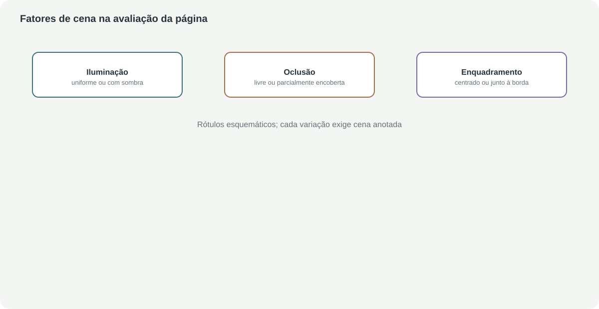
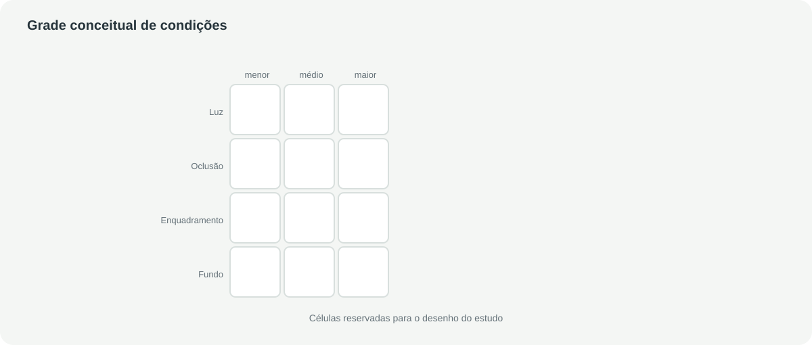
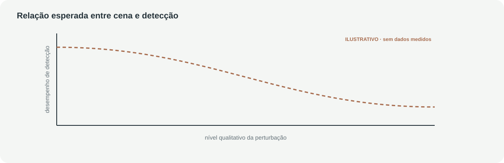

# Avaliação da detecção de páginas em cenas capturadas por câmera

## Resumo

A localização correta de uma página em uma imagem é condição para que um sistema de desenho assistido por câmera possa apoiar uma atividade com papel, mas cenas cotidianas variam em iluminação, oclusão, enquadramento, fundo e movimento. A literatura de documentos fotografados oferece métodos e coleções, porém seus critérios nem sempre se transferem para uma tarefa interativa. Este artigo formula uma proposta de avaliação que define detecção correta por sobreposição da região e erro de cantos, sem impor um valor universal. Organiza fatores de cena em níveis qualitativos, propõe um desenho balanceado e combina precisão, recall, sobreposição média, erro geométrico e tempo até a primeira detecção. O protocolo também trata anotação incerta, cenas sem referência confiável e análise de sensibilidade a critérios escolhidos antes da coleta. As figuras são esquemas de planejamento, não resultados. O artigo entrega conceitos, métricas e um protocolo para estudos futuros. Como não há dados empíricos, nenhuma afirmação de desempenho é feita e os campos de resultados permanecem pendentes.

**Palavras-chave:** detecção de páginas; documentos fotografados; visão computacional; avaliação; cenas não controladas

## Abstract

Correctly locating a page in an image is a prerequisite for a camera-assisted drawing system to support paper-based activity, yet everyday scenes vary in lighting, occlusion, framing, background, and motion. Literature on photographed documents provides methods and datasets, but its criteria do not always transfer to an interactive task. This article proposes an evaluation that defines correct detection through region overlap and corner error without imposing a universal value. It organizes scene factors into qualitative levels, proposes a balanced design, and combines precision, recall, mean overlap, geometric error, and time to first detection. The protocol also addresses uncertain annotation, scenes without a reliable reference, and sensitivity analysis for criteria selected before data collection. Figures are planning diagrams, not results. The article contributes concepts, metrics, and a protocol for future studies. Since no empirical data are available, it makes no performance claim and leaves the results fields pending.

**Keywords:** page detection; photographed documents; computer vision; evaluation; uncontrolled scenes

## 1. Introdução

Localizar a página em uma cena capturada por câmera parece uma tarefa simples enquanto o papel está isolado, plano e totalmente visível. Em uso cotidiano, entretanto, páginas podem aparecer parcialmente, receber sombra, refletir luz, ocupar pequena parte da imagem ou se misturar a fundos com textura. Uma avaliação que conte apenas quadros fáceis pode sugerir desempenho amplo sem testar as condições que motivam o uso. Para comparar sistemas de desenho assistido por câmera, é necessário definir o que conta como página detectada corretamente e como a dificuldade da cena será representada.

A detecção de páginas pode ser formulada como localização de uma região quadrilateral, segmentação de uma área de papel ou identificação de cantos e contorno. Essas formulações não são equivalentes. Uma região pode sobrepor-se à anotação e ainda apresentar cantos deslocados; uma estimativa de cantos pode ser geometricamente próxima, mas falhar sob oclusão parcial; uma detecção tardia pode ser correta quando aparece, mas pouco útil para a tarefa interativa. Portanto, a pergunta sobre “acerto” precisa combinar localização, geometria e tempo, sem definir um limite universal antes de considerar o uso.

A literatura em documentos fotografados aborda distorção de perspectiva, iluminação não uniforme, sombras, curvatura, desfoque e fundos complexos. Benchmarks de documentos e imagens de cena apoiam comparação de métodos, mas podem privilegiar tipos de documento ou condições de captura específicos. Trabalhos de segmentação e avaliação por sobreposição oferecem métricas consolidadas, enquanto estudos de retificação usam erro de cantos ou qualidade da imagem resultante. Essas tradições formam uma base metodológica, mas não resolvem como balancear fatores de cena e avaliar a detecção em uma interação contínua com papel.

A lacuna deste artigo é um protocolo de avaliação independente de implementação que defina detecção correta para páginas, represente fatores de cena de forma explícita e associe métricas complementares. A pergunta proposta é: **como avaliar a localização de páginas em cenas variadas, distinguindo erro espacial, ausência de detecção e demora até a primeira resposta?** A investigação futura deverá separar qualidade geométrica, cobertura de condições e disponibilidade temporal, evitando reduzir tudo a uma taxa agregada.

O artigo oferece três contribuições. Primeiro, define uma noção operacional de detecção correta baseada em sobreposição e erro de cantos, com critérios escolhidos antes da coleta. Segundo, organiza fatores de cena e níveis qualitativos para construir uma avaliação balanceada sem supor que todos os fatores tenham o mesmo efeito. Terceiro, propõe um conjunto de métricas e uma análise que separa acerto, geometria e tempo até a primeira detecção. Nenhuma dessas contribuições afirma resultado sobre um sistema já medido.
 A seleção da amostra também explicita se a avaliação é por imagem estática ou por sequência, e se a página precisa permanecer visível por toda a atividade. Essa escolha determina o que significa primeira detecção e evita comparar uma fotografia isolada a uma interação contínua como se fossem o mesmo problema.

A seção 2 revisa detecção e retificação de documentos fotografados, segmentação em cenas naturais e métricas de benchmark. A seção 3 apresenta definições e a taxonomia de fatores. A seção 4 descreve cenas, anotação, critérios de acerto, métricas e análise. A seção 5 lista resultados a preencher quando houver dados. A seção 6 discute interpretações possíveis; a seção 7 delimita ameaças à validade; e a seção 8 resume o que falta para conclusões empíricas.

A população de interesse não precisa ser tratada como “todas as páginas”. Um projeto pode delimitar folhas soltas, páginas desenhadas em ambientes domésticos ou condições específicas de uso. Essa delimitação orienta os fatores e a escolha de anotações. Termos amplos como “robusto” ou “funciona no mundo real” não substituem a especificação de quais cenas foram incluídas, quais ficaram ausentes e quais usos motivam a comparação. A proposta enfatiza esse ponto porque as mesmas métricas podem sustentar conclusões diferentes quando a população-alvo muda.

## 2. Trabalhos relacionados

### 2.1 Localização e retificação de documentos fotografados

A digitalização de documentos por câmera combina detecção da página e correção de sua geometria. Trabalhos de retificação representam a folha como superfície plana ou quase plana e procuram localizar uma região delimitadora antes de transformar a imagem para uma vista frontal [5–8]. Métodos baseados em limites, estruturas locais e operações morfológicas tratam a relação entre contorno e imagem capturada [6, 7, 9]. Esses estudos fornecem conceitos geométricos e de imagem, mas não estabelecem por si mesmos critérios de desempenho para um cenário de desenho interativo.

Métodos de localização de documentos em imagens fotografadas frequentemente combinam cor, gradiente, linhas, bordas e hipóteses sobre forma. Competições de binarização organizam a comparação de documentos degradados, enquanto estudos de detecção em vídeos de celular tratam cenas naturais e variação de captura [11, 12, 20–22]. Os fatores considerados variam de acordo com o problema. Um método para documento impresso pode pressupor texto e contraste que não existem em uma folha de desenho em branco. A avaliação precisa, portanto, especificar se a região anotada corresponde à folha física, à área útil ou a outra definição operacional.

A retificação transforma a imagem observada para uma representação mais próxima da página vista de frente. Métricas de retificação podem medir erro dos cantos, correspondência entre linhas ou qualidade visual posterior. Uma boa sobreposição de contornos não garante que cada canto seja preciso, e uma diferença de canto pode ter efeito maior em uma região da folha do que em outra. Para este artigo, retificação é contexto relacionado; a pergunta central é localizar a página. Não se descreve como um sistema realiza essa operação, nem se assume que a avaliação precise expor sua representação interna.

### 2.2 Segmentação e detecção em cenas naturais

A segmentação procura separar regiões de interesse do fundo, enquanto a detecção pode produzir uma caixa, um polígono ou uma máscara. Trabalhos de avaliação em visão computacional ressaltam que a escolha da representação afeta a métrica. Uma caixa delimitadora pode ignorar a forma quadrilateral da página; uma máscara pode avaliar contorno detalhado, mas exigir anotação mais custosa. Para uma folha aproximadamente plana, a região quadrilateral e seus cantos fornecem descrições complementares. A avaliação pode calcular sobreposição de áreas e erro geométrico, mantendo a definição de acerto independente de qualquer arquitetura.

A sobreposição entre previsão e anotação é frequentemente resumida pela interseção sobre união, conhecida como Intersection over Union (IoU), ou pelo índice de Jaccard em protocolos de documentos [1, 2]. Essa métrica compara área compartilhada à área coberta por ambas as regiões. Uma IoU maior indica maior sobreposição segundo aquela representação, mas não estabelece sozinha se o erro importa para o uso. Uma taxa de acerto baseada em IoU requer um valor mínimo escolhido antes da avaliação. Variar esse critério em análise de sensibilidade mostra como conclusões dependem da definição, em vez de selecionar retrospectivamente o valor mais favorável.

Benchmarks de detecção em cenas naturais promovem protocolos compartilhados, divisão de dados e métricas comparáveis. Benchmarks de detecção consolidaram práticas de avaliação por precisão, recall e sobreposição, embora objetos genéricos não correspondam necessariamente a folhas. Coleções de documentos capturados por câmera, como SmartDoc e DocUNet, aproximam a questão e incluem variações de captura ou deformação [1, 3, 4]. Nenhuma coleção substitui a validação de uma tarefa particular. A composição da amostra precisa cobrir o espaço de interesse e declarar seus limites.

### 2.3 Benchmarks e métricas de avaliação

Precisão e recall respondem a aspectos diferentes. Precisão indica que fração das detecções declaradas corresponde a páginas válidas sob o critério adotado; recall indica que fração das páginas anotadas foi encontrada. Ambas podem ser afetadas pelo procedimento de pareamento entre detecções e anotações. Se houver mais de uma região candidata ou várias páginas na cena, as regras de correspondência precisam ser descritas. Uma métrica agregada por imagem também pode tratar de forma diferente cenas com uma página e cenas com várias regiões plausíveis.

Erro de cantos mede distância entre cantos previstos e anotados, com unidade em pixels ou normalização por uma dimensão da imagem. O erro em pixels depende da resolução de captura; uma medida normalizada melhora comparação entre tamanhos, mas pode ocultar o impacto absoluto em uma aplicação. Relatar ambas pode ser apropriado quando a resolução fizer parte do desenho. O tempo até a primeira detecção mede o intervalo entre o início de uma condição válida e a primeira resposta que satisfaz a definição de acerto. Essa medida temporal complementa a geometria, mas depende da cadência de observação e da regra de persistência da resposta.

As competições de binarização documentam protocolos e métricas para comparar imagens de documentos, mas não devem ser confundidas com benchmarks de fronteira da página [20–22]. A literatura também discute qualidade da anotação e desacordo entre avaliadores. A borda física da página pode ser ambígua quando há sombra, dobra ou oclusão. Um protocolo de anotação deve declarar como os cantos são identificados em casos parciais, se avaliadores trabalham independentemente e como divergências são resolvidas. O benchmark deve registrar quais cenas foram excluídas e por quê. Uma métrica calculada sobre rótulos instáveis não deve ser interpretada como medida precisa de comportamento.

A lacuna que permanece é um protocolo para avaliar a detecção da página em condições relevantes a desenho assistido por câmera, que combine sobreposição, geometria, cobertura de fatores e tempo até a primeira detecção. A proposta deste artigo usa práticas de benchmarks como referência metodológica, mas não copia coleções nem presume que seu domínio seja intercambiável. A contribuição é tornar explícitas as escolhas de anotação e de acerto, permitindo que futuros estudos comparem condições sem esconder dependência de critérios.

Resultados de segmentação também dependem da forma de anotação e da granularidade da região avaliada. Uma máscara detalhada pode penalizar pequenas diferenças de contorno que não alteram a localização útil, enquanto uma caixa pode ignorar deformação importante nos cantos. Por isso, a escolha da representação deve ser coerente com a pergunta e apresentada junto aos resultados. Se um benchmark existente for reutilizado, o estudo precisa declarar quais classes, divisões ou imagens foram usadas e por que esse subconjunto corresponde à população definida.

## 3. Enquadramento do problema

Neste artigo, página é a folha física que constitui a região de interesse da cena. A anotação de referência é um polígono definido pela borda observável da folha, acompanhado de seus cantos quando eles puderem ser identificados. Em situações com oclusão, sombra ou dobra, o anotador segue uma instrução comum e marca a incerteza, em vez de inventar uma borda invisível. Uma cena pode ser classificada como avaliável, parcialmente avaliável ou sem referência confiável; essa classificação deve ser determinada sem consultar a saída do sistema.

Uma detecção é um relato observável de uma região candidata associada à página. Para comparar detecção e referência, calcula-se a interseção sobre união entre as áreas poligonais. O critério mínimo de sobreposição que define acerto precisa ser escolhido antes de examinar os resultados. O artigo não fixa um valor, pois sua adequação depende de como a página será usada. Uma análise de sensibilidade pode mostrar se a conclusão muda sob critérios alternativos justificados, sem selecionar apenas aquele que maximiza o desempenho.

A geometria da detecção é avaliada separadamente por erro de cantos. Para cada canto pareado, mede-se a distância entre a posição estimada e a referência. O erro pode ser relatado em pixels e normalizado por uma dimensão da imagem, desde que a normalização seja declarada. Quando a página está parcialmente oculta e um canto não pode ser anotado com confiança, a avaliação informa essa ausência e não atribui erro zero. A região pode ainda ser comparada se houver uma anotação parcial com regras explícitas, mas esses casos devem ser analisados separadamente.

A dimensão temporal distingue encontrar uma página de encontrá-la a tempo de apoiar a atividade. Tempo até a primeira detecção é o intervalo entre a primeira cena em que a página atende aos critérios de inclusão e a primeira resposta que satisfaz o critério de acerto predefinido. Essa métrica não afirma que a resposta permaneça estável depois do primeiro evento. Se a continuidade for relevante, ela deve ser descrita por medidas próprias de persistência ou falha, sem confundir com detecção inicial.

A definição de acerto também distingue uma página de regiões semelhantes no fundo. Uma folha branca sobre uma mesa clara pode ter fronteira pouco visível; um retângulo impresso pode competir visualmente com a borda; uma área retangular próxima pode receber uma detecção falsa. Casos assim exigem anotação do objeto físico de interesse e registro de alternativas plausíveis. A equipe não deve escolher a região de referência a partir da saída que deseja avaliar. Uma instrução comum e revisada antes da análise reduz esse risco, embora não o elimine.

Por fim, as métricas caracterizam propriedades diferentes da decisão de localizar. Sobreposição resume área, erro de cantos resume geometria, precisão e recall resumem correspondência com referências, e tempo descreve disponibilidade temporal. Não há razão para esperar que uma medida represente todas as demais. Uma comparação justa apresenta resultados desagregados e explica qual dimensão sustenta cada conclusão. Essa separação é especialmente importante quando uma tarefa exige continuidade da atividade e não apenas reconhecimento posterior da imagem.

Os fatores de cena são propriedades controláveis ou registráveis que podem alterar visibilidade e geometria. A Tabela 1 os organiza por tipo e por níveis qualitativos. As descrições “menor”, “intermediário” e “maior” indicam ordenação planejada dentro de um fator, não valores físicos universais. A intensidade de uma sombra, por exemplo, não é diretamente comparável à fração de página encoberta. Os níveis precisam ser definidos de forma observável no protocolo e fotografados ou descritos para permitir auditoria.

**Tabela 1.** Fatores de cena e níveis qualitativos propostos para uma avaliação balanceada, explicitando variações de iluminação, oclusão, enquadramento, fundo, aparência da página, distância e movimento, organizados em níveis qualitativos de cobertura.

| Fator | Níveis qualitativos possíveis | Como definir no protocolo | Risco de confusão |
|---|---|---|---|
| Iluminação | uniforme; sombra localizada; reflexo | Descrever distribuição e posição da luz observável | Pode se confundir com cor e textura do papel. |
| Oclusão | ausente; parcial; extensa | Registrar região visível e parte encoberta | A anotação dos cantos pode ficar incerta. |
| Enquadramento | central; próximo à borda; parcialmente fora de cena | Descrever posição relativa da folha na imagem | Pode variar junto à escala aparente. |
| Fundo | simples; texturizado; com objetos próximos | Categorizar elementos no entorno da folha | Contraste pode mudar junto à cor do fundo. |
| Aparência da página | clara; colorida; com marcas ou dobra | Registrar cor, conteúdo e deformação visíveis | Marcas podem se confundir com borda. |
| Distância | próxima; intermediária; distante | Definir categorias observáveis por configuração de captura | Tamanho aparente e foco também mudam. |
| Movimento | parada; pequeno movimento; movimento contínuo | Registrar condição temporal durante a captura | Desfoque e alteração do enquadramento podem coexistir. |
| Foco e nitidez | nítido; levemente desfocado; desfocado | Definir por inspeção independente da detecção | Desfoque pode decorrer de movimento ou foco. |

O enquadramento do problema separa também ausência de detecção, detecção incorreta e detecção correta tardia. Ausência é uma cena válida sem resposta correspondente durante o período avaliado. Detecção incorreta ocorre quando a região relatada não corresponde à página de referência segundo o critério estabelecido. Detecção tardia satisfaz o critério geométrico, mas ultrapassa a janela de observação definida para a tarefa. A janela deve ser justificada pelo protocolo, não escolhida depois de conhecer o desempenho.

A figura de fatores apresenta exemplos esquemáticos sem sugerir saídas reais. A matriz da Figura 2 mostra que uma avaliação balanceada considera cruzamentos de condições, ainda que a combinação completa possa ser grande demais. A seleção de subconjuntos deve preservar cobertura e explicar quais interações entre fatores serão avaliadas. A Figura 3 fornece apenas uma forma esperada para relacionar perturbação e desempenho; nenhuma tendência é atribuída ao sistema.

## 4. Protocolo de avaliação proposto

O estudo começa por definir a população de cenas e a unidade de análise. Uma cena corresponde a uma condição de captura anotada, e uma sequência corresponde a observações relacionadas durante uma tarefa. A amostra deve incluir cenas planejadas para cobrir os fatores da Tabela 1, além de variação natural que seja relevante à pergunta. A equipe documenta origem, condições e restrições de uso das imagens. Se cenas envolverem pessoas ou espaço privado, consentimento e proteção de identidade são definidos antes da coleta.

A construção da amostra deve evitar que uma condição difícil apareça sempre junto de outra. Por exemplo, se todas as cenas com sombra também tiverem a página parcialmente fora do enquadramento, não será possível separar seus efeitos. Um desenho fatorial completo pode ser inviável; nesse caso, um plano balanceado seleciona combinações que cubram cada fator e as interações prioritárias. A seleção é registrada antes da execução. O relatório apresenta quais combinações foram incluídas e quais ficaram fora, sem tratar a cobertura parcial como cobertura total.

A anotação da referência é produzida por pessoas que não veem as saídas avaliadas, quando isso for praticável. O manual define borda, cantos, oclusão e casos ambíguos. Uma parte das cenas recebe anotação independente por mais de uma pessoa para estimar desacordo. O estudo relata o procedimento de adjudicação, a forma de representar incerteza e o número de casos sem referência confiável após a coleta. Se uma condição alterar fisicamente a folha, como dobra ou amassado, a anotação acompanha a borda visível sem presumir uma forma plana perfeita.

**Definição de acerto.** A regra primária combina região e geometria: a detecção deve satisfazer o critério de sobreposição previamente definido e permanecer dentro da tolerância geométrica estabelecida para cantos válidos. O estudo fixa esses critérios antes de analisar o conjunto de avaliação, com justificativa vinculada ao uso. Como não existe um valor universal, são apresentados resultados de sensibilidade a critérios alternativos, caso a conclusão dependa deles. O artigo não determina um número de sobreposição ou uma tolerância em pixels.

A correspondência entre detecções e páginas anotadas é definida para cenas com uma ou várias regiões candidatas. O método de pareamento, a política para detecções repetidas e a forma de lidar com páginas ausentes são registrados. Uma página prevista mais de uma vez não deve inflar recall; detecções sobre fundo não devem desaparecer da avaliação de precisão. Para uma cena sem página avaliável, o protocolo esclarece se ela mede falso positivo, é excluída da análise principal ou compõe uma análise separada.

A equipe mede precisão, recall, sobreposição média, erro de cantos e tempo até a primeira detecção. A Tabela 2 apresenta definições e limites. A precisão e o recall usam contagens derivadas do pareamento e do critério de acerto. A sobreposição média resume regiões pareadas e deve ser acompanhada da distribuição, pois a média pode ocultar casos ruins. Erro de cantos é relatado por cena e por canto quando possível. O tempo até detecção usa a sequência e o marco inicial especificados. Intervalos de incerteza são estimados com método compatível com a unidade amostral, sem tratar quadros da mesma sessão como observações independentes.

**Tabela 2.** Métricas para caracterizar detecção de páginas, com definições independentes de limites numéricos; a equipe deverá fixar critérios de acerto antes da coleta e reportar incerteza.

| Métrica | Definição | Unidade ou agregação | Limite interpretativo |
|---|---|---|---|
| Precisão | Detecções corretas divididas por detecções relatadas | Proporção por cena ou condição | Depende do critério e do pareamento adotados. |
| Recall | Páginas detectadas corretamente divididas por páginas anotadas avaliáveis | Proporção por cena ou condição | Não resume atraso nem qualidade geométrica. |
| IoU média | Área da interseção dividida pela área da união entre região detectada e anotada | Proporção por caso pareado | Média pode esconder caudas e casos de falha. |
| Erro de cantos | Distância entre cantos correspondentes da detecção e referência | Pixels e, se justificado, medida normalizada | Sensível a resolução e incerteza de anotação. |
| Tempo até primeira detecção | Tempo da primeira cena válida até resposta que atende ao critério | Tempo por sequência | Depende da amostragem temporal e da janela de observação. |
| Falha de localização | Ausência de região correta ou região fora do critério | Contagem e proporção por fator | Deve distinguir ausência, incorreção e atraso. |

A matriz e as figuras ajudam a comunicar a estrutura do protocolo antes de qualquer resultado. A Figura 1 apresenta fatores de cena de forma esquemática; a Figura 2 ilustra a grade de fatores e níveis; a Figura 3 mostra uma curva genérica sem valores. Esses elementos não descrevem a configuração interna do sistema. São instrumentos de planejamento e de comunicação do estudo.

**Figura 1.** Painéis conceituais de cenas com luz, oclusão e enquadramento distintos. Os rótulos indicam fatores a variar, não imagens de participantes nem saídas do sistema avaliado; elaboração própria.

**Figura 2.** Matriz conceitual de fatores por níveis qualitativos, destinada a orientar a cobertura de condições. As células estão vazias e não representam contagens, resultados ou intensidades medidas; elaboração própria.

**Figura 3.** Curva ilustrativa entre perturbação de cena e desempenho de detecção, com eixos sem valores. A forma esperada, não é resultado e não antecipa tendência empírica; elaboração própria.

A análise começa com estatísticas por fator e nível, depois examina interações previamente selecionadas. A equipe apresenta valores por cena e agregados, distribuição e incerteza, além de falhas e casos sem anotação confiável. A análise de sensibilidade mostra se o padrão depende do critério de sobreposição ou da tolerância de cantos. Uma comparação com uma linha de base genérica pode ajudar a contextualizar o protocolo, mas precisa usar os mesmos dados, anotações e condições. O rótulo “linha de base” descreve uma referência de comparação, não uma implementação específica.

O tempo até a primeira detecção é analisado separadamente da precisão e da geometria. Uma detecção rápida e incorreta não é sucesso, assim como uma detecção correta que surge tarde pode ser inadequada a uma tarefa contínua. A janela de observação e a política para sequências sem detecção são pré-especificadas. Se a distribuição temporal for assimétrica, são relatados sumários robustos e a cauda. Quadros ausentes no registro externo são tratados como falha do instrumento, não como ausência automática de detecção.

A validade do protocolo depende de cobertura, anotação e clareza das definições. A revisão dos dados verifica se fatores foram balanceados e se categorias são utilizáveis. A equipe mantém um registro das mudanças no plano, explica desvios e evita alterar critérios depois de inspecionar resultados. A liberação de materiais, descrições e código analítico deve respeitar licenças e privacidade, permitindo auditoria na extensão possível.

Uma linha de base deve ser escolhida por sua relevância metodológica, não por conveniência ou resultado esperado. Pode representar uma regra geométrica genérica ou uma prática publicada, desde que sua aplicação use exatamente as mesmas cenas e rótulos. A comparação não deve revelar detalhes de um sistema proprietário nem transformar um artigo de benchmark em alegação de equivalência entre tarefas. Se os procedimentos diferirem, o texto deverá explicar por que a comparação continua informativa.

Para reduzir efeitos de ordem, as condições podem ser apresentadas em sequência aleatória ou em blocos balanceados, conforme o equipamento e a logística permitirem. A equipe registra reinicializações, perdas da gravação externa e condições que precisaram ser repetidas. A unidade de reamostragem para intervalos de incerteza deve respeitar a dependência entre imagens da mesma sequência. Tratar todos os quadros correlacionados como observações independentes estreitaria artificialmente a incerteza e faria a evidência parecer mais forte do que é.

## 5. Estrutura dos resultados

Os resultados deverão começar pela descrição do conjunto de cenas e da cobertura de fatores. A tabela de composição mostrará quantas condições foram incluídas em cada nível após a coleta, quais combinações não foram observadas e quantas cenas ficaram sem referência geométrica confiável. Nenhum total é antecipado neste artigo. A seção apresentará o procedimento de anotação, o desacordo observado entre avaliadores e as exclusões, distinguindo limitações de dados das falhas de detecção.

Para cada fator, serão reportados precisão, recall, sobreposição, erro de cantos e tempo até a primeira detecção. As métricas serão apresentadas por nível e em agregados, com distribuição e incerteza apropriadas à unidade de amostragem. Uma linha de base genérica, se incluída, será avaliada com as mesmas cenas e referências. Resultados sob critérios alternativos de sobreposição serão mantidos visíveis para mostrar a sensibilidade das conclusões, e não para escolher retrospectivamente um critério favorável.

As figuras conceituais desta proposta não representam dados. A curva da Figura 3 deverá ser substituída por uma visualização derivada de observações quando houver uma coleta, identificando as condições e o método de agregação. A Tabela 3 marca os campos que aguardam medição. Células sem observação serão identificadas como [PENDENTE-DADOS], e a ausência de uma estimativa não será apresentada como desempenho nulo ou perfeito.

**Tabela 3.** Campos de resultados previstos para uma aplicação futura, separando composição das cenas, qualidade geométrica, detecção, demora e incerteza de anotação; todas as medidas permanecem pendentes até a coleta.

| Campo | Resultado futuro |
|---|---|
| Cobertura dos fatores e combinações | [PENDENTE-DADOS] |
| Precisão e recall por condição | [PENDENTE-DADOS] |
| Sobreposição média e distribuição | [PENDENTE-DADOS] |
| Erro de cantos e incerteza de anotação | [PENDENTE-DADOS] |
| Tempo até a primeira detecção | [PENDENTE-DADOS] |
| Comparação com linha de base | [PENDENTE-DADOS] |

## 6. Discussão

Se a detecção permanecer correta em condições variadas, o resultado sustentará uma afirmação restrita à amostra e aos critérios avaliados. Ele não demonstrará robustez universal nem dispensará testes em contextos ausentes. A interpretação dependerá da cobertura dos fatores, da confiabilidade das anotações e da presença de interações entre condições. Um desempenho consistente em cenas iluminadas e enquadradas não autoriza generalização para sombra, oclusão ou movimento se essas condições não estiverem incluídas.

Se a sobreposição for alta, mas o erro de cantos também for relevante, as métricas estarão respondendo a granularidades diferentes. A região como um todo pode coincidir substancialmente enquanto pequenos deslocamentos localizados permanecem. Essa diferença pode ser importante para uma aplicação que dependa de alinhamento geométrico, mas menos importante quando basta detectar a presença da página. O uso pretendido deve orientar a interpretação; nenhuma das medidas deve ser tratada como substituta automática da outra.

Se precisão e recall divergirem, o sistema poderá produzir poucas detecções incorretas e deixar páginas sem localizar, ou encontrar muitas páginas ao custo de candidatos equivocados. A apresentação conjunta torna esse compromisso observável. Uma única medida composta poderia esconder a diferença. A análise deve relatar também os tipos de cena associados às falhas e verificar se o padrão decorre de cobertura desigual, anotação incerta ou comportamento sistemático.

Se o tempo até a primeira detecção aumentar em algumas condições, a detecção geométrica correta ainda poderá chegar tarde para uma interação contínua. Esse resultado se relacionaria a estudos de processamento de documentos em vídeo, que tratam atualização durante captura, mas não seria diretamente comparável sem alinhar definições de início e sucesso. Uma resposta tardia e uma ausência de resposta são desfechos distintos. A janela temporal e a persistência exigida precisam estar estabelecidas antes da coleta.

Se a conclusão depender fortemente do critério de sobreposição, o estudo deverá destacar essa sensibilidade. O resultado não é motivo para selecionar o valor que produza maior acerto; indica que a definição de sucesso precisa de justificativa ligada ao uso. Análise de sensibilidade e erro de cantos ajudam a separar a decisão operacional da evidência observada. Essa recomendação acompanha a prática de benchmarks que explicitam critérios, mas reconhece que protocolos de documentos diferentes têm finalidades distintas.

O protocolo aproxima pesquisas sobre retificação, segmentação e avaliação de documentos fotografados [1–15, 20–25]. Essas linhas de trabalho mostram fatores como sombra, baixa iluminação, desfoque, deformação e oclusão, além de soluções com objetivos variados. O artigo não compara métodos específicos nem afirma superioridade. Sua contribuição é propor uma estrutura de avaliação independente de implementação que exponha como amostra, critério de acerto e métrica moldam as conclusões.

## 7. Limitações e ameaças à validade

A validade de construção depende da correspondência entre a definição de página e o objeto de interesse. A borda pode ser ambígua sob sombra, dobra, baixo contraste ou oclusão. Uma anotação de canto incerta pode introduzir erro na métrica usada para avaliar o próprio sistema. O protocolo recomenda registrar incerteza e separar cenas sem referência confiável, mas essa exclusão pode reduzir a representação das condições mais difíceis. A equipe deve mostrar quantos casos foram excluídos e por qual motivo após a coleta.

A validade interna é ameaçada por fatores que variam em conjunto. Distância muda escala aparente; movimento pode gerar desfoque; a iluminação pode alterar contraste; a posição de fundo e folha pode mudar simultaneamente. Um desenho balanceado reduz confusão, porém combinações incompletas deixam interações sem observação. O estudo não deve interpretar correlações entre fator e falha como efeito causal quando não controlou condições concorrentes. Análises de uma condição por vez não capturam necessariamente interações do mundo real.

A validade de medida depende da resolução da imagem, da qualidade do registro temporal e das regras de pareamento. IoU depende da região anotada e do critério de acerto. Erro de cantos em pixels varia com tamanho da imagem, enquanto uma medida normalizada depende da dimensão escolhida. Precisão e recall mudam com a política para detecções múltiplas. O relatório precisa documentar essas escolhas para que resultados de fontes distintas não pareçam comparáveis quando usam definições incompatíveis.

A validade externa é limitada pela seleção de páginas, fundos, dispositivos, condições físicas e atividades. Um conjunto com desenhos ou materiais específicos pode não representar páginas em branco, coloridas, dobradas ou com objetos próximos. Modelos de documento fotográfico encontrados na literatura podem não cobrir necessidades de interação contínua. A diversidade de cenas deve ser descrita sem afirmar representatividade de “uso real” a partir de conveniência ou de poucas condições.

A validade dos dados envolve privacidade, consentimento, licença e qualidade de anotação. Imagens podem incluir pessoas ou conteúdo escrito. O compartilhamento precisa respeitar permissões e reduzir informação identificável quando necessário. Restrições devem ser descritas, pois a indisponibilidade de dados reduz auditoria independente. Este artigo não apresenta um benchmark nem dados coletados; a própria adequação dos fatores propostos ainda precisa ser examinada em piloto.

## 8. Conclusão

Este artigo propôs avaliar a detecção de páginas em cenas capturadas por câmera com métricas complementares de precisão, recall, sobreposição, erro de cantos e tempo até a primeira detecção. Também organizou fatores de cena em níveis qualitativos e descreveu um protocolo de anotação, balanceamento e análise de sensibilidade. A noção de detecção correta foi definida sem impor um critério numérico universal.

A proposta não informa o desempenho de um sistema existente. Uma aplicação futura deverá justificar critérios, reunir cenas com cobertura adequada, registrar incerteza de anotação e preencher os campos pendentes. As conclusões precisarão ser limitadas às condições observadas e aos usos que motivaram os critérios. Sem dados e revisão independente, a contribuição permanece metodológica.
 A escolha dos fatores poderá ser revisada após piloto, desde que as alterações ocorram antes da coleta principal e sejam documentadas. O estudo deverá ainda preservar a diferença entre região detectada, qualidade geométrica e tempo de resposta, pois cada dimensão responde a uma pergunta distinta.

## Declarações

- Uso de IA generativa: texto redigido com apoio de IA generativa, com revisão e responsabilidade dos autores; referências conferidas por DOI ou página bibliográfica.
- Dados: este artigo não apresenta dados experimentais; imagens futuras deverão respeitar privacidade, licença e consentimento.
- Código: não há implementação de avaliação ou análise de resultados associada a este manuscrito.
- Conflito de interesses: os autores deverão declarar conflitos relevantes antes da submissão.
- Ética: estudos futuros com pessoas ou conteúdo identificável deverão obter aprovação ética e consentimento aplicável.
- Contribuição dos autores: a contribuição individual deverá ser descrita na versão submetida.

## Referências

[1] Burie, J.-C.; Chazalon, J.; Coustaty, M. et al. ICDAR2015 Competition on Smartphone Document Capture and OCR (SmartDoc). 2015 13th International Conference on Document Analysis and Recognition, 2015, 1161–1165. https://doi.org/10.1109/ICDAR.2015.7333943
[2] Zhukovsky, A.; Nikolaev, D.; Arlazarov, V. et al. Segments Graph-Based Approach for Document Capture in a Smartphone Video Stream. 2017 14th IAPR International Conference on Document Analysis and Recognition, 2017, 337–342. https://doi.org/10.1109/ICDAR.2017.63
[3] Ma, K.; Shu, Z.; Bai, X.; Wang, J.; Samaras, D. DocUNet: Document Image Unwarping via a Stacked U-Net. Proceedings of the IEEE Conference on Computer Vision and Pattern Recognition, 2018, 4700–4709. https://doi.org/10.1109/CVPR.2018.00494
[4] Das, S.; Ma, K.; Shu, Z.; Samaras, D.; Shilkrot, R. DewarpNet: Single-Image Document Unwarping With Stacked 3D and 2D Regression Networks. Proceedings of the IEEE/CVF International Conference on Computer Vision, 2019. https://doi.org/10.1109/ICCV.2019.00022
[5] Tsoi, Y. C.; Brown, M. S. Multi-view document rectification using boundary. Proceedings of the IEEE Conference on Computer Vision and Pattern Recognition, 2007. https://doi.org/10.1109/CVPR.2007.383251
[6] Lu, S.; Chen, B. M.; Ko, C. C. Perspective rectification of document images using fuzzy set and morphological operations. Image and Vision Computing, 23(6), 2005, 541–553. https://doi.org/10.1016/j.imavis.2005.01.003
[7] Lu, S.; Chen, B. M.; Ko, C. C. A partition approach for the restoration of camera images of planar and curled document. Image and Vision Computing, 24(8), 2006, 837–848. https://doi.org/10.1016/j.imavis.2006.02.008
[8] Liang, J.; DeMenthon, D.; Doermann, D. S. Geometric Rectification of Camera-Captured Document Images. IEEE Transactions on Pattern Analysis and Machine Intelligence, 30(4), 2008, 591–605. https://doi.org/10.1109/TPAMI.2007.70724
[9] Zhu, Y.; Dai, R.; Xiao, B.; Wang, C. Perspective rectification of camera-based document images using local linear structure. Proceedings of the ACM Symposium on Applied Computing, 2008, 451–452. https://doi.org/10.1145/1363686.1363797
[10] Koo, H. I.; Cho, N. I. Rectification of Figures and Photos in Document Images Using Bounding Box Interface. Proceedings of the IEEE Computer Society Conference on Computer Vision and Pattern Recognition, 2010, 3121–3128. https://doi.org/10.1109/CVPR.2010.5540071
[11] Puybareau, É.; Géraud, T. Real-Time Document Detection in Smartphone Videos. Proceedings of the IEEE International Conference on Image Processing, 2018, 1498–1502. https://doi.org/10.1109/ICIP.2018.8451533
[12] Vũ Ngọc, M. Ô.; Fabrizio, J.; Géraud, T. Document detection in videos captured by smartphones using a saliency-based method. Proceedings of the International Conference on Document Analysis and Recognition Workshops, 2019. https://doi.org/10.1109/ICDARW.2019.30059
[13] Tropin, D. V.; Ilyuhin, S. A.; Nikolaev, D. P.; Arlazarov, V. V. Approach for Document Detection by Contours and Contrasts. Proceedings of the International Conference on Pattern Recognition, 2021, 9689–9695. https://doi.org/10.1109/ICPR48806.2021.9413271
[14] Pan, R.; Zhu, A. Multi-document detection via corner localization and association. Neurocomputing, 466, 2021, 37–48. https://doi.org/10.1016/j.neucom.2021.09.033
[15] Tropin, D. V.; Ershov, A. M.; Nikolaev, D. P.; Arlazarov, V. V. Advanced Hough-based method for on-device document localization. Computer Optics, 45(5), 2021, 702–712. https://doi.org/10.18287/2412-6179-CO-895
[16] Lins, R. D. Document Image Binarization Platform (DIB Platform), v.1. TC-11 dataset and platform, 2017. https://tc11.cvc.uab.es/datasets/DIB%20Platform_1
[17] Alqudah, M. K.; Bin Nasrudin, M. F.; Bataineh, B. et al. Investigation of binarization techniques for unevenly illuminated document images acquired via handheld cameras. 2015 2nd International Conference on Computer, Communications, and Control Technology, 2015. https://doi.org/10.1109/I4CT.2015.7219634
[18] Chaves, G. P.; Vieira, T.; Silva, G. de F. P. e; Lins, R. D.; Simske, S. J. A Quality, Size and Time Assessment of the Binarization of Documents Photographed by Smartphones. Journal of Imaging, 9(2), 2023, 41. https://doi.org/10.3390/jimaging9020041
[19] Wang, B.; Chen, C. L. P. Local Water-Filling Algorithm for Shadow Detection and Removal of Document Images. Sensors, 20(23), 2020, 6929. https://doi.org/10.3390/s20236929
[20] Gatos, B.; Ntirogiannis, K.; Pratikakis, I. DIBCO 2009: document image binarization contest. International Journal on Document Analysis and Recognition, 14, 2011, 35–44. https://doi.org/10.1007/s10032-010-0115-7
[21] Pratikakis, I.; Gatos, B.; Ntirogiannis, K. ICDAR 2011 Document Image Binarization Contest (DIBCO 2011). Proceedings of the International Conference on Document Analysis and Recognition, 2011, 1506–1510. https://doi.org/10.1109/ICDAR.2011.299
[22] Pratikakis, I.; Zagoris, K.; Barlas, G.; Gatos, B. ICDAR2017 Competition on Document Image Binarization (DIBCO 2017). Proceedings of the International Conference on Document Analysis and Recognition, 2017. https://doi.org/10.1109/ICDAR.2017.228
[23] Lopes Junior, C. A. M.; Neves Junior, R. B. das; Bezerra, B. L. D. et al. ICDAR 2021 Competition on Components Segmentation Task of Document Photos. Proceedings of the International Conference on Document Analysis and Recognition, 2021, 678–692. https://doi.org/10.1007/978-3-030-86337-1_45
[24] Li, H.; Wu, X.; Chen, Q.; Xiang, Q. Foreground and Text-Lines Aware Document Image Rectification. Proceedings of the IEEE/CVF International Conference on Computer Vision, 2023, 19574–19583. https://doi.org/10.1109/ICCV51070.2023.01793
[25] Sun, R.; Wang, S.; Ji, L.; Wang, Z. Rectification of camera-captured document images with multi-column layouts and non-textual objects. Electronics Letters, 54(8), 2018, 502–503. https://doi.org/10.1049/el.2018.0470
