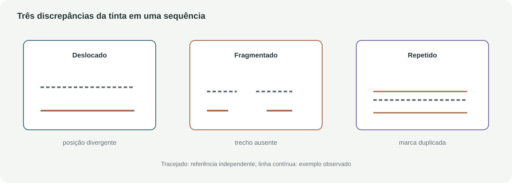
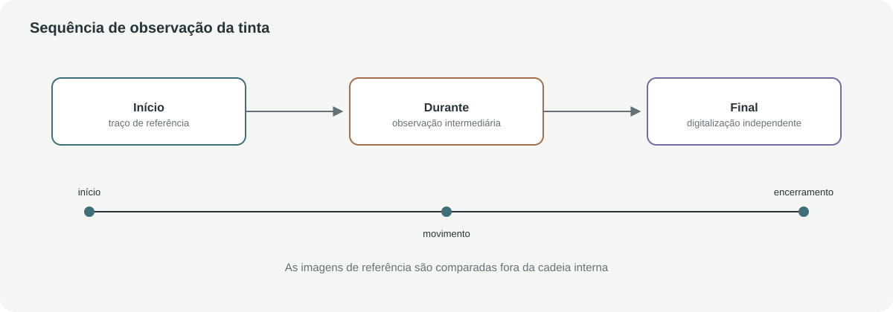
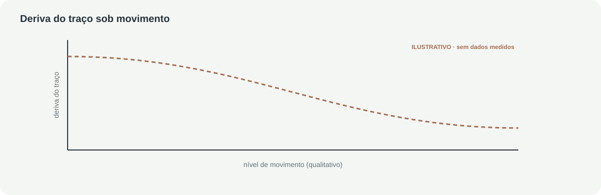

# Preservação temporal da tinta em desenho assistido por câmera

## Resumo

Em uma atividade de desenho, marcas digitais devem conservar posição, continuidade e identidade enquanto o papel e a mão se movimentam. A expressão “preservar a tinta” é ampla demais para orientar avaliação sem distinguir tipos de erro. Este artigo define operacionalmente três discrepâncias: traço deslocado, quando a posição diverge da referência; fragmentado, quando partes esperadas deixam de aparecer; e repetido, quando uma marca é apresentada mais de uma vez. Propõe medi-las comparando observações durante a atividade com uma digitalização independente do desenho final. O protocolo varia movimento da folha entre parada, pequeno e grande, e inclui condições de apagamento para examinar a manutenção de marcas restantes. Métricas de distância, cobertura, lacunas e duplicação são tratadas separadamente para evitar um índice agregado que esconda diferenças. Figuras conceituais mostram os três erros, uma sequência de observação e uma curva ilustrativa sem valores. O sistema é tratado como caixa-preta. Como não há dados, o artigo não afirma que qualquer erro ocorra ou que seja evitado; os resultados ficam pendentes até a coleta e a comparação com a referência.

**Palavras-chave:** preservação de tinta; consistência temporal; registro de imagens; desenho; avaliação visual

## Abstract

During drawing, digital marks should preserve position, continuity, and identity as the paper and hand move. The phrase “preserving ink” is too broad to guide evaluation without distinguishing error types. This article operationally defines three discrepancies: displaced strokes, when position diverges from a reference; fragmented strokes, when expected portions disappear; and repeated strokes, when a mark is shown more than once. It proposes measuring them by comparing observations during the activity with an independent scan of the final drawing. The protocol varies paper movement across stationary, small, and large conditions and includes erasure to examine preservation of remaining marks. Distance, coverage, gaps, and duplication metrics are treated separately to avoid an aggregate score that hides differences. Conceptual figures show the three errors, an observation sequence, and an illustrative curve without values. The system is treated as a black box. Since no data are available, the article makes no claim that any error occurs or is prevented; results remain pending until collection and comparison with the reference.

**Keywords:** ink preservation; temporal consistency; image registration; drawing; visual evaluation

## 1. Introdução

Uma atividade de desenho produz marcas ao longo do tempo. A pessoa acrescenta traços, desloca o papel, cobre parte da cena com a mão, pausa e por vezes apaga trechos. Uma representação digital pode parecer correta em um instante e ainda divergir do desenho ao fim da sessão. A posição de uma linha pode mudar, parte de um traço pode deixar de aparecer ou uma marca pode surgir duplicada. Sem definições operacionais, essas situações ficam agrupadas sob termos vagos como “deriva”, “perda” ou “instabilidade”, dificultando comparação entre estudos.

A literatura sobre consistência temporal em vídeo aborda variação de aparência, alinhamento entre quadros e preservação de objetos ao longo de sequências. Pesquisa sobre registro de imagens e mosaicos mede deslocamento e alinhamento entre observações. Estudos de digitalização de quadros brancos procuram preservar conteúdo escrito enquanto usuários interagem com a superfície. Pesquisa de desenho digital e similaridade de traços oferece medidas de cobertura, forma e distância; estudos de tinta digital também discutem continuidade e percepção durante o gesto [25]. Cada área fornece conceitos úteis, mas seus desfechos não são intercambiáveis. Um erro de registro entre quadros não significa necessariamente que uma marca final está ausente; uma baixa similaridade global pode ocultar uma pequena duplicação local.

A lacuna que motiva este artigo é uma taxonomia aplicável à preservação de tinta em um sistema de desenho assistido por câmera, ligada a medidas observáveis e a um protocolo temporal. A pergunta de pesquisa proposta é: **como detectar e caracterizar deslocamento, fragmentação e repetição de traços durante uma sessão, considerando movimento e apagamento?** O objetivo é comparar observações intermediárias com uma referência independente do desenho final, sem descrever como o sistema acumula, filtra ou combina informação.

O artigo oferece três contribuições. Primeiro, define três erros em linguagem operacional e associa cada um a uma medida distinta. Segundo, organiza condições de movimento e apagamento para observar sua relação com preservação temporal. Terceiro, propõe um protocolo de referência, análise por sequência e relato de incerteza, tratando o sistema como caixa-preta. Essas contribuições são propostas metodológicas, não resultados experimentais.

A seção 2 situa a proposta em consistência temporal, registro de imagens e digitalização de superfícies de escrita. A seção 3 apresenta a taxonomia e a tabela de definições, métodos de medida e unidades. A seção 4 descreve cenas, condições, métricas e análise. A seção 5 reserva campos para resultados futuros. A seção 6 interpreta desfechos possíveis; a seção 7 delimita ameaças à validade; e a seção 8 resume o que falta antes de avaliar empiricamente a preservação.

O foco é conteúdo desenhado que deveria continuar visível, não qualidade estética nem reconhecimento automático do desenho. A distinção evita ampliar a conclusão para dimensões que não serão medidas.

A preservação deve ser definida em relação a uma referência e a um período. Uma comparação apenas entre o primeiro e o último quadro pode não revelar em que momento ocorreu uma mudança. Uma comparação com o desenho final pode identificar diferenças acumuladas, mas não necessariamente recuperar a ordem de eventos. O protocolo usa observações intermediárias para descrever quando uma discrepância aparece e uma digitalização final para verificar quais marcas permaneceram no produto físico. Essa distinção entre trajetória e estado final orienta as métricas e evita tratar a sessão como uma única imagem.

A escala de avaliação também precisa ser explícita. Um estudo pode perguntar se cada marca individual permanece íntegra, se o conjunto do desenho mantém sua forma ou se o documento final continua legível. Uma medida global de semelhança serve à segunda pergunta, mas não localiza necessariamente uma fragmentação. O protocolo adota a marca como unidade primária e reporta características de sessão como contexto. Assim, a avaliação pode apontar quais discrepâncias ocorreram sem assumir que uma diferença visual pequena seja irrelevante ou que toda diferença implique prejuízo funcional.

## 2. Trabalhos relacionados

### 2.1 Consistência temporal em vídeo

A consistência temporal em vídeo é estudada em rastreamento, segmentação, estabilização e síntese de quadros. Métodos são avaliados por correspondência de objetos, estabilidade de contornos, alinhamento e variação de aparência ao longo de sequências [1–6]. Surveys de rastreamento visual descrevem a necessidade de medir acurácia e robustez diante de mudanças de escala, iluminação, oclusão e movimento. Estudos de segmentação de vídeo observam que boa qualidade em quadros isolados não garante coerência ao longo do tempo. Essas contribuições sustentam o uso de métricas temporais, mas o presente artigo não avalia segmentação de objetos nem reprodução de vídeo.

A acumulação de erro pode ser examinada por trajetória, comparação de pares de quadros ou contraste com uma referência externa. Registro de vídeo e estabilização procuram alinhar cenas ou reduzir movimento aparente; já preservação de tinta pergunta se o traço corresponde ao desenho físico. O referencial físico altera o sentido de “estável”: uma página que se move na imagem pode continuar estável em relação ao papel. Por isso, medidas de consistência temporal precisam especificar se comparam coordenadas de imagem, regiões alinhadas ou posições relativas à folha.

Métricas temporais podem incluir variação de deslocamento entre observações, duração de lacunas, persistência de marcas e recuperação depois de uma interrupção. A escolha depende da pergunta. Uma sequência visualmente suave pode manter um traço deslocado, enquanto uma série com pequenas oscilações pode terminar próxima à referência. Um único escore de consistência pode ocultar essas diferenças. O protocolo proposto combina medidas de posição, cobertura e duplicação e reporta falhas por sequência [14–21].

### 2.2 Registro e mosaico de imagens

Registro de imagens estima correspondências entre observações que representam uma cena comum. Mosaicos combinam vistas para ampliar cobertura ou reconstruir uma superfície [7–10, 22–24]. Essa literatura estuda erro de alinhamento, deriva, sobreposição, perda de correspondência e distorções ao longo da sequência. Estudos de quadros brancos digitalizados são particularmente próximos porque tratam escrita e desenho sobre uma superfície física que pode mudar de posição ou ser parcialmente coberta [11–13]. Trabalhos como VideoToon e sistemas de captura de quadros demonstram a utilidade de relacionar múltiplas observações a um conteúdo escrito, embora objetivos e condições variem.

A qualidade de um mosaico pode ser avaliada por alinhamento de pontos, coerência de linhas ou comparação com imagem de referência. Uma reconstrução visual plausível não garante que todos os traços tenham sido preservados. Duplicações e fragmentações podem ocorrer localmente sem alterar a aparência global de modo evidente. Estudos de registro de documentos e superfícies planas também tratam distorções de perspectiva, papel curvo ou movimento da câmera, mas suas métricas geométricas nem sempre capturam a semântica de um traço desenhado.

O artigo usa a noção de registro somente para definir comparação com uma referência externa. Não especifica como o sistema obtém correspondências ou mantém traços ao longo do tempo. A métrica compara posições observáveis e cobertura da marca, preservando a separação entre método interno e evidência experimental. Esse recorte permite discutir erros sem oferecer uma descrição que reconstrua a implementação.

### 2.3 Digitalização de quadros e similaridade de traços

Sistemas de captura de quadros brancos procuram transformar uma superfície de escrita em documento legível e compartilhar seu conteúdo [11–13]. Trabalhos de digitalização investigam extração de traços, remoção de sombras, correção geométrica e manutenção de escrita durante alterações da cena. Esses sistemas fornecem precedentes para comparar a superfície física com uma representação digital, mas podem operar com pressupostos diferentes de um desenho livre assistido por câmera. A contribuição relevante é o uso de referência física e a atenção a mudanças ao longo do tempo.

Reconhecimento de escrita e desenho utiliza medidas de similaridade entre sequências, curvas ou imagens. Distância entre traços, cobertura de pixels, alinhamento local e forma podem responder a perguntas distintas. Uma medida de imagem global pode penalizar mudança de cor ou espessura sem indicar se uma linha foi deslocada. Uma distância entre curvas pode ignorar uma marca repetida fora da correspondência principal. Para os três erros deste artigo, métricas especializadas são preferíveis: distância para deslocamento, lacunas e cobertura para fragmentação, e contagem ou sobreposição para repetição.

A referência final também tem limitações. Uma digitalização pode introduzir sombra, deformação ou perda de espessura; uma anotação manual pode simplificar o traço. A literatura de qualidade de documentos alerta que pré-processamento e condições de captura afetam medidas visuais. O protocolo documenta a origem e a incerteza da referência, compara material físico e digitalizado em um procedimento externo e evita atribuir ao sistema diferenças causadas pela própria captura de referência.

A lacuna é a falta de uma estrutura que una eventos temporais, classes de movimento, apagamento e três tipos de erro ligados a métricas separadas. Este artigo propõe essa estrutura sem alegar que um método publicado seja equivalente ao contexto de desenho. O foco é definir o que medir e como relatar, não apresentar um mecanismo interno de preservação.

Estudos de consistência temporal em stylização e mapeamento tonal tratam oscilações perceptíveis entre quadros, enquanto registros de documentos se concentram em alinhar superfícies ou melhorar a leitura. Pesquisas de assinatura digital, por outro lado, comparam sequências de traço e distinguem variação natural de instabilidade. Esses domínios fornecem ferramentas e perguntas diferentes. Uma classificação de erro para tinta deve preservar essa diferença e evitar transferir automaticamente uma métrica que foi concebida para outra finalidade. A proposta liga cada definição à unidade de evidência mais direta e prevê análise de ambiguidades.

A discussão futura também poderá comparar relatos dos participantes com medidas físicas, desde que os dois desfechos sejam apresentados separadamente. Uma percepção de fluidez não confirma ausência de fragmentação, e uma diferença visual não implica necessariamente prejuízo percebido. Essa separação mantém observação e interpretação distintas.

## 3. Enquadramento do problema

A unidade de análise é uma marca ou grupo de marcas identificável no desenho físico e nas observações da sessão. Antes da comparação, o estudo define quais traços pertencem à referência e como tratar marcas ambíguas, sobrepostas ou apagadas intencionalmente. O desenho final digitalizado constitui a referência do conteúdo que permaneceu. Observações intermediárias descrevem a aparência temporal, mas não substituem o artefato físico. A identidade visual de uma marca é atribuída por anotação independente do resultado avaliado, e casos sem correspondência confiável são mantidos como não avaliáveis.

**Deslocado** significa que uma marca correspondente aparece em posição diferente da referência, além da incerteza combinada de anotação e digitalização. A medida principal é a distância entre pontos ou contornos correspondentes, expressa em milímetros sobre a superfície ou normalizada pela largura da folha. O estudo informa se reporta distância média, mediana, percentis ou máximo. Uma marca pode estar deslocada sem ser fragmentada, e uma translação constante não deve ser confundida com perda de conteúdo.

**Fragmentado** significa que uma marca contínua da referência aparece como segmentos separados ou com trechos ausentes nas observações. A medida pode incluir a proporção do comprimento de referência coberta, o comprimento total de lacunas e a quantidade de segmentos descontínuos. A unidade é comprimento físico, razão de cobertura ou contagem, conforme o procedimento. O protocolo determina se uma lacuna decorre de apagamento intencional, oclusão transitória, falha de observação ou ausência persistente. Essas causas são distintas e não devem ser inferidas apenas da imagem final.

**Repetido** significa que a mesma marca física aparece mais de uma vez na representação comparada, sem corresponder a traços adicionais no desenho de referência. Pode ser medido pela quantidade de componentes duplicados, sua sobreposição e distância entre cópias. A contagem depende da regra que agrupa segmentos como uma mesma marca. Uma duplicação parcial pode parecer fragmentação em outra definição; por isso, o manual de anotação descreve exemplos e casos ambíguos antes da análise. A classificação pode admitir mais de um tipo de erro quando isso representar a observação com maior fidelidade.

O custo de cada discrepância depende do uso. Um pequeno deslocamento pode ser aceitável para uma anotação expressiva, mas um traço fragmentado pode alterar a interpretação de uma palavra ou diagrama. Uma cópia repetida pode tornar um desenho visualmente carregado mesmo quando a marca original permanece. O protocolo não converte essas diferenças em pesos fixos. Se o estudo produzir um escore composto, cada ponderação deverá vir de uma finalidade declarada e ser apresentada junto às medidas separadas. A classificação qualitativa dos erros deve preceder qualquer síntese para manter a relação entre observação e interpretação.

A Tabela 1 resume definições, comparação e unidade. As métricas são calculadas em relação à referência final digitalizada e a observações intermediárias correspondentes. A referência é registrada externamente, sem expor como a tinta é representada dentro do sistema. A unidade do erro deve ser compatível com a pergunta: deslocamento físico, cobertura de traço ou número de duplicações. Uma contagem sem denominador ou uma razão sem definição de comprimento não permite comparação.

**Tabela 1.** Definições operacionais de deslocamento, fragmentação e repetição da tinta, com comparação de referência e unidade de medida; os critérios se aplicam à representação observável ao longo do tempo.

| Erro | Definição | Como medir contra referência | Unidade possível |
|---|---|---|---|
| Deslocado | Marca correspondente em posição diferente do desenho físico | Distância entre traços ou contornos pareados | Milímetros ou razão pela largura da folha |
| Fragmentado | Trecho contínuo esperado aparece separado ou ausente | Cobertura da referência e comprimento das lacunas | Razão, milímetros ou contagem de segmentos |
| Repetido | Uma marca física corresponde a cópias múltiplas na representação | Contagem de duplicações e sobreposição entre cópias | Contagem ou proporção de marcas afetadas |

Essas definições não impõem uma ordem causal. Uma marca pode deslocar-se e depois fragmentar, mas o protocolo classifica observações segundo evidência disponível, sem deduzir o que ocorreu dentro do sistema. O relatório pode descrever a sequência de eventos observados, como “deslocamento seguido de ausência”, se os quadros sustentarem essa descrição. Não deve inferir operações internas a partir da aparência final.

Movimento é categorizado por condição observável: folha parada, movimento pequeno ou movimento grande. A descrição operacional usa a trajetória física registrada externamente e níveis definidos antes da análise. Não há um valor universal que separe pequeno e grande; o estudo justifica a categorização e mantém unidades contínuas disponíveis quando a instrumentação permitir. Apagamento é uma condição separada: parte do desenho é removida intencionalmente enquanto outras marcas devem permanecer. A avaliação observa se marcas preservadas continuam alinhadas, completas e sem duplicação.

A Figura 1 ilustra visualmente os erros. A Figura 2 mostra uma sequência externa de observações e uma comparação final. A Figura 3 apresenta apenas uma forma de curva possível para explorar deriva conforme movimento; sem dados, não sugere direção nem magnitude. Essas figuras são conceituais e não descrevem a cadeia interna do sistema.

## 4. Protocolo de avaliação proposto

O estudo reúne desenhos de referência e sequências de observação durante tarefas definidas. Os desenhos são digitalizados ao final em condições descritas e com resolução adequada à pergunta. A equipe registra dimensões da folha, orientação, distância de captura e estados de movimento. A tarefa inclui períodos de traço contínuo, pausa, retomada e apagamento de marcas selecionadas, se essas ações forem relevantes ao objetivo. A ordem das condições é balanceada ou randomizada quando isso não prejudicar a tarefa.

A coleção deve cobrir diferentes tipos de marca, como linhas longas, segmentos curtos, curvas e cruzamentos, sem supor que sua geometria determine o desempenho. O protocolo registra se traços se sobrepõem ou ficam próximos, pois tais casos dificultam a correspondência. Uma amostra é anotada por avaliadores independentes que recebem instruções comuns. A equipe calcula desacordo e resolve ambiguidades por procedimento previamente definido. Marcas que não podem ser identificadas com confiança são excluídas da medida principal, mas sua frequência é reportada.

As condições de movimento incluem folha parada, movimento pequeno e movimento grande. A classificação é sustentada por registro externo da folha, sem depender de medidas internas. Para cada nível, observações são sincronizadas com o desenho final digitalizado. A condição de apagamento remove uma parte selecionada do desenho e registra quais marcas deveriam permanecer. O protocolo especifica se apagamento ocorre antes ou durante a sessão, pois a temporalidade altera a referência válida. Uma análise separada pode considerar pausa, retorno e oclusão da mão, mas não deve misturá-los ao efeito de apagamento.

Métricas são computadas por marca, sequência e condição. Deslocamento usa distância física entre traços correspondentes, com normalização pela largura se dimensões variam. Fragmentação usa cobertura do comprimento de referência, extensão de lacunas e número de segmentos separados. Repetição usa quantidade de duplicações e fração de marcas afetadas. A equipe também calcula uma taxa de falha de correspondência e reporta sua origem conhecida ou desconhecida. Essas métricas permanecem separadas; um escore composto poderia esconder que um tipo de erro melhora enquanto outro piora.

A equipe registra o comprimento de referência antes de estimar cobertura e documenta como separam marcas próximas. Para distância, o procedimento define quais segmentos são comparados e como trata cruzamentos. Para repetição, anotadores verificam se componentes semelhantes correspondem a uma marca original ou a um traço adicional feito pela pessoa. Essas decisões são avaliadas em uma amostra independente e relatadas por categoria. Se a concordância for baixa, os casos ambíguos são apresentados separadamente em vez de forçar uma classificação única. O material de treinamento não entra na amostra de avaliação, evitando que critérios sejam ajustados a exemplos selecionados.

A análise temporal descreve quando cada discrepância aparece e se permanece até o fim. Uma comparação quadro a quadro não deve presumir independência entre observações consecutivas. A unidade de reamostragem acompanha sessão, folha ou participante, conforme o desenho. Resultados são sumarizados com distribuição, intervalos de incerteza e exemplos selecionados por regra documentada. O estudo não atribui causa a um movimento específico se iluminação, oclusão ou enquadramento também mudarem.

A Figura 1 apresenta os três erros em linguagem visual; a Figura 2 organiza início, observação intermediária e digitalização final; a Figura 3 mostra uma forma ilustrativa sem valores. A sequência é construída com registros externos e a referência física. As figuras não descrevem como marcas são combinadas ou mantidas internamente.

**Figura 1.** Esquema dos três erros de preservação da tinta: traço deslocado, traço fragmentado e traço repetido. São diagramas conceituais comparados a referência independente e não mostram processos internos; elaboração própria.

**Figura 2.** Sequência conceitual entre início, observação intermediária e digitalização final, usada para contextualizar comparações temporais. Os quadros não representam medições ou uma sequência interna; elaboração própria.

**Figura 3.** Curva ilustrativa de deriva do traço conforme condição de movimento, com eixos sem números. A forma esperada, não é resultado; não antecipa comportamento medido; elaboração própria.

A Tabela 2 sintetiza condições e métricas. O estudo define níveis qualitativos antes da coleta e descreve como movimento pequeno e grande foram distinguidos. A condição de apagamento avalia marcas preservadas e removidas separadamente, permitindo verificar se o conteúdo intencionalmente apagado é confundido com erro de preservação. Não se pressupõe que todo traço deva permanecer depois de apagado; a referência e o objetivo da tarefa determinam o que deve ser comparado.

**Tabela 2.** Condições de movimento e apagamento a comparar, ligadas às métricas de deriva e preservação; os níveis são definidos pelo estudo e não representam resultados observados.

| Condição | Evidência observada | Métrica principal | Interpretação |
|---|---|---|---|
| Folha parada | Sequência sem deslocamento deliberado | Distância e fragmentação | Referência para condição temporalmente estável. |
| Movimento pequeno | Deslocamento limitado definido no protocolo | Deriva e cobertura | Variação sob movimento de menor amplitude. |
| Movimento grande | Deslocamento mais amplo definido no protocolo | Deriva, falha e repetição | Condição de maior exigência geométrica. |
| Apagamento | Remoção intencional de marcas selecionadas | Preservação de traços restantes | Distingue mudança pretendida de perda não intencional. |

A linha de análise começa por verificar qualidade da digitalização, sincronização e concordância de anotação. Em seguida, classifica marcas por tipo de erro e calcula medidas por condição. A equipe compara padrões entre movimento e parada, e examina se apagamento afeta marcas que deveriam permanecer. Intervalos de incerteza respeitam a dependência dentro de cada sessão. Valores extremos são mantidos salvo quando uma falha instrumental, definida antes, justificar exclusão.

A ameaça de que uma digitalização final altere espessura ou contraste é tratada por procedimento independente e registro da incerteza. Comparações baseadas em distância não devem atribuir precisão além da resolução da referência. Se a marca física for ambígua, a anotação de incerteza permanece visível. O protocolo também documenta falhas de captura, quadros ausentes e oclusões para separar limitação do instrumento de discrepância persistente observada.

O manual de anotação inclui casos simulados ou exemplos de treinamento que não entram na análise principal. Esses exemplos esclarecem quando uma marca é considerada interrompida e quando uma lacuna é apenas parte intencional do desenho. Os anotadores não recebem informação sobre a condição de movimento sempre que isso não for necessário para reconhecer o traço. A concordância entre anotadores é apresentada por categoria de erro, pois diferenças podem ser maiores para repetição do que para deslocamento. A adjudicação registra qual evidência foi usada e não altera a definição depois de observar os resultados.

## 5. Estrutura dos resultados

A aplicação apresentará a composição dos desenhos, os tipos de traços avaliados e a cobertura das condições de movimento e apagamento. Para cada sequência, o relatório informará quais marcas puderam ser pareadas com a referência, quais ficaram ambíguas e quais foram excluídas segundo o plano. Os resultados de deslocamento, fragmentação e repetição serão mostrados separadamente, com unidades, distribuição e incerteza. A análise indicará quando uma falha decorreu de oclusão, falha da referência, apagamento intencional ou discrepância observável sem causa conhecida.

A análise temporal descreverá se uma discrepância apareceu em observação intermediária e permaneceu até a comparação final. Uma medida final não substituirá o registro de quando a mudança ocorreu. A Figura 3 continuará sendo apenas uma forma ilustrativa até haver dados medidos. Uma figura futura deverá mostrar unidades e condições e não reutilizar a curva esquemática como se fosse observação. A Tabela 3 reserva os campos a preencher. Neste manuscrito, todos permanecem [PENDENTE-DADOS].
 A aplicação também indicará a versão do manual de anotação, o procedimento de sincronização e a forma de calcular unidades físicas.
 A análise deverá reportar também sequências excluídas e o motivo de cada exclusão.

**Tabela 3.** Estrutura dos resultados futuros para deslocamento, fragmentação e repetição, organizada por condição e referência; nenhuma célula contém medições porque o protocolo ainda não foi aplicado.

| Resultado | Registro futuro |
|---|---|
| Deslocamento por estado de movimento | [PENDENTE-DADOS] |
| Cobertura e lacunas de traços | [PENDENTE-DADOS] |
| Marcas repetidas por sequência | [PENDENTE-DADOS] |
| Efeito observado após apagamento | [PENDENTE-DADOS] |
| Desacordo de anotação e falhas de referência | [PENDENTE-DADOS] |

## 6. Discussão

Se a distância entre traços permanecer pequena e estável nas condições observadas, o estudo poderá afirmar preservação espacial para a amostra e a referência empregadas. Essa conclusão não implica ausência de fragmentação ou repetição. Cada erro precisa de sua própria análise. Uma média baixa pode coexistir com poucas falhas importantes, motivo para apresentar distribuição e exemplos selecionados por regra transparente. A finalidade de uso determina se determinada variação é aceitável; não há uma margem universal nesta proposta.

Se fragmentação aumentar durante movimento, o padrão indicará associação entre essa condição e lacunas observadas. O estudo deve verificar se as lacunas aparecem em trechos de baixa visibilidade, oclusão ou perda de registro externo. Sem evidência suficiente, a associação não identifica causa. Se marcas forem apagadas intencionalmente, a comparação deve excluir as marcas removidas da categoria de fragmentação e concentrar-se no conteúdo que deveria permanecer. Uma política incorreta de referência poderia classificar apagamento pretendido como erro.

Se marcas repetidas aparecerem, elas podem representar duplicação, ambiguidade de anotação ou mudança do próprio desenho. A revisão de exemplos e a concordância entre anotadores ajudam a distinguir esses casos, mas não tornam a interpretação automática. Repetição localizada pode ser relevante mesmo quando uma medida de similaridade global é alta. A apresentação desagregada preserva informação sobre localização e identidade da marca.

Se deslocamento for constante em toda a sessão, a média final pode esconder um viés persistente. Se o deslocamento variar e retornar, uma comparação entre início e fim pode sugerir estabilidade que não existiu durante a atividade. As observações intermediárias são necessárias para representar a trajetória. Em contrapartida, a amostragem muito esparsa pode perder oscilações breves. O protocolo deve explicar como sua cadência foi escolhida e limitar inferências a mudanças que ela pode observar.

Se apagamento afetar marcas não selecionadas, o resultado pode apontar uma interação entre a ação de apagar e a preservação do restante do desenho. Essa interpretação exige descrição clara de quais marcas deveriam continuar presentes e de como a referência foi estabelecida. Se apenas a digitalização final estiver disponível, não será possível afirmar em que instante o conteúdo foi perdido. Uma comparação temporal completa separa resultado final de trajetória observada.

A proposta dialoga com pesquisas de consistência em vídeo, mosaicos de documentos, captura de quadros brancos e similaridade de traços [1–21]. Essas áreas oferecem métricas e problemas análogos, mas não compartilham necessariamente unidade ou finalidade. Alinhamento global de imagens não mede diretamente fragmentação semântica de uma marca; similaridade de assinatura não é automaticamente válida para desenho livre. O valor do protocolo está em explicitar definições e unidades que possam ser testadas em contexto próprio.

Um resultado sem discrepâncias observadas ainda dependerá da sensibilidade do instrumento e da cobertura de movimentos. A ausência de erros pode refletir um conjunto de cenas pouco exigente ou uma métrica que não capture eventos breves. Por isso, a discussão futura combinará frequência de discrepâncias, amplitude, duração e contexto, além de apresentar limites de detecção. Uma taxa agregada sem descrição de exposição não permitirá concluir que a tinta permaneceu preservada durante toda a sessão.

Se as três categorias variarem em direções diferentes, o estudo deve resistir a resumir o conjunto em uma classificação global. O deslocamento pode diminuir enquanto fragmentação aumenta, ou uma condição de apagamento pode alterar repetição sem alterar posição. Esses padrões mistos podem orientar uma hipótese subsequente sobre a tarefa e os instrumentos. A interpretação deverá permanecer no nível de associação observada, sem explicar a mudança por um processo interno não medido.

A comparação com literatura de assinatura digital é particularmente limitada pela estrutura das marcas. Assinaturas tendem a ter ordem temporal e finalidade de autenticação, enquanto desenhos livres podem combinar linhas independentes e sobrepostas. Métricas de similaridade de assinatura são úteis para inspirar comparações sequenciais, mas não validam uma medida de fragmentação para desenho. A proposta exige um piloto no domínio de interesse e não trata transferência entre tarefas como garantida.

## 7. Limitações e ameaças à validade

A validade de construção depende de a taxonomia representar as discrepâncias relevantes. Deslocamento, fragmentação e repetição não cobrem todo erro possível. Mudança de espessura, cor, forma ou ordem das marcas pode afetar a experiência sem se encaixar claramente em uma das categorias. Um estudo poderá registrar essas dimensões adicionais, mas deve mantê-las separadas em vez de forçar classificação inadequada. A escolha da marca como unidade também pode ser difícil em desenhos com traços sobrepostos ou sem segmentação visual clara.

A validade interna é ameaçada por mudanças simultâneas de movimento, oclusão, iluminação e apagamento. Uma diferença observada após uma ação não demonstra que essa ação a causou se outras condições mudaram. O protocolo recomenda balanceamento e registro, mas não elimina confusão. A ordem das tarefas, a familiaridade com a atividade e a estratégia de desenho podem influenciar a sessão. A análise precisa preservar dependência temporal e não tratar quadros consecutivos como replicações independentes.

A validade da medida depende de digitalização, alinhamento, anotação e sincronização. O desenho final pode ser deformado pelo papel, a espessura do traço pode variar e a referência pode perder pequenas marcas. Medidas de comprimento dependem de escala física; sobreposição depende de registro geométrico; contagem depende de definição de identidade. Incerteza de referência deve acompanhar cada métrica. Uma digitalização sem qualidade suficiente pode tornar a conclusão inconclusiva.

A validade externa é limitada pela variedade de papel, ferramenta de desenho, tarefas, ambientes e participantes. Uma atividade com linhas longas pode não representar letras, diagramas ou sombreado. Movimento pequeno e grande são categorias dependentes do estudo, não classes universais. O resultado deve ser limitado às condições observadas e não generalizado para toda forma de desenho ou uso.

A validade dos dados inclui privacidade das imagens, consentimento, licenças e disponibilidade das sequências. Conteúdo desenhado pode revelar informação pessoal ou autoral. Restrições de acesso reduzem auditoria independente, mas podem ser necessárias. O estudo deve explicar quais materiais podem ser compartilhados e oferecer descrições ou sumários compatíveis com as restrições. Este manuscrito não apresenta dados nem valida a taxonomia em aplicação piloto.

## 8. Conclusão

Este artigo definiu três erros observáveis de preservação da tinta: deslocamento, fragmentação e repetição. Propôs compará-los com uma digitalização independente do desenho final e observar sua evolução durante uma sessão. O protocolo varia movimento da folha entre parada, pequeno e grande e inclui apagamento para distinguir remoção intencional de perda de marcas que deveriam permanecer.

A proposta não descreve mecanismos internos e não afirma que esses erros ocorram em qualquer sistema. Uma aplicação futura deverá validar a referência, instruir anotadores, registrar incerteza e preencher os campos pendentes com sequências medidas. As conclusões terão de permanecer limitadas às marcas, tarefas e condições incluídas. Até essa aplicação, a taxonomia e as métricas são propostas para avaliação, não evidência de preservação.
 O protocolo deverá ser revisado após piloto caso as categorias não possam ser aplicadas de forma consistente, mantendo um registro das alterações e sua justificativa.
 A escolha de métricas e unidades será publicada junto à descrição das condições para permitir comparação independente.

## Declarações

- Uso de IA generativa: texto redigido com apoio de IA generativa, com revisão e responsabilidade dos autores; referências conferidas por DOI ou página bibliográfica.
- Dados: este artigo não apresenta dados empíricos; imagens futuras dependerão de consentimento, licença e proteção apropriada.
- Código: não há código de análise de resultados associado a este manuscrito.
- Conflito de interesses: os autores deverão declarar conflitos pertinentes antes da submissão.
- Ética: estudos com participantes deverão obter aprovação ética e consentimento antes da coleta.
- Contribuição dos autores: a contribuição individual deverá ser informada na versão submetida.

## Referências

[1] Bonneel, N.; Tompkin, J.; Sunkavalli, K. et al. Blind Video Temporal Consistency. ACM Transactions on Graphics, 34(6), 2015, Article 196. https://doi.org/10.1145/2816795.2818107
[2] Aydın, T. O.; Stefanoski, N.; Croci, S.; Gross, M.; Smolic, A. Temporally Coherent Local Tone Mapping of HDR Video. ACM Transactions on Graphics, 33(6), 2014, Article 196. https://doi.org/10.1145/2661229.2661268
[3] Chen, T.; Cheng, M.-M.; Tan, P.; Shamir, A.; Hu, S.-M. Automatic Motion-Guided Video Stylization and Personalization. Proceedings of ACM Multimedia, 2011, 1041–1044. https://doi.org/10.1145/2072298.2071933
[4] Shekhar, S.; Reimann, M.; Hilscher, M. et al. Interactive Control over Temporal Consistency while Stylizing Video Streams. Computer Graphics Forum, 42(4), 2023, e14891. https://doi.org/10.1111/cgf.14891
[5] Ozcinar, C.; Lauga, P.; Valenzise, G.; Dufaux, F. Spatio-temporal constrained tone mapping operator for HDR video compression. Journal of Visual Communication and Image Representation, 54, 2018, 166–178. https://doi.org/10.1016/j.jvcir.2018.06.003
[6] Lu, C.; Xiao, Y.; Tang, C.-K. Real-Time Video Stylization Using Object Flows. IEEE Transactions on Visualization and Computer Graphics, 24(6), 2018, 2051–2063. https://doi.org/10.1109/TVCG.2017.2700470
[7] Zitová, B.; Flusser, J. Image registration methods: a survey. Image and Vision Computing, 21(11), 2003, 977–1000. https://doi.org/10.1016/S0262-8856(03)00137-9
[8] Ghosh, D.; Kaabouch, N. A survey on image mosaicing techniques. Journal of Visual Communication and Image Representation, 34, 2016, 1–11. https://doi.org/10.1016/j.jvcir.2015.10.014
[9] Kumar, G. H.; Shivakumara, P.; Guru, D. S.; Nagabhushan, P. Document image mosaicing: A novel approach. Sādhanā, 29(3), 2004, 329–341. https://citeseerx.ist.psu.edu/document?doi=394002f63fedafe63691ec8fa072af9d2b942a0d&repid=rep1&type=pdf
[10] Srinath, S.; Ravikumar, C. N. Braille Document Image Mosaicing: A Novel Approach. International Journal of Computer Applications, 103(6), 2014, 32–36. https://doi.org/10.5120/18081-8906
[11] Zhang, Z.; He, L.-W. Whiteboard scanning and image enhancement. Digital Signal Processing, 17(2), 2007, 414–432. https://doi.org/10.1016/j.dsp.2006.05.006
[12] Arango Duque, C. A.; Abebe, M. A.; Shahid, M.; Hardeberg, J. Y. Color and Quality Enhancement of Videoconferencing Whiteboards. Journal of Perceptual Imaging, 1(1), 2018, 010504-1–010504-13. https://doi.org/10.2352/J.Percept.Imaging.2018.1.1.010504
[13] Courtney, J. CleanPage: Fast and Clean Document and Whiteboard Capture. Journal of Imaging, 6(10), 2020, 102. https://doi.org/10.3390/jimaging6100102
[14] Iwata, K.; Kise, K.; Nakai, T. et al. Capturing Digital Ink as Retrieving Fragments of Document Images. 10th International Conference on Document Analysis and Recognition, 2009, 1236–1240. https://doi.org/10.1109/ICDAR.2009.192
[15] Huang, K.; Yan, H. Stability and style-variation modeling for on-line signature verification. Pattern Recognition, 36(10), 2003, 2253–2270. https://doi.org/10.1016/S0031-3203(03)00126-2
[16] Rashidi, S.; Fallah, A.; Towhidkhah, F. Similarity evaluation of online signatures based on modified dynamic time warping. Applied Artificial Intelligence, 27(7), 2013, 599–617. https://doi.org/10.1080/08839514.2013.813187
[17] Manabe, Y.; Chakraborty, B. Efficient On-line Handwritten Signature Verification by Integrating DTW and Proposed Local Dynamic Similarity Measure. Journal of Japan Society for Fuzzy Theory and Intelligent Informatics, 24(6), 2012, 1165–1176. https://doi.org/10.3156/jsoft.24.1165
[18] Huang, K.; Yan, H. On-line signature verification based on stroke matching. Proceedings of the International Conference on Document Analysis and Recognition, 2002. https://staff.itee.uq.edu.au/lovell/aprs/dicta2002_proceedings/Huang219.pdf
[19] Fischer, A.; Plamondon, R. Signature verification based on the kinematic theory of rapid human movements. IEEE Transactions on Human-Machine Systems, 47(2), 2017, 169–180. https://doi.org/10.1109/THMS.2016.2634922
[20] Doroz, R.; Kudłacik, P.; Porwik, P. Online signature verification modeled by stability oriented reference signatures. Information Sciences, 460–461, 2018, 151–171. https://doi.org/10.1016/j.ins.2018.05.049
[21] Swaileh, W.; Imbert, F.; Soullard, Y. et al. Online handwriting trajectory reconstruction from kinematic sensors using temporal convolutional network. International Journal on Document Analysis and Recognition, 26, 2023, 289–302. https://doi.org/10.1007/s10032-023-00430-1
[22] Liang, J.; DeMenthon, D.; Doermann, D. S. Geometric Rectification of Camera-Captured Document Images. IEEE Transactions on Pattern Analysis and Machine Intelligence, 30(4), 2008, 591–605. https://doi.org/10.1109/TPAMI.2007.70724
[23] Tsoi, Y.-C.; Brown, M. S. Multi-view document rectification using boundary. Proceedings of the IEEE Conference on Computer Vision and Pattern Recognition, 2007. https://doi.org/10.1109/CVPR.2007.383251
[24] Puybareau, É.; Géraud, T. Real-Time Document Detection in Smartphone Videos. Proceedings of the IEEE International Conference on Image Processing, 2018, 1498–1502. https://doi.org/10.1109/ICIP.2018.8451533
[25] Annett, M. (Digitally) Inking in the 21st Century. IEEE Computer Graphics and Applications, 37(1), 2017, 92–99. https://doi.org/10.1109/MCG.2017.1
