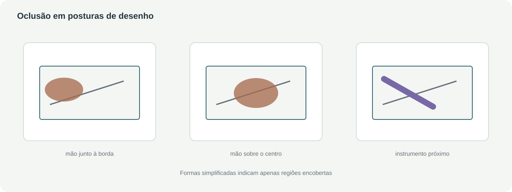
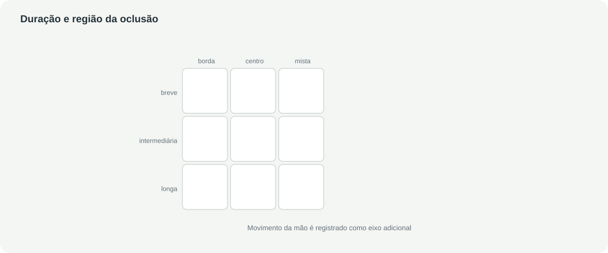
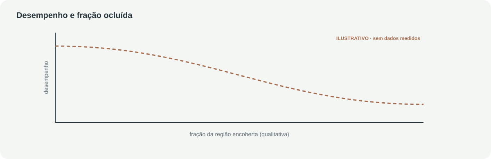

# Oclusões por mão e instrumento em desenho assistido por câmera

## Resumo

A mão e o instrumento de escrita encobrem a página durante o desenho; essa oclusão é parte normal da atividade, não uma exceção artificial a remover do teste. Para avaliar seus efeitos, é preciso especificar duração, movimento e região coberta, além de medir quanto da página ficou ocluída. Este artigo propõe uma taxonomia e um protocolo para estudar um sistema de desenho assistido por câmera sob essas condições. A classificação separa episódios breves, intermediários e longos; movimento reduzido, moderado e amplo; e oclusões na borda, no centro ou em regiões combinadas. A fração ocluída é definida pela área encoberta em relação à área da página, sem valor fixo de aceitação. O protocolo relaciona cada condição a detecção, continuidade e tempo de recuperação após a mão sair. Figuras conceituais ilustram posturas, uma matriz de condições e uma curva sem dados. Como não há resultados, o artigo não afirma que a oclusão cause falhas nem descreve como o sistema a trata; essas relações permanecem para avaliação empírica.

**Palavras-chave:** oclusão; interação com caneta; mão; continuidade; avaliação de usabilidade

## Abstract

The hand and writing instrument cover the page during drawing; this occlusion is a normal part of the activity, not an artificial exception to remove from testing. Evaluating its effects requires specifying duration, motion, and covered region, as well as measuring how much of the page is occluded. This article proposes a taxonomy and protocol for studying a camera-assisted drawing system under these conditions. The classification separates brief, intermediate, and long episodes; low, moderate, and broad movement; and occlusion at the edge, center, or combined regions. The occluded fraction is defined as covered area relative to page area, with no fixed acceptance value. The protocol relates each condition to detection, continuity, and recovery time after the hand leaves. Conceptual figures illustrate postures, a condition matrix, and a curve without data. Since no results are available, the article does not claim that occlusion causes failures or describe how the system handles it; these relationships remain for empirical evaluation.

**Keywords:** occlusion; pen interaction; hand; continuity; usability evaluation

## 1. Introdução

A mão e o instrumento de escrita encobrem parte da página durante o desenho. Essa oclusão é parte normal da atividade e deve ser tratada como condição de uso, não como exceção artificial a eliminar da avaliação. A pessoa posiciona a mão para apoiar o gesto, alcança diferentes regiões do papel e move o instrumento sobre a marca recém-produzida. Oclusão pode durar pouco ou persistir, cobrir a borda ou o centro, e acompanhar movimento pequeno ou amplo. Esses casos impõem exigências distintas para continuidade e recuperação.

Uma avaliação que simplesmente informa “há oclusão” não explica quanta área ficou escondida, por quanto tempo ou com que movimento. Também não distingue se a saída observável manteve continuidade durante a cobertura, ficou ausente ou retornou depois que a mão saiu. Sem essa separação, estudos podem misturar condição experimental e interpretação. O efeito da oclusão precisa ser medido sem descrever como um sistema de desenho assistido por câmera detecta ou trata a mão.

A literatura de visão computacional estuda oclusão em rastreamento de objetos, reconhecimento de gestos e segmentação de mãos. Pesquisa sobre interação com caneta discute postura, contato, regiões de apoio e conflitos entre mão e superfície. Sistemas de mesa digital ou papel interativo também investigam como pessoas escrevem enquanto o corpo ocupa parte do campo visual. Esses trabalhos fundamentam fatores e formas de avaliação, mas seus resultados não se transferem automaticamente para uma tarefa de desenho diferente ou para um sistema específico. Estudos de interação direta com caneta mostram que posição da mão, contato não pretendido e postura variam com a superfície e a tarefa [1, 4, 10, 11].

A lacuna deste artigo é uma estrutura para classificar oclusões de mão e instrumento por duração, movimento e região coberta, relacionando cada nível a medidas de detecção, continuidade e recuperação. A pergunta proposta é: **como a duração, o movimento e a localização da oclusão se associam à disponibilidade e à continuidade observáveis durante o desenho?** A proposta também mede a fração da página coberta, de modo que resultados possam ser relacionados à quantidade e não apenas à categoria qualitativa.

O artigo oferece três contribuições. Primeiro, define uma taxonomia de três eixos com níveis operacionais que podem ser descritos antes da coleta. Segundo, especifica a fração ocluída e métricas de continuidade, detecção e recuperação. Terceiro, propõe um protocolo que compara episódios de oclusão com períodos sem cobertura, mantendo o sistema como caixa-preta. Nenhuma contribuição constitui resultado experimental ou afirma que determinado nível seja tolerável. O protocolo também especifica quais decisões metodológicas precisam ser declaradas para que uma comparação entre sessões não confunda a geometria coberta com diferenças de instrução, instrumento ou enquadramento.

A seção 2 revê oclusão em rastreamento, segmentação de mão, interação com caneta e sistemas de papel digital. A seção 3 define os eixos e apresenta a tabela de classificação. A seção 4 conecta as condições às medidas e descreve coleta, análise e ameaças. A seção 5 reserva campos para resultados posteriores. A seção 6 interpreta possíveis padrões; a seção 7 delimita ameaças à validade; e a seção 8 resume a evidência ainda necessária.

A fração ocluída é importante porque categorias como “parcial” podem abranger quantidades muito diferentes. Define-se como área da região encoberta dividida pela área total da página, observada em um marco temporal declarado. A fração pode variar dentro do mesmo episódio, portanto uma única observação não resume necessariamente a duração inteira. O protocolo mantém essa medida contínua junto aos níveis qualitativos e não escolhe um valor fixo como critério de sucesso.

A oclusão também se distribui de modo diferente conforme postura e tarefa. Uma pessoa pode apoiar a mão na borda enquanto desenha no centro, ou cobrir a área de trabalho com a palma e instrumento. A mão dominante, a posição sentada e o tamanho da página podem influenciar essas posturas. Um protocolo que força uma única postura pode não representar o uso cotidiano. Por isso, a coleta deve incluir ação natural e registrar como as instruções experimentais influenciam comportamento, sem interpretar diferenças de postura como capacidade geral do participante.

## 2. Trabalhos relacionados

### 2.1 Oclusão em rastreamento e detecção visual

Oclusão é uma fonte recorrente de dificuldade em rastreamento de objetos. Surveys de rastreamento distinguem ocultação parcial e completa, reaparecimento, confusão entre objetos e perda de identidade. Métodos são avaliados por precisão de localização, duração de falha e capacidade de recuperar o alvo. Em uma tarefa de desenho, o objeto de interesse é a página e a saída relevante é sua disponibilidade para a interação; a mão pode cobrir uma parte sem ocultar a página inteira. Portanto, métricas de benchmark de objetos precisam ser adaptadas à geometria e à finalidade do desenho.

Segmentação de mão e reconhecimento de gestos estudam como a mão aparece contra fundos variados e como movimento altera forma e aparência. Trabalhos clássicos usam cor, forma, contorno ou aprendizado supervisionado, enquanto revisões modernas discutem conjuntos de dados e desafios de iluminação, postura e oclusão. Este artigo não compara métodos de segmentação nem descreve como um sistema processa mãos. A literatura é usada para motivar a descrição da postura, da região coberta e da variação temporal.

Oclusões podem também ser intencionais. A mão que cobre a área de trabalho pode esconder parte do desenho por uma duração associada ao movimento natural. Diferente de uma obstrução externa, sua localização pode acompanhar o traço e deslocar-se sobre o papel. A medida de fração ocluída em cada intervalo permite descrever essa variação sem inferir mecanismo interno. A comparação entre episódios não ocluídos e ocluídos deve manter semelhantes as demais condições quando o objetivo for isolar associação.

### 2.2 Segmentação de mão e interação com caneta

Interação com caneta e papel inclui contato, postura, apoio da mão, alcance e coordenação entre instrumento e superfície. Estudos de interfaces com caneta identificam conflitos entre intenção de desenhar, apoio da palma e manipulação do conteúdo. Trabalhos sobre rejeição de palma ou interação bimanual demonstram que a mão pode ser simultaneamente parte da ação e fonte de oclusão. Essa dualidade fundamenta uma avaliação que não trate a presença da mão como ruído anormal. Em vez de considerar a mão apenas como obstáculo, estudos exploram interfaces cientes da oclusão e mostram que a localização do conteúdo em relação à mão importa para a interação [2, 3, 5, 6, 7, 8].

Sistemas ópticos de rastreamento de caneta investigam precisão, alinhamento e movimento do instrumento em superfícies comuns. Embora esses sistemas tenham objetivos variados, fornecem precedentes para medir a interação por registros externos e para distinguir movimento do instrumento de conteúdo desenhado. O protocolo deste artigo não revela como a mão ou instrumento são detectados ou tratados. Ele observa condições de entrada e respostas visíveis, com anotação independente da região coberta.

A literatura de segmentação de mão também alerta que aparência e forma variam com iluminação, tom de pele, luvas, distância e fundo. Essas dimensões podem interagir com a fração coberta. Por isso, a amostra deve descrever características relevantes do contexto sem inferir desempenho para todas as pessoas. Quando dados demográficos forem coletados, sua finalidade, consentimento e proteção precisam ser explicitados. A avaliação deve evitar generalizações universais a partir de poucos participantes ou configurações.

### 2.3 Mesas digitais e interação com papel

Mesas digitais e interfaces de superfície permitem escrita, desenho e manipulação direta. Pesquisas em interação multiusuário, papel digital e captura de quadros observam como mãos e instrumentos cobrem conteúdo durante tarefas. Esses estudos distinguem interação por toque, caneta, objeto físico e movimento sobre a superfície. A postura natural do usuário pode reduzir a visibilidade de marcas, mas também indica onde a atividade está ocorrendo. Essa interação entre sinal e contexto é relevante para interpretar continuidade.

Estudos de visão em mesas ou superfícies interativas por vezes medem latência de recuperação, perda de contato ou precisão de localização. A métrica “tempo até recuperar” precisa definir quando a oclusão terminou e quando uma resposta é considerada novamente disponível. Se a mão sair gradualmente, o fim pode ser ambíguo; o protocolo deve identificar o marco observável e a incerteza. A recuperação também pode depender de interrupção da tarefa ou de movimento residual, o que deve ser registrado.

A literatura oferece vários componentes, mas não uma taxonomia comum que cruze duração, movimento e região coberta com fração ocluída e recuperação em desenho assistido por câmera. Algumas linhas priorizam detecção instantânea; outras privilegiam interação com caneta; outras ainda estudam superfícies compartilhadas. A lacuna deste artigo é integrar essas dimensões em uma avaliação de caixa-preta, sem assumir que uma postura específica seja defeituosa ou que determinado tratamento interno exista. Pesquisas sobre papel digital, rastreamento de sombras, objetos físicos e gestos próximos à superfície ampliam o repertório de situações observáveis [13–17, 22–24]. Ainda assim, a unidade de avaliação aqui é o episódio de cobertura da página durante o desenho, não a classificação de um gesto nem o desempenho de um dispositivo específico.

A literatura de interação natural também mostra que ocultação pode ser funcional. A mão fornece apoio, coordenação e referência visual ao gesto, embora esconda temporariamente a superfície. A avaliação deve evitar rotular toda cobertura como erro e perguntar qual informação observável é necessária para que a atividade continue. Sistemas de superfície interativa podem usar sensores e representações diferentes, então seus resultados servem como contexto e não como comparação direta. O protocolo atual mantém o foco na saída visível durante uso com papel e descreve a condição sem supor uma implementação comum entre estudos.

O tempo de recuperação é uma medida especialmente pertinente depois de oclusão persistente. Estudos de rastreamento geralmente relatam sucesso em localizar um alvo, mas o momento em que a observação volta a ser útil pode depender da tarefa. Recuperação não significa apenas que a página voltou ao campo visual; exige a resposta externa definida pelo protocolo. A literatura fornece motivação para separar recuperação de precisão instantânea, mas não determina um intervalo aceitável para desenho. Esse intervalo precisa ser investigado conforme atividade e expectativa dos usuários.

Há ainda trabalhos sobre entrada por caneta complementada por gestos aéreos, rastreamento de ponta e desenho colaborativo que ajudam a delimitar o cenário. Eles mostram que atividades gráficas podem combinar contato, movimento acima da superfície e coordenação entre pessoas, embora esses contextos não sejam equivalentes à cobertura involuntária da página [19–21, 25]. A síntese resultante separa três níveis de evidência: observação física da mão, resposta visível da interação e interpretação sobre a qualidade da atividade. Essa separação evita atribuir à oclusão um efeito que poderia decorrer de pausa, mudança de tarefa ou deslocamento da folha.

O protocolo também se beneficia de distinguir o estudo do reconhecimento visual da experiência de desenhar. Uma tarefa artificial que peça à pessoa para cobrir uma região pode aumentar a repetibilidade, mas alterar a postura e o ritmo. Uma tarefa livre aproxima o uso espontâneo, mas pode gerar menos ocorrências de uma condição rara. A literatura não resolve esse compromisso para todas as superfícies e grupos. O desenho proposto registra se a cobertura foi espontânea ou instruída e reporta os dois tipos separadamente, preservando contexto para interpretar a ocorrência e a resposta.

## 3. Enquadramento do problema

A unidade primária é um episódio de oclusão, definido como intervalo no qual mão ou instrumento cobrem uma parte anotável da página. O início ocorre quando a região coberta ultrapassa o critério visual previamente estabelecido; o fim ocorre quando ela volta a ficar visível segundo a mesma regra. Se a cobertura oscilar, o estudo define se episódios adjacentes são unidos ou separados. A regra é aplicada a partir do registro externo e não depende de observar a resposta do sistema.

A classificação usa três eixos independentes. **Duração** pode ser breve, intermediária ou longa, com fronteiras temporais escolhidas e justificadas pelo protocolo. **Movimento** pode ser pequeno, moderado ou amplo, medido pela trajetória externa da mão ou instrumento durante o episódio. **Região** pode corresponder à borda, ao centro ou a múltiplas áreas. O nível de cada eixo é anotado separadamente; uma oclusão longa não implica necessariamente movimento amplo, e uma oclusão central pode durar pouco.

Fração ocluída é a proporção da área da página coberta em um instante ou agregada sobre um intervalo declarado. Se Aₒ representa área coberta e Aₚ a área total da página, a fração é f = Aₒ/Aₚ. A medida depende da referência geométrica da página e da anotação da mão. Pode ser calculada em observações amostradas e resumida por distribuição ao longo do episódio. A proposta não prescreve limite numérico de aceitação, pois qualquer valor depende da tarefa e deverá ser estudado.

O efeito observável pode ser descrito em três dimensões. **Disponibilidade de detecção** indica se a página continua sendo reportada como presente segundo critério externo do estudo. **Continuidade** registra se o traço mantém relação visual ao longo do episódio e ao reaparecimento da área. **Recuperação** mede o tempo entre o fim observável da oclusão e o retorno da resposta que atende ao critério de disponibilidade. Essas medidas caracterizam saída e tempo, mas não informam como a mão é tratada internamente.

A Tabela 1 organiza os eixos e níveis. Para reduzir ambiguidade, o manual apresenta exemplos esquemáticos e regras para oclusões parcialmente sobrepostas, mudança gradual de cobertura e instrumento que cruza a página sem mão visível. Casos difíceis são marcados como incertos em vez de receber classificação forçada. Um episódio pode incluir mais de uma região ou variar de posição durante sua duração; a anotação preserva essa mudança quando a amostragem permitir.

**Tabela 1.** Classificação da oclusão por duração, movimento e região encoberta, com níveis qualitativos e descrições operacionais; os eixos são registrados separadamente para evitar confundir causas diferentes.

| Eixo | Níveis qualitativos | Definição operacional | Registro complementar |
|---|---|---|---|
| Duração | Breve; intermediária; longa | Intervalo entre início e fim observáveis | Tempo contínuo do episódio |
| Movimento | Pequeno; moderado; amplo | Deslocamento externo durante a cobertura | Trajetória ou categoria definida antes |
| Região | Borda; centro; combinada | Localização da área coberta na página | Fração ocluída por observação |

A relação entre oclusão e desempenho não é necessariamente monotônica. Cobrir uma pequena região pode ser crítica se coincide com uma área importante, enquanto maior cobertura em outra região pode não interromper a tarefa. A fração ocluída mede quantidade, não importância semântica. O protocolo deve registrar, quando relevante, a posição do traço ativo e distinguir a região em que a pessoa trabalha da região coberta. Essa informação permite interpretar a continuidade sem afirmar que toda área tem o mesmo peso.

O enquadramento também distingue oclusão, apagamento e ausência de página. Oclusão é cobertura transitória por mão ou instrumento; apagamento altera intencionalmente o conteúdo; ausência indica que a página não está presente ou não pode ser observada pelo protocolo. Esses eventos requerem métricas distintas. O protocolo não usa a cobertura como causa presumida de qualquer falha: compara a ocorrência observada com condições de referência e relata associações.

A taxonomia ainda registra se o instrumento cobre uma marca recém-produzida ou outra região. Essa distinção pode ajudar a interpretar continuidade, mas não altera a definição de fração ocluída. A pessoa pode movimentar a mão sem que a área total coberta mude muito, ou alterar a cobertura enquanto permanece quase parada. Assim, movimento e fração são medidas relacionadas, mas não redundantes. A classificação é atribuída por episódio e a análise apresenta sua variabilidade temporal quando a resolução do registro permitir.

A Figura 1 ilustra posturas em que regiões distintas são cobertas. A Figura 2 cruza duração e região, mantendo movimento como eixo adicional. A Figura 3 apresenta apenas uma forma ilustrativa de desempenho conforme a fração coberta. Nenhuma das figuras contém dados ou descreve o tratamento interno da mão ou do instrumento.

## 4. Protocolo de avaliação proposto

A coleta abrange sessões em que pessoas desenham com a mão e instrumento de escrita visíveis em uma gravação externa. O protocolo descreve tarefa, folha, posição de captura, iluminação e instruções. As atividades incluem momentos de traço contínuo, pausas, deslocamento da mão e cobertura de regiões distintas. A equipe não solicita posturas artificiais que impeçam a ação natural, mas pode usar instruções para garantir cobertura de categorias necessárias. Participantes consentem com a gravação, e imagens são protegidas conforme plano ético.
 Um piloto verifica se os episódios previstos ocorrem sem esforço incomum e se os anotadores conseguem identificar começo, fim e região coberta. Se determinadas posturas não ocorrerem espontaneamente, elas podem ser induzidas apenas quando isso corresponder à pergunta e for aceitável do ponto de vista ético. O estudo distingue condições naturais de instruídas.

A amostragem cruza duração e região com movimento. Um desenho completamente fatorial pode gerar muitas condições, então uma seleção balanceada mantém cobertura por eixo e prioriza interações justificadas. A ordem de tarefas é alternada ou randomizada quando praticável. A equipe registra mão dominante, tipo geral de instrumento e experiência pertinente apenas quando isso responde à pergunta; coleta de características pessoais exige justificativa e consentimento. O estudo não deve generalizar para todos os usuários com base em uma amostra restrita.

A anotação é conduzida por pessoas que não veem a métrica de desempenho da condição, quando possível. Instruções definem início e fim de episódio, região, movimento e fração coberta. Uma amostra é anotada de forma independente para avaliar concordância. Sobreposições rápidas, instrumento fino e sombra podem tornar os limites incertos; o manual registra incerteza e procedimento de adjudicação. A fração é estimada em instantes amostrados ou continuamente, conforme a capacidade da gravação, e a cadência é documentada.

O protocolo relaciona cada nível a efeitos observáveis esperados, não garantidos. Episódios mais longos podem aumentar a janela em que a página está parcialmente indisponível; movimento amplo pode coincidir com alteração de postura e enquadramento; cobertura central pode ocultar a região ativa do traço. Essas relações são hipóteses de desenho e serão examinadas por condição. A equipe mede disponibilidade de detecção, continuidade e tempo de recuperação após a mão sair. Também reporta a fração ocluída e sua variação no episódio.

**Tabela 2.** Métricas propostas para avaliar detecção, continuidade e recuperação após a mão sair, relacionando cada medida à definição observável e à limitação correspondente, sem estabelecer valor de aceitação.

| Métrica | Definição | Unidade ou resumo | Limitação |
|---|---|---|---|
| Fração ocluída | Área encoberta dividida pela área da página | Razão por observação ou episódio | Não representa importância da região coberta. |
| Disponibilidade | Episódios em que a página permanece observável conforme critério | Proporção por condição | Depende da definição externa de presença. |
| Continuidade do traço | Interrupções ou discrepâncias durante e após cobertura | Contagem, duração ou distância | Medidas distintas não devem ser colapsadas. |
| Tempo de recuperação | Intervalo entre fim da oclusão e retorno à disponibilidade | Tempo por episódio | Depende da regra para início e fim. |
| Falha persistente | Ausência de recuperação até o encerramento da janela | Contagem e proporção | Deve separar término de observação de falha. |

**Figura 1.** Posturas esquemáticas em que a mão ou o instrumento encobrem partes distintas da página. Os painéis ilustram condições comuns de uso, não pessoas específicas nem tratamento interno; elaboração própria.

**Figura 2.** Matriz de duração da oclusão por região da página, com células reservadas para condições a testar. Os níveis são qualitativos e não representam medidas ou resultados; elaboração própria.

**Figura 3.** Curva ilustrativa da relação entre fração ocluída e desempenho, com eixos sem números. A forma esperada, não é resultado, e não antecipa tendência empírica; elaboração própria.

O tempo de recuperação começa no primeiro instante em que a região coberta deixa de estar ocluída segundo anotação independente. Seu término é a primeira resposta observável que satisfaz o critério de disponibilidade, definido antes da análise. Se não houver retorno dentro da janela, registra-se falha persistente e não se calcula tempo como se fosse zero. A janela e a regra de censura são descritas. Resultados são apresentados por episódio e agregados por participante, evitando tratar episódios da mesma pessoa como independentes.

A análise compara condições com e sem oclusão e estratifica por duração, movimento, região e fração. A associação entre fração e desempenho pode ser explorada sem presumir forma linear. Interações são avaliadas quando planejadas e suportadas pela amostra. Intervalos de incerteza refletem agrupamento por sessão ou participante. A equipe evita interpretar efeito causal se as posturas também alterarem a tarefa, a localização do traço ou o enquadramento.

A análise distingue a região total da página da região onde o traço está ativo. Se ambas forem anotadas, a relação entre cobertura global e cobertura do gesto pode ser descrita como duas variáveis, sem colapsá-las. Essa distinção é útil quando uma pequena fração total esconde justamente o ponto de interação, ou quando uma grande área coberta está afastada do traço. O estudo registra essa informação apenas se ela puder ser anotada de forma confiável.

Uma linha de base sem oclusão estima o comportamento em condições visíveis e contextualiza as medidas. Ela não representa a expectativa de que a mão desapareça da atividade. Comparações são pareadas por pessoa e tarefa quando possível. Se a duração da oclusão variar muito, análise por faixas qualitativas e por fração contínua podem ser apresentadas lado a lado. O protocolo também relata episódios sem recuperação, em vez de excluir silenciosamente os casos mais longos.

O protocolo pré-especifica exclusões, tratamento de oclusão incerta, dados ausentes e episódios em que a pessoa interrompe a atividade. A referência de fração ocluída é independente da saída do sistema. As condições são descritas o suficiente para comparação, sem revelar mecanismo interno. A gravação, as anotações e o código de análise são disponibilizados na extensão permitida por consentimento e privacidade.

O plano de análise define também como lidar com a dependência entre observações. Uma pessoa pode produzir muitos episódios, e episódios próximos podem compartilhar postura, ritmo e contexto. A unidade de resumo deve ser explicitada, com resultados por participante e por condição antes de qualquer agregação global. Quando houver modelagem, a estrutura deve reconhecer agrupamento e apresentar incerteza; a escolha do modelo é justificada pelo desenho, sem transformar associação em causa. Casos sem evento comparável são descritos em vez de removidos sem explicação.

A qualidade da referência externa precisa ser examinada separadamente da resposta avaliada. O protocolo pode usar uma avaliação independente por anotadores, uma digitalização final ou outra medida apropriada à tarefa, desde que a escolha seja documentada e não dependa do comportamento que se deseja medir. Uma amostra comum de episódios permite discutir concordância e limites de anotação. O relatório informa se a região encoberta foi delineada manualmente e como dúvidas foram resolvidas, mas não expõe qualquer mecanismo interno do sistema.

Para interpretar tempo de recuperação, a equipe deve preservar o vínculo entre o episódio de cobertura e a primeira resposta novamente disponível. Um evento posterior pode ser confundido com recuperação se a pessoa mudou de atividade ou reposicionou a página; por isso, mudanças de contexto são anotadas. Também se distinguem interrupção da tarefa, ausência de observação e falha persistente. Essas categorias protegem a análise contra a prática de descartar justamente os episódios em que a resposta não reaparece dentro da janela observada.

Por fim, o protocolo deve registrar condições que afetam a visibilidade sem torná-las explicações retrospectivas. Iluminação, sombra projetada, orientação do papel e distância de observação podem acompanhar mudanças de postura. Quando mantidas constantes, são descritas como condições do estudo; quando variam, entram no registro e na análise planejada. O objetivo é permitir que leitores identifiquem o alcance da avaliação, sem insinuar que uma única sessão represente todo uso possível.

## 5. Estrutura dos resultados

Esta seção reserva o formato de apresentação para uma avaliação futura. Nenhuma observação experimental foi fornecida para este artigo. Portanto, não se reportam valores de desempenho, diferenças entre condições, taxas de falha ou tempos observados. Os campos marcados como `[PENDENTE-DADOS]` devem ser substituídos somente após coleta, conferência da referência externa e análise documentada. As categorias e métricas descrevem o plano; não antecipam o comportamento do sistema.

O primeiro quadro deverá caracterizar a amostra de episódios, incluindo duração, movimento, região e fração ocluída. Uma linha indicará cada condição planejada, com o número de participantes e sessões preenchido depois da coleta. O segundo quadro apresentará disponibilidade, continuidade, recuperação e falha persistente. Cada estimativa será acompanhada de incerteza e da regra de agregação. Quando uma célula não tiver observações, o relatório indicará ausência de dados em vez de atribuir valor nulo.

**Tabela 3.** Estrutura para relatar episódios por condição e cobertura observada; as células permanecem como campos de coleta até que exista uma amostra revisada e nenhuma delas representa resultado atual.

| Condição | Episódios | Fração ocluída | Observações válidas |
|---|---|---|---|
| Duração e região | [PENDENTE-DADOS] | [PENDENTE-DADOS] | [PENDENTE-DADOS] |
| Movimento e região | [PENDENTE-DADOS] | [PENDENTE-DADOS] | [PENDENTE-DADOS] |
| Condição sem cobertura | [PENDENTE-DADOS] | Não aplicável | [PENDENTE-DADOS] |

Uma figura futura poderá mostrar distribuições de continuidade por categoria, sempre identificando participantes e episódios. Outra poderá relacionar fração ocluída a uma métrica previamente definida e exibir incerteza, evitando suavização que esconda concentração de observações. A Figura 3 deste artigo é apenas um esquema de forma possível. Não há pontos, escalas ou estimativas nela; qualquer gráfico empírico deverá vir de dados verificados e ser distinguido visualmente da ilustração.

## 6. Discussão

O protocolo separa detecção, continuidade e recuperação porque essas respostas podem divergir. Se a página continuar disponível durante a cobertura, mas o traço apresentar interrupções, o achado apontará diferença entre disponibilidade geral e preservação da atividade gráfica. Se a disponibilidade cair enquanto a mão cobre uma área pequena, a posição da área poderá ser mais informativa que a fração total. Se a saída voltar apenas após a mão sair, a duração da cobertura e o tempo de recuperação precisarão ser interpretados juntos. Essas possibilidades não são resultados deste artigo.

Um padrão associado à duração, sem associação clara com movimento ou região, sugeriria que a janela de observação importa mais do que a trajetória da mão naquele desenho. Essa leitura ainda exigiria verificar se episódios longos coincidem com pausas, maior dificuldade da tarefa ou mudança de postura. Uma relação com movimento amplo poderia refletir deslocamento conjunto da mão, do papel ou do enquadramento. Por isso, as medidas externas devem ser consideradas como descrição do episódio e a conclusão causal deve permanecer restrita ao desenho experimental.

Uma associação com região coberta pode indicar que a localização da oclusão afeta a utilidade da saída de modo diferente da quantidade total de área escondida. O centro e a borda não são categorias semânticas universais: a região do traço ativo pode atravessar ambas. Relatar a posição do desenho em curso ajuda a separar localização geométrica e relevância para a tarefa. Caso a associação desapareça ao considerar a posição do traço, isso sugeriria que a fração global era uma descrição incompleta, e não que a observação anterior estivesse errada.

Também é possível que as categorias não apresentem diferenças discerníveis nas condições avaliadas. Esse padrão não provaria ausência de efeito em qualquer situação. A interpretação dependeria da variedade de posturas, da resolução da gravação, do número e distribuição de participantes e da precisão da referência externa. Uma concentração de episódios em uma única categoria reduziria a capacidade de comparação. O relatório deve apresentar esse desequilíbrio e evitar transformar a falta de evidência em evidência de equivalência.

As medidas propostas dialogam com a literatura de interação com caneta, que trata a mão como parte funcional da ação, e com pesquisas de superfícies digitais que estudam o conflito entre conteúdo visível e área ocupada [1–8]. Trabalhos sobre toque não intencional e rastreamento de sombras mostram por que postura e região merecem descrição própria [10, 13, 14, 18]. O presente protocolo adiciona uma unidade temporal de episódio e relaciona cobertura à recuperação observável; ele não propõe uma solução de interface nem transfere diretamente os resultados de estudos de mesa para papel.

A escolha entre tarefa natural e tarefa instruída envolve um compromisso metodológico. A tarefa natural preserva o comportamento espontâneo, mas pode não produzir todas as combinações da taxonomia. A tarefa guiada amplia o controle, mas pode levar participantes a adotar posturas pouco comuns. Uma estratégia em duas partes pode primeiro registrar uma atividade livre e depois solicitar tarefas breves para condições específicas. Se adotada, a análise mantém esses blocos separados e relata como as instruções modificaram o comportamento. O estudo não interpreta a facilidade de executar uma pose solicitada como conforto ou preferência.

O uso de dados de imagem exige cautela adicional. A mão, a escrita e hábitos de desenho podem ser identificáveis ou sensíveis mesmo sem rosto. O plano de consentimento deve explicar gravação, retenção, acesso e compartilhamento. Uma versão pública pode conter apenas anotações derivadas se os registros visuais não puderem ser distribuídos. Essa restrição reduz a possibilidade de reanotação independente, então deve ser considerada ao caracterizar a força da evidência. A transparência sobre limites de acesso é parte do relato, não uma falha a ocultar.

Se a recuperação variar entre tarefas, a discussão deve perguntar se a métrica escolhida corresponde ao que a pessoa considera retorno útil. Disponibilidade visual pode ser uma condição necessária e ainda insuficiente para retomar o desenho. Entrevistas ou observações de tarefa poderiam ajudar a interpretar esse descompasso em um estudo posterior, mas não substituem a anotação operacional. A distinção entre medida técnica e significado para a pessoa evita que a equipe atribua valor de experiência a uma mudança de saída que não foi avaliada com participantes.

Em conjunto, os cenários possíveis mostram por que o artigo não define uma quantidade aceitável de oclusão. Um valor universal ignoraria tarefa, posição do traço, instrução e contexto visual. O protocolo serve para organizar observações que permitam decisões específicas e justificadas. A contribuição está na comparabilidade das descrições e na ligação explícita entre condição, resposta e incerteza; a existência e a direção de qualquer efeito permanecem perguntas empíricas.

## 7. Limitações e ameaças à validade

A validade de construção depende de as categorias representarem aspectos relevantes da oclusão. Duração, movimento, região e fração são descritores observáveis, mas não esgotam forma da mão, pressão, preferência postural, importância semântica do traço nem conforto. A classificação em níveis qualitativos pode ocultar variações dentro de uma categoria. A medida contínua de fração reduz parte dessa perda, mas também depende do marco temporal e da área de referência escolhidos. Estudos futuros devem justificar essas decisões em relação à tarefa.

A definição de continuidade também pode combinar fenômenos diferentes. Uma interrupção visual, uma marca deslocada e um atraso de retorno têm consequências distintas. Se forem resumidos em uma única medida, diferenças importantes podem desaparecer. Por outro lado, muitas métricas aumentam a chance de interpretações seletivas. O protocolo deve declarar desfechos principais e complementares, explicar como cada um é anotado e apresentar medidas separadas quando seus significados não forem equivalentes. Uma definição que dependa do juízo do pesquisador deve ser acompanhada de manual e avaliação de concordância.

A validade interna pode ser ameaçada por fatores que mudam junto com a oclusão. Movimento da folha, distância, sombra, velocidade do gesto e dificuldade do desenho podem afetar a resposta observada. Uma comparação observacional descreve associação, mas não isola causa. Um experimento controlado pode reduzir confundimento, ao custo de produzir posturas artificiais. Alternância de condições, pareamento por pessoa, registro do contexto e análise pré-especificada ajudam a interpretar resultados, sem eliminar toda ambiguidade.

A validade externa é limitada pela população, pelo tipo de papel, pelo instrumento e pelo ambiente de captura. Pessoas com estilos de desenho, destreza, preferências de mão e necessidades de acesso distintas podem se comportar de modo diferente. Uma amostra conveniente não permite generalizar a todos os usuários. O relatório deve dizer quem participou, como foi recrutado e quais condições foram observadas, preservando a privacidade. Repetição em contextos diversos é necessária antes de formular recomendações amplas.

A qualidade dos dados externos também pode limitar a interpretação. Resolução insuficiente, sombras confundidas com a mão, bordas fora do quadro e sincronização incerta podem deslocar início e fim do episódio. Anotadores podem divergir sobre cobertura parcial e a localização exata do traço ativo. A amostragem temporal pode não captar oclusões breves. Esses problemas devem ser quantificados ou descritos e não corrigidos por suposições não registradas. A análise de sensibilidade pode explorar regras de anotação alternativas, se forem definidas antes de observar os resultados.

Existe ainda risco de efeito de observação: a gravação ou a instrução pode alterar a postura e a velocidade. Se sessões guiadas forem misturadas com desenho espontâneo, a condição experimental pode explicar parte da diferença. O protocolo registra a origem de cada episódio e apresenta estratos separados. Mesmo assim, a presença de equipamento e equipe pode mudar a interação. Essa limitação não invalida o estudo, mas restringe a interpretação a condições documentadas.

Finalmente, a interpretação permanece externa ao sistema avaliado. Uma alteração visível não identifica o mecanismo que a produziu e não deve ser descrita como causa interna. Uma avaliação de caixa-preta facilita comparação de resultado, mas limita diagnósticos e recomendações de implementação. Os dados podem sustentar afirmações sobre episódios observados, não sobre todos os modos de operação nem sobre mecanismos não medidos. Esse limite deve acompanhar qualquer conclusão futura.

## 8. Conclusão

Este artigo propõe avaliar a oclusão natural de mão e instrumento durante desenho por meio de uma taxonomia de duração, movimento e região, complementada pela fração da página coberta. O protocolo relaciona esses descritores à disponibilidade, à continuidade do traço e ao tempo de recuperação depois que a cobertura termina. Tabelas e figuras organizam o registro sem apresentar resultados inexistentes.

A proposta mantém a distinção entre condição observada e resposta do sistema, considera tarefas naturais e instruídas separadamente e prevê tratamento explícito para incerteza, dependência entre episódios e privacidade. A literatura sobre caneta, mão, papel digital e superfícies compartilhadas motiva as dimensões, mas não determina efeitos para um cenário específico. Assim, nenhuma postura é classificada de antemão como falha ou como aceitável.

O próximo passo é conduzir uma avaliação com participantes, registrar episódios e validar as anotações independentes. Até que esses dados existam, a relação entre quantidade e localização da cobertura e desempenho permanece `[PENDENTE-DADOS]`. Os resultados deverão preencher os campos reservados, reportar incerteza e limitar conclusões às tarefas e condições realmente observadas.

## Declarações

- Uso de IA: texto redigido com apoio de IA generativa, com revisão e responsabilidade dos autores; referências conferidas por DOI.
- Dados: não há dados experimentais neste artigo; resultados futuros serão apresentados após coleta e validação.
- Código: não há código de análise associado a resultados nesta versão; materiais futuros serão descritos com sua versão.
- Conflito de interesses: os autores deverão declarar qualquer conflito pertinente antes da submissão.
- Ética: qualquer estudo com gravação de participantes será submetido à avaliação ética aplicável antes do recrutamento.
- Contribuição dos autores: a versão final deverá explicitar as contribuições individuais dos autores.

## Referências

[1] Vogel, D. et al. Hand occlusion with tablet-sized direct pen input. Proceedings of the SIGCHI Conference on Human Factors in Computing Systems, 2009. https://doi.org/10.1145/1518701.1518787
[2] Vogel, D.; Balakrishnan, R. Occlusion-aware interfaces. Proceedings of the SIGCHI Conference on Human Factors in Computing Systems, 2010. https://doi.org/10.1145/1753326.1753365
[3] Vogel, D.; Casiez, G. Hand occlusion on a multi-touch tabletop. Proceedings of the SIGCHI Conference on Human Factors in Computing Systems, 2012. https://doi.org/10.1145/2207676.2208390
[4] Vogel, D.; Balakrishnan, R. Direct Pen Interaction With a Conventional Graphical User Interface. Human–Computer Interaction, 2010. https://doi.org/10.1080/07370024.2010.499839
[5] Lee, J. et al. PhantomPen: Virtualization of pen head for digital drawing free from pen occlusion and visual parallax. Proceedings of the ACM Symposium on User Interface Software and Technology, 2012. https://doi.org/10.1145/2380116.2380159
[6] Brandl, P. et al. Occlusion-aware menu design for digital tabletops. CHI Extended Abstracts on Human Factors in Computing Systems, 2009. https://doi.org/10.1145/1520340.1520461
[7] Khalilbeigi, M. et al. Occlusion-aware interaction techniques for tabletop systems. CHI Extended Abstracts on Human Factors in Computing Systems, 2012. https://doi.org/10.1145/2212776.2223831
[8] Khalilbeigi, M. et al. ObjecTop: Occlusion awareness of physical objects on interactive tabletops. Proceedings of the ACM International Conference on Interactive Tabletops and Surfaces, 2013. https://doi.org/10.1145/2512349.2512806
[9] Kitani, K. et al. Toward the reduction of incorrect drawn ink retrieval. Human-centric Computing and Information Sciences, 2017. https://doi.org/10.1186/s13673-017-0099-0
[10] Annett, M. et al. Exploring and understanding unintended touch during direct pen interaction. ACM Transactions on Computer-Human Interaction, 2014. https://doi.org/10.1145/2674915
[11] Badam, S. K. et al. Tracing and sketching performance using blunt-tipped styli on direct-touch tablets. Proceedings of the International Working Conference on Advanced Visual Interfaces, 2014. https://doi.org/10.1145/2598153.2598182
[12] Aslan, I. et al. Exploring the user experience of proxemic hand and pen input above and aside a drawing screen. Proceedings of the International Conference on Mobile and Ubiquitous Multimedia, 2018. https://doi.org/10.1145/3282894.3282906
[13] Echtler, F. et al. Shadow tracking on multi-touch tables. Proceedings of the Working Conference on Advanced Visual Interfaces, 2008. https://doi.org/10.1145/1385569.1385640
[14] Isogawa, T. et al. Making graphical information visible in real shadows on interactive tabletops. IEEE Transactions on Visualization and Computer Graphics, 2014. https://doi.org/10.1109/TVCG.2014.2316002
[15] Rädle, R. et al. HuddleLamp: Spatially-aware mobile displays for ad-hoc around-the-table collaboration. Proceedings of the ACM International Conference on Interactive Tabletops and Surfaces, 2014. https://doi.org/10.1145/2669485.2669500
[16] Fujinawa, M. et al. Occlusion-aware hand posture based interaction on tabletop projector. Adjunct Publication of the ACM Symposium on User Interface Software and Technology, 2019. https://doi.org/10.1145/3332167.3356890
[17] Xu, C. et al. Recognizing unintentional touch on interactive tabletop. Proceedings of the ACM on Interactive, Mobile, Wearable and Ubiquitous Technologies, 2020. https://doi.org/10.1145/3381011
[18] Apitz, G.; Guimbretière, F. CrossY: A crossing-based drawing application. Proceedings of the ACM Symposium on User Interface Software and Technology, 2004. https://doi.org/10.1145/1029632.1029635
[19] Wu, C. et al. DodecaPen: Accurate 6DoF tracking of a passive stylus. Proceedings of the ACM Symposium on User Interface Software and Technology, 2017. https://doi.org/10.1145/3126594.3126664
[20] Jansen, C.; Sklar, E. Exploring co-creative drawing workflows. Frontiers in Robotics and AI, 2021. https://doi.org/10.3389/frobt.2021.577770
[21] Chen, X. et al. Two-handed drawing on augmented desk system. Proceedings of the Working Conference on Advanced Visual Interfaces, 2002. https://doi.org/10.1145/1556262.1556297
[22] Kim, H. J. et al. AR Pen and Hand Gestures: A New Tool for Pen Drawings. CHI Extended Abstracts on Human Factors in Computing Systems, 2013. https://doi.org/10.1145/2468356.2468525
[23] Aslan, I. et al. Pen + Mid-Air: An Exploration of Mid-Air Gestures to Complement Pen Input on Tablets. Proceedings of the Nordic Conference on Human-Computer Interaction, 2016. https://doi.org/10.1145/2971485.2971511
[24] Aslan, I. et al. Pen + Mid-Air Gestures: Eliciting Contextual Gestures. Proceedings of the ACM International Conference on Multimodal Interaction, 2018. https://doi.org/10.1145/3242969.3242979
[25] Maierhöfer, S. et al. TipTrack: Precise, low-latency, robust optical pen tracking on arbitrary surfaces using an IR-emitting pen tip. Proceedings of the International Conference on Tangible, Embedded, and Embodied Interaction, 2024. https://doi.org/10.1145/3623509.3633366
