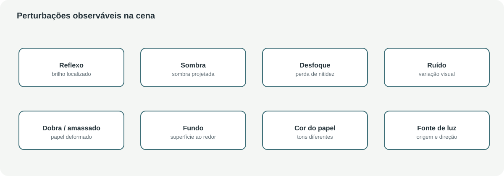
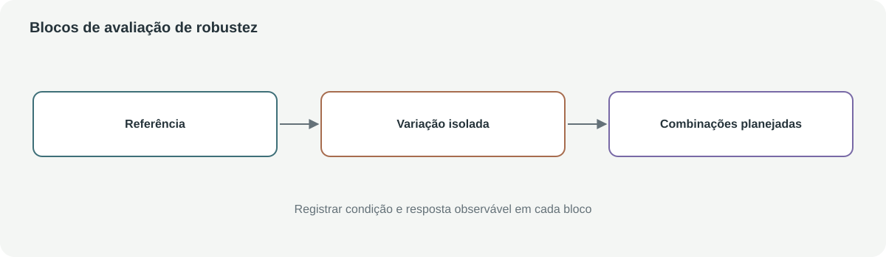
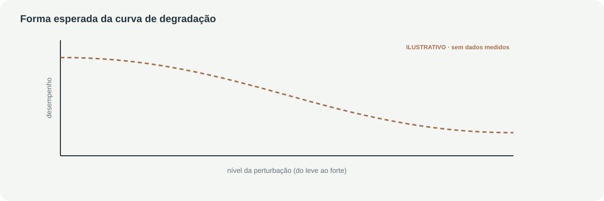

# Robustez da interpretação visual em condições cotidianas

## Resumo

Sistemas que interpretam desenhos capturados por câmera são usados sob variações de iluminação, papel e ambiente que não aparecem em uma cena controlada. Comparar apenas uma condição ideal não revela quais mudanças acompanham a perda de qualidade nem se perturbações diferentes produzem dificuldades semelhantes. Este artigo propõe um protocolo para avaliar robustez em condições cotidianas sem descrever mecanismos internos. O enquadramento organiza oito fatores: reflexo, sombra, desfoque, ruído, dobra ou amassado, fundo, cor do papel e fonte de luz. Para cada fator, define observação externa, níveis qualitativos e forma de variação. A avaliação primeiro compara cada fator isoladamente com uma referência e depois estuda combinações justificadas. As métricas incluem desempenho por condição, degradação relativa à referência, sensibilidade entre níveis e recuperação quando a cena retorna à condição inicial. Tabelas e diagramas registram o catálogo e o desenho do estudo. Como não há medições disponíveis, o artigo não atribui efeitos a fatores, não estabelece limites aceitáveis e reserva a seção de resultados para dados futuros. A proposta fornece um vocabulário comparável para documentar cenários, incerteza e alcance das conclusões.

**Palavras-chave:** robustez; condições reais; desenho; visão computacional; avaliação

## Abstract

Camera-assisted drawing systems operate under changes in lighting, paper, and surroundings that are absent from controlled scenes. Evaluating only an ideal condition cannot show which changes accompany a loss of quality or whether different perturbations create similar difficulties. This article proposes a protocol for assessing robustness in everyday conditions without describing internal mechanisms. The framework organizes eight factors: glare, shadow, blur, noise, paper folds or wrinkles, background, paper color, and light source. For each factor, it defines an external observation, qualitative levels, and a way to vary the condition. Evaluation first compares each factor in isolation against a reference and then studies justified combinations. Measures include performance by condition, degradation relative to the reference, sensitivity across levels, and recovery after the scene returns to its initial condition. Tables and diagrams describe the catalog and study design. Since no measurements are available, the article assigns no effects to any factor, sets no acceptable limits, and reserves the results section for future data. The proposal provides a comparable vocabulary for documenting scenarios, uncertainty, and the scope of conclusions.

**Keywords:** robustness; real-world conditions; drawing; computer vision; evaluation

## 1. Introdução

Uma avaliação feita sob iluminação uniforme, papel plano e fundo simples descreve apenas uma parte das condições em que desenhos são produzidos. Em ambientes cotidianos, a luz pode refletir no papel ou ser parcialmente bloqueada; a folha pode ter textura, cor ou deformação; e objetos próximos podem se confundir com a região de interesse. Além disso, a câmera pode registrar movimento ou perda de nitidez. Essas variações acontecem antes e durante a captura e podem coexistir, embora seus efeitos não sejam necessariamente equivalentes.

O termo robustez costuma resumir a manutenção de desempenho quando entradas ou condições mudam. Para ser útil em uma avaliação, essa ideia precisa ser ligada a uma condição externa observável, a uma tarefa e a uma resposta definida. “Ambiente real” não é uma condição única: uma mesa próxima a uma janela difere de uma superfície sob luz difusa, mesmo que ambas sejam descritas como interiores. A categoria também não informa se a página está plana, se há brilho localizado ou se o enquadramento inclui objetos concorrentes. Um catálogo explícito ajuda a transformar esse rótulo amplo em variações documentáveis.

Este artigo propõe estudar um sistema de desenho assistido por câmera como caixa-preta. A análise considera apenas a condição apresentada e o resultado visível para uma tarefa previamente definida. O estudo não atribui uma variação a etapa interna, nem infere qual fator foi reconhecido. A pergunta é: **como fatores visuais cotidianos, avaliados isoladamente e em combinações planejadas, se associam à qualidade observável da interpretação de páginas e desenhos?** A formulação é associativa porque o protocolo pode ser executado tanto em sessões controladas quanto em observação natural, e nem todo cenário permite manipulação causal.

O artigo oferece três contribuições. Primeiro, apresenta um catálogo operacional de reflexo, sombra, desfoque, ruído, deformação do papel, fundo, cor do papel e fonte de luz. Segundo, propõe uma sequência de avaliação que separa variações isoladas de combinações, com referência comum e registro da condição. Terceiro, define medidas para comparar desempenho, degradação, sensibilidade e recuperação, acompanhadas de limites para interpretação. Essas contribuições especificam um protocolo, não um resultado experimental nem uma afirmação de que o sistema mantenha ou perca qualidade em qualquer fator.

A seção 2 situa o trabalho na literatura sobre corrupções visuais, documentos capturados em ambientes não controlados e avaliação de robustez. A seção 3 define as perturbações e como registrá-las sem supor uma resposta. A seção 4 descreve condições, coleta, medidas e análise. A seção 5 reserva os quadros de resultados para uma avaliação posterior. A seção 6 discute como interpretar possíveis padrões, e a seção 7 delimita ameaças à validade. A seção 8 sintetiza a proposta e a evidência necessária.

O catálogo não pretende cobrir todos os fenômenos de uma cena. Perspectiva, movimento da folha, oclusão, sujeira, transparência, desgaste, compressão e diferenças entre dispositivos também podem alterar a observação. Alguns desses aspectos têm protocolos próprios nos demais artigos da coleção. Aqui, a seleção prioriza fatores ambientais e materiais que podem ser descritos independentemente e manipulados em estudos controlados. A escolha reduz a amplitude do problema para tornar as comparações mais interpretáveis.

Também é importante distinguir condição adversa de falha. Uma cena com sombra não é automaticamente inválida; pode ser uma ocorrência normal da tarefa. O desempenho precisa ser observado para uma finalidade definida, como localizar a página ou preservar marcas do desenho. Sem essa finalidade, “robusto” se torna um adjetivo sem critério. O protocolo, por isso, exige uma tarefa e uma referência externa antes de comparar condições.

O estudo não pressupõe que todas as pessoas encontrem os mesmos ambientes nem que uma condição simulada reproduza a diversidade cotidiana. A avaliação controlada permite isolar mudanças, enquanto a coleta em uso natural melhora a representatividade e introduz confundidores. As duas abordagens respondem a perguntas diferentes. Registrar a origem de cada cena, as condições conhecidas e o modo de exposição permite que leitores avaliem essa diferença sem interpretar um cenário de laboratório como retrato universal.

## 2. Trabalhos relacionados

### 2.1 Corrupções e variações visuais

Estudos de robustez em visão computacional organizam mudanças de entrada em famílias como ruído, desfoque, contraste, compressão e alterações climáticas ou de iluminação. Benchmarks de corrupção comum são úteis porque mantêm uma tarefa de referência e aplicam transformações controladas, permitindo examinar sensibilidade sem confundir cada mudança com outra [1, 3, 8]. Eles também destacam que o desempenho em uma distribuição familiar não garante comportamento equivalente em imagens modificadas. Exemplos adversariais naturais, diversidade de fundo e avaliações fora da distribuição mostram outros aspectos dessa diferença [2, 4, 6, 7, 9]. Entretanto, uma transformação aplicada a fotografias genéricas não representa automaticamente papel, tinta, brilho especular ou sombras de uma atividade de desenho. O tipo de conteúdo, a escala e o critério de sucesso precisam ser considerados antes de transferir conclusões.

Pesquisas sobre qualidade de imagem e captura fotográfica distinguem nitidez, ruído, exposição, faixa tonal e reprodução de cor. Uma mesma cena pode mudar com fonte, posição e espectro da iluminação, assim como com propriedades refletivas da superfície. Reflexo e sombra são particularmente relevantes porque alteram a visibilidade local, enquanto desfoque afeta os limites de marcas e bordas. Essas dimensões motivam um catálogo em que a condição é registrada separadamente da resposta, em vez de serem resumidas por uma noção genérica de “imagem ruim”.

Uma dificuldade metodológica é que os nomes de perturbações nem sempre correspondem a intervenções independentes. Mudanças na fonte de luz podem alterar brilho, sombra, balanço de cor e exposição simultaneamente. Uma folha amassada pode gerar novas sombras e modificar o plano aparente. A avaliação isolada exige verificar quais propriedades mudaram de fato e registrar efeitos colaterais. Benchmarks controlados fornecem precedentes para decompor variações, mas a cena física requer documentação e verificação visual adicionais.

### 2.2 Documentos em ambientes não controlados

Captura de documentos por câmera é estudada em cenários com página inclinada, deformada, sombreada ou parcialmente iluminada. Conjuntos de dados e métodos de avaliação exploram detecção de bordas, retificação, remoção de sombras e desdobramento de páginas [10–13]. Essas tarefas se relacionam a desenho porque compartilham papel, marcas e captura sob iluminação variável. Ainda assim, a qualidade de uma imagem legível não equivale à preservação de todos os traços: uma operação que melhora contraste de texto pode apagar ou alterar marcas fracas. A métrica precisa corresponder ao uso, e a avaliação não deve supor que resultados em documentos impressos se estendam a desenhos manuais.

Conjuntos de cenas naturais e benchmarks de captura móvel ajudam a estudar enquadramento, fundo e iluminação fora de estúdios. A variação entre ambientes pode refletir diferenças de câmera, distância, orientação e processamento, além da condição visual desejada. Quando todas mudam juntas, uma comparação não identifica qual fator acompanha a diferença. Concursos de binarização de documentos e avaliações de qualidade oferecem precedentes para critérios e coleções comuns [14–17, 24]. Por isso, a proposta registra informações de captura disponíveis e separa testes de fator único de uma fase combinada.

Um conjunto de documentos fotografados também depende da diversidade dos próprios documentos. Fontes impressas, anotações manuscritas, contrastes de tinta e fundos de página podem produzir distribuições muito diferentes. Métricas agregadas sobre uma única coleção não descrevem necessariamente o comportamento em outro conjunto. Avaliações compartilhadas oferecem regras e referências comuns, mas a interpretação deve considerar critérios de anotação, origem das imagens e tipo de degradação incluída. Essa preocupação orienta a documentação da amostra neste artigo: a condição deve ser caracterizada junto com o conteúdo avaliado, sem assumir que a palavra “documento” representa uma classe visual homogênea.

Trabalhos sobre documentos dobrados e imagens com sombras mostram que a geometria da página e a iluminação podem interagir [10–12]. A sombra pode ser projetada pelo ambiente ou criada pela própria curvatura do papel. Uma avaliação que classifique ambas como “sombra” pode misturar origens distintas; o protocolo anota se o papel parece plano e se a região escura segue uma dobra observável. A distinção é descritiva, não pretende recuperar a causa física com certeza.

### 2.3 Avaliação de robustez

Estratégias de avaliação variam entre estresse controlado, teste em ambientes naturais e mudança de distribuição. O teste controlado facilita atribuir diferenças a fatores isolados, enquanto a coleta natural mostra a mistura de condições encontrada em uso. Avaliações de robustez também alertam para o uso de um único indicador: uma média pode ocultar falhas concentradas em uma condição ou em uma tarefa. Distribuições por cenário, medidas de incerteza e desagregação por participante ou sessão tornam o relato mais informativo.

Abordagens de sensibilidade analisam quanto uma medida varia conforme a condição muda. A forma da relação pode ser gradual, descontínua ou dependente de uma combinação. O protocolo não assume uma curva monotônica: uma perturbação mais intensa pode afetar pouco certa tarefa e muito outra; a resposta também pode saturar ou oscilar. Relatar a sequência de níveis e a condição de referência é necessário para interpretar qualquer curva. Estudos específicos sobre degradação de documentos, sombra, reflexo, exposição e desfoque exemplificam a diversidade de fenômenos que podem ser avaliados separadamente [17–23, 25]. Figuras ilustrativas desta proposta não substituem dados nem antecipam uma tendência.

A lacuna abordada é metodológica. Há trabalhos sobre corrupções de imagem, captura de documentos e avaliação em ambientes diversos, mas seus fatores e desfechos nem sempre se alinham à interpretação de desenho em papel. Falta, para este cenário, um catálogo conciso que una medidas externas de condição, exposição isolada e combinada, e respostas observáveis sem especificar o interior do sistema. O presente artigo propõe essa estrutura como base para estudos que deverão declarar tarefa, amostra e condições. A taxonomia deve ser revisada se a literatura futura ou a coleta revelar fatores relevantes ausentes.

### 2.2 Documentos em ambientes não controlados

[Literatura sobre captura de páginas, cenas cotidianas e benchmarks.]

### 2.3 Avaliação de robustez

[Literatura sobre avaliação isolada e combinada; explicitar a lacuna.]

## 3. Enquadramento do problema

Robustez é tratada como a variação da resposta observável entre uma condição de referência e condições que alteram a cena. A comparação exige que a tarefa, o material e a definição do desfecho permaneçam claros. Cada perturbação é descrita por três campos: propriedade visual a registrar, forma de estabelecer níveis qualitativos e modo de variação. A palavra “nível” indica uma ordenação definida pelo protocolo, não um valor interno nem um resultado. Se duas propriedades mudarem ao mesmo tempo, a cena pertence à etapa de combinação e não deve ser rotulada como teste isolado.

O catálogo inclui oito fatores. **Reflexo** é uma região de brilho que reduz contraste local; pode ser anotado por localização e área relativa, usando superfície e iluminação documentadas. **Sombra** é uma região escurecida que atravessa ou margeia a página; registra-se posição, extensão e relação com o desenho. **Desfoque** é a perda de nitidez aparente nas bordas; pode ser graduado pela qualidade de uma referência visual externa, sem deduzir sua origem. **Ruído** é a variação visual não pertencente ao desenho, descrita por sua distribuição e intensidade aparente em áreas sem tinta. Esses fatores podem surgir em conjunto, mas devem ser separados no estudo controlado.

**Dobra e amassado** descrevem deformações visíveis do suporte, incluindo vincos e ondulações. O registro indica presença, localização, extensão e se a página permanece apoiada ou elevada. **Fundo** descreve o que aparece ao redor da folha, incluindo contraste, textura e elementos concorrentes; a anotação distingue fundo uniforme de superfície visualmente complexa sem nomear objetos identificáveis. **Cor do papel** registra variações de tonalidade e acabamento, incluindo páginas coloridas ou envelhecidas quando fizerem parte do escopo. **Fonte de luz** descreve origem, posição relativa, difusão e consistência durante a sessão, pois essas características podem mudar reflexo e sombra.

**Tabela 1.** Catálogo das perturbações com forma observável de medição e variação planejada, permitindo descrever as condições sem pressupor mecanismos internos ou causalidades específicas do sistema, para futura comparação entre estudos.

| Perturbação | Registro externo | Variação planejada |
|---|---|---|
| Reflexo | Localização e extensão do brilho | Condições qualitativas de brilho ausente, localizado ou amplo |
| Sombra | Área, posição e relação com o desenho | Sombra ausente, lateral ou atravessando a página |
| Desfoque | Nitidez visual de bordas de referência | Condições de foco nítido e perda gradual de nitidez |
| Ruído | Variação em regiões sem tinta | Cena limpa e níveis visuais crescentes de ruído |
| Dobra ou amassado | Localização e extensão da deformação | Suporte plano e deformações documentadas |
| Fundo | Contraste e textura ao redor da folha | Fundo simples e fundos com complexidade visual distinta |
| Cor do papel | Tonalidade e acabamento registrados | Papéis com aparências diferentes, mantendo a tarefa |
| Fonte de luz | Posição e caráter difuso ou direto | Configurações de iluminação documentadas |

Os níveis qualitativos precisam ser definidos com exemplos visuais e revisados no piloto. Não há um corte universal que separe uma sombra “leve” de uma “forte”, pois a aparência depende de papel, exposição e região de interesse. Uma descrição ordinal permite organizar condições sem alegar uma escala física inexistente. Sempre que houver instrumento de medição, seus limites e incerteza são relatados; quando a classificação for visual, o manual e a concordância entre anotadores são apresentados.

A resposta observável deve refletir a tarefa escolhida. Em uma tarefa de localização, pode-se reportar se a página foi encontrada segundo uma referência anotada. Em uma tarefa de preservação, pode-se comparar o desenho observado com uma digitalização independente. O estudo pode ainda avaliar disponibilidade, continuidade, legibilidade ou recuperação, desde que cada desfecho tenha definição e referência próprias. Não se deve combinar essas respostas sob um único escore sem justificar a relação entre elas.

Fatores ambientais não são necessariamente independentes nem graduais. O brilho pode cobrir uma região diferente conforme a orientação; a dobra pode alterar o fundo aparente ao criar uma sombra; o ruído pode se tornar mais visível em um papel de baixo contraste. A taxonomia registra cada fator separadamente e reserva combinações para uma etapa posterior. Uma cena natural pode conter múltiplos fatores e ser classificada em mais de uma categoria, mas não deve ser tratada como evidência isolada de qualquer uma delas.

O enquadramento também diferencia perturbação planejada de covariável. Uma mudança de câmera pode acompanhar um teste de iluminação sem ser parte do fator pretendido. Se não puder ser mantida constante, deve ser registrada e incluída na interpretação. Condições de referência são repetidas ao longo da coleta para verificar deriva temporal e mudança de contexto. A referência é uma condição definida para aquele estudo; não equivale a um padrão universal de cena perfeita.

A Figura 1 reúne esquemas dos fatores do catálogo. A figura apresenta categorias visuais, não a prevalência delas nem a resposta esperada. A separação em painéis ajuda a planejar variações, mas não implica que cada fator possa ser produzido ou medido sem influência colateral. Os detalhes para estabelecer as condições são descritos no protocolo e nas anotações da coleta.

**Figura 1.** Catálogo conceitual de reflexo, sombra, desfoque, ruído, deformação do papel, fundo, cor e iluminação. Os ícones são esquemáticos, sem retratos de cenas ou resultados; elaboração própria.

## 4. Protocolo de avaliação proposto

O estudo começa com uma referência documentada e uma tarefa constante. Na primeira etapa, varia-se um fator por vez, mantendo os demais tão estáveis quanto possível. A ordem das condições é alternada ou sorteada quando isso não compromete o controle, reduzindo associação entre condição e fadiga, aquecimento ou deriva da cena. Cada condição é capturada em mais de uma sessão ou repetição planejada conforme o desenho, e a regra de repetição é publicada antes da análise. O artigo não fixa tamanho amostral porque ele depende da variabilidade e do efeito mínimo relevante, que ainda precisam ser definidos a partir de piloto e objetivo científico.

Na segunda etapa, são testadas combinações selecionadas com justificativa. Um desenho fatorial completo pode se tornar excessivo à medida que fatores e níveis se multiplicam. Uma amostra balanceada pode priorizar interações plausíveis, como reflexo com fonte de luz ou dobra com sombra, sem alegar que essas combinações sejam as únicas importantes. A equipe documenta quais combinações foram escolhidas e quais ficaram fora. Se a coleta for natural, as categorias coexistentes são anotadas e a análise descreve associações, evitando atribuição causal indevida.

A captura deve incluir uma referência independente que permita classificar condição e resposta. Isso pode envolver anotações de cena, uma imagem ou digitalização de referência do desenho e registro externo da sequência. O método escolhido depende do desfecho e deve ser descrito sem expor detalhes internos. A equipe confirma que o material de referência não foi alterado pela condição de forma que impeça a comparação. Imagens com dúvidas de anotação são sinalizadas e submetidas a adjudicação por regra predefinida.

As medidas são definidas antes da coleta. **Desempenho por condição** resume o desfecho principal em cada combinação. **Degradação relativa** compara a medida em uma condição perturbada com a referência, usando uma definição que mantenha direção e escala interpretáveis. **Sensibilidade** descreve como a resposta muda entre níveis ordenados de uma mesma perturbação. **Recuperação** registra se a resposta retorna quando a cena volta à referência, incluindo tempo ou estado apenas se a tarefa permitir uma definição externa clara. Além disso, são relatados dados ausentes, falhas persistentes e incerteza de anotação.

**Tabela 2.** Métricas para resumir desempenho de referência, degradação, sensibilidade e recuperação, com definições externas e limitações interpretativas declaradas antes da coleta, sem impor interpretações causais ou confundir medidas distintas.

| Métrica | Definição operacional | Resumo | Limitação |
|---|---|---|---|
| Desempenho por condição | Desfecho previamente definido em cada cena | Distribuição e incerteza por condição | Depende da tarefa e da referência |
| Degradação relativa | Diferença ou razão frente à condição de referência | Estimativa pareada por sessão | A direção depende da métrica original |
| Sensibilidade | Mudança observada entre níveis do mesmo fator | Inclinação ou contraste ordenado | Níveis qualitativos podem não ser equidistantes |
| Recuperação | Retorno ao desfecho de referência após remover a condição | Estado ou tempo de retorno | Exige definir o fim da perturbação |
| Falha persistente | Ausência do desfecho até o fim da observação | Contagem e proporção por condição | Não confundir com encerramento de sessão |
| Incerteza de anotação | Divergência entre classificação e referência | Concordância e casos adjudicados | Não substitui a validade da própria referência |

O plano de análise apresenta a distribuição de cada desfecho antes de qualquer síntese. Para medidas contínuas, são relatadas estimativas centrais e intervalos de incerteza apropriados; para categorias, são mostradas frequências por condição. A unidade de agrupamento deve refletir o desenho, porque observações repetidas da mesma pessoa ou folha não são independentes. As comparações principais são pareadas sempre que a coleta permitir. A análise não seleciona retrospectivamente a métrica que produza a diferença mais forte.

A avaliação da degradação compara cada condição com a referência correspondente, preservando pareamento por pessoa, tarefa e sessão quando disponível. A sensibilidade pode ser estimada por contrastes ordenados entre níveis, mas não se presume distância igual entre categorias como “baixo”, “intermediário” e “alto”. Uma figura de curva usa forma qualitativa apenas para explicar a apresentação futura. Dados serão mostrados com pontos ou distribuições e não substituídos por uma linha suavizada sem explicação.

O protocolo inclui controle de qualidade. A equipe verifica se cada fator pretendido foi realmente alterado e se covariáveis importantes permaneceram constantes. Uma amostra das cenas é avaliada por anotadores independentes que não conhecem o desfecho da condição sempre que isso for possível. Diferenças são discutidas por manual e regra de adjudicação, com a concordância reportada. A sequência dos arquivos de referência e respostas é documentada de forma suficiente para auditoria, sem divulgar informação identificável desnecessária.

Se a condição combinada mostrar degradação diferente da esperada a partir dos fatores isolados, o relatório apresenta essa interação como observação do desenho e delimita a interpretação. Pode ser que uma perturbação reduza a visibilidade de outra, ou que seus efeitos se reforcem; nenhuma possibilidade deve ser presumida. Um estudo exploratório pode identificar combinações para investigações posteriores, mas não sustenta recomendação ampla sem repetição e variedade de ambientes.

A Figura 2 mostra os blocos do protocolo: referência, variação isolada e combinações planejadas. A Figura 3 é uma curva ilustrativa da forma possível de degradação. Ambas comunicam uma estrutura de teste e não contêm valores. A avaliação deverá apresentar seus próprios gráficos com condições identificadas, observações individuais quando adequado e intervalos de incerteza.

O desenho considera ética e privacidade quando a coleta inclui pessoas, espaços domésticos ou desenhos potencialmente identificáveis. O consentimento informa o propósito, o registro visual, retenção e compartilhamento. Elementos pessoais ao redor da folha são removidos ou protegidos antes de qualquer publicação. A política de acesso a dados é descrita mesmo que o compartilhamento integral não seja possível. Restrições de acesso fazem parte da interpretação da reprodutibilidade e não devem ser omitidas.

**Figura 2.** Sequência conceitual de comparação entre condição de referência, perturbação isolada e combinações planejadas. Ela descreve blocos de avaliação, não etapas internas do sistema; elaboração própria.

**Figura 3.** Curva ilustrativa de degradação conforme a intensidade qualitativa de uma perturbação. Não há valores nos eixos nem dados medidos; a forma esperada, não é resultado; elaboração própria.

## 5. Estrutura dos resultados

Esta seção reserva a apresentação de uma avaliação futura. Não há medições fornecidas para este artigo, portanto não se reportam diferenças, taxas, percentuais ou rankings entre perturbações. Os campos marcados como `[PENDENTE-DADOS]` só poderão ser preenchidos após coleta, revisão das anotações e análise correspondente. A tabela registra estrutura do relato e não codifica um resultado esperado.

O primeiro resumo informa quais condições foram efetivamente capturadas, quais permaneceram ausentes e como a condição foi verificada. Para cada fator, descreve-se a referência, os níveis observados, o número de unidades experimentais e as exclusões justificadas. Uma condição planejada que não ocorreu deve continuar identificada como não coletada, em vez de desaparecer do relato. Também são informadas as combinações selecionadas e a razão para incluí-las.

**Tabela 3.** Modelo de apresentação dos resultados futuros por fator, com campos separados para condição, observações, medida e incerteza; os espaços vazios não representam estimativas nem diferenças empíricas.

| Fator e nível | Observações | Medida principal | Incerteza e notas |
|---|---|---|---|
| Reflexo | [PENDENTE-DADOS] | [PENDENTE-DADOS] | [PENDENTE-DADOS] |
| Sombra | [PENDENTE-DADOS] | [PENDENTE-DADOS] | [PENDENTE-DADOS] |
| Desfoque e ruído | [PENDENTE-DADOS] | [PENDENTE-DADOS] | [PENDENTE-DADOS] |
| Papel, fundo e iluminação | [PENDENTE-DADOS] | [PENDENTE-DADOS] | [PENDENTE-DADOS] |

Uma apresentação completa separa a distribuição por condição da comparação com a referência. O gráfico deverá identificar a tarefa e o desfecho, mostrar as observações ou sua distribuição, e explicar qualquer agregação. Se uma combinação de fatores for mostrada, a legenda indicará quais condições coexistiram. Uma estimativa sem observações visíveis ou medida de incerteza pode ocultar a concentração dos dados e deve ser evitada.

A Figura 3 deste artigo é apenas uma curva conceitual. Nenhum ponto ou intervalo empírico está disponível. Se os dados futuros não sustentarem uma curva monotônica, a visualização deverá refletir essa forma ou usar comparações categóricas, sem ajustar a observação à expectativa visual do esquema. O relato também deverá distinguir resultado ausente, medida inconclusiva e falha persistente, preservando a razão de cada caso.

## 6. Discussão

O protocolo permite examinar se condições ambientais se associam a mudanças na tarefa sem presumir que uma perturbação seja sempre prejudicial. Se uma medida variar com a presença de reflexo, por exemplo, o resultado ainda dependerá da posição do brilho, do traço ativo, do papel e da iluminação. Uma associação agregada pode esconder diferenças entre regiões. A discussão deve apresentar essas condições e evitar transformar o nome do fator em explicação suficiente.

Se um fator isolado acompanhar uma mudança e os demais não, a primeira pergunta é se a intervenção conseguiu separar as condições pretendidas. Mudança de fonte de luz, por exemplo, pode alterar simultaneamente sombra e cor aparente. Um efeito atribuído ao fator isolado seria frágil se essas variáveis não fossem registradas. A interpretação deve reportar tanto a condição planejada quanto a observada e discutir desvios do desenho antes de propor explicações.

Se uma combinação produzir uma resposta distinta das condições isoladas, pode haver interação entre fatores ou diferença de distribuição das cenas. A interação não demonstra por si só mecanismo físico nem generalização a outro ambiente. Ela aponta uma condição a investigar com repetição e melhor controle. A literatura de benchmarks de corrupções e de condições adversas mostra a utilidade de distinguir mudanças controladas de imagens naturais; seus achados apoiam o desenho, mas não preveem a resposta do desenho em papel [1–8].

Uma queda apenas em tarefas de preservação, sem mudança em localização geral, indicaria que um resumo amplo de sucesso é insuficiente. Essa possibilidade reforça o uso de métricas ligadas ao objetivo. Uma medida de leitura ou detecção de página não necessariamente avalia a integridade de traços finos. Estudos de documentos degradados e de avaliação de qualidade ajudam a mostrar como a tarefa define o sentido de “bom resultado”, mas desenhos possuem distribuição visual e uso diferentes de texto impresso [10–17, 24].

Também pode ocorrer pouca ou nenhuma diferença nas condições testadas. Isso não significaria robustez universal. O resultado só seria informativo para a variedade de cenas, tarefa e população observadas, com poder para detectar diferenças relevantes. Condições pouco intensas, amostra concentrada ou medidas imprecisas podem ocultar associações. O relatório deve apresentar incerteza e cobertura do estudo, em vez de resumir o achado como ausência de sensibilidade.

O catálogo enfatiza fatores separados porque essa decomposição facilita comparação. Porém, cenas cotidianas são compostas: papel, fonte, sombra e fundo podem variar juntos. Benchmarks com corruptelas controladas possibilitam comparação sistemática, ao passo que conjuntos naturais capturam parte da complexidade e diversidade do mundo real [1, 4, 6, 7]. Uma abordagem útil combina as duas perspectivas. Testes isolados ajudam a compreender associações específicas; avaliações naturais verificam se os fatores e interações escolhidos são relevantes em contexto.

Trabalhos de remoção de sombra, brilho especular e correção de documentos mostram que os fenômenos são tratados como tarefas distintas e que há conjuntos de dados especializados para cada um [17–23]. O artigo não propõe aplicar essas transformações à saída nem adotar uma técnica de correção. A relevância da literatura está em evidenciar diferenças entre fenômenos que um rótulo amplo de qualidade visual esconderia. A avaliação futura deve separar descrição de condição, resposta observada e intervenção de melhoria.

A comparação entre papel plano e deformado é outro exemplo de cautela. Uma dobra pode alterar posição aparente, iluminação e foco, portanto seu efeito não é apenas “mais textura”. O registro externo da deformação e a relação com a região ativa permitem discutir quais situações foram incluídas. Resultados de desdobramento de documentos podem informar a caracterização física, mas não estabelecem que um desenho será interpretado ou preservado com a mesma qualidade [10–12].

Uma consequência prática da estrutura é que recomendações só devem surgir depois de replicação em cenários distintos. Se a resposta variar entre classes de papel ou fontes de luz, recomendações genéricas podem ser inadequadas. O protocolo pode orientar uma matriz de condições de uso, mas a escolha de uma condição aceitável pertence à aplicação e aos requisitos de usuários. A equipe apresenta evidência e incerteza; a decisão de produto não deve ser disfarçada como um limite científico universal.

Por fim, a proposta incentiva apresentar resultados negativos e condições não avaliadas. Benchmarks tendem a destacar conjuntos e métricas publicáveis, mas um estudo de robustez também deve dizer quais combinações não foram testadas e quais cenas não foram representadas. Essa transparência reduz conclusões além dos dados e facilita escolher o próximo experimento. Sem a coleta, toda interpretação nesta seção continua condicional.

## 7. Limitações e ameaças à validade

A validade de construção depende da correspondência entre fatores e fenômenos reais. “Reflexo”, “sombra” e “ruído” podem reunir causas ou aparências distintas. Níveis ordinais não asseguram intervalos iguais, e a descrição qualitativa pode divergir entre anotadores. O protocolo propõe registrar propriedades externas, mas não elimina a ambiguidade de classificação. O manual, a revisão piloto e a concordância devem ser relatados para que essa incerteza possa ser julgada.

A métrica de desempenho pode representar apenas uma parte da qualidade de desenho. Sucesso em localizar uma página não garante preservação de traços, assim como legibilidade não garante continuidade temporal. Usar medidas demais aumenta risco de análise seletiva; usar uma só pode ocultar diferenças importantes. A equipe deve justificar desfecho principal, reportar desfechos secundários como tais e manter definições separadas quando expressarem propriedades distintas.

A validade interna é ameaçada por covariação. Fonte de luz, exposição, orientação do papel e distância podem mudar junto com uma perturbação. A manipulação planejada pode introduzir artefatos que não surgiriam em uso natural, enquanto a observação natural não permite atribuição causal simples. Alternância de ordem, repetição de referências e documentação das cenas reduzem parte desses riscos, mas não provam que todas as diferenças observadas derivem do fator nomeado.

A validade externa é delimitada pelo papel, desenho, câmera, ambiente e participantes incluídos. Uma sessão de laboratório pode não representar uma residência, sala de aula ou espaço público. Tipos de tinta, textura, cor e prática de desenho também variam. A amostra e o contexto devem ser informados; não se generaliza para todas as condições cotidianas a partir de poucas configurações. Avaliações posteriores em locais e materiais diversos são necessárias para ampliar o alcance.

A validade dos dados depende de referência e sincronização adequadas. Uma digitalização pode diferir do original por escala, iluminação ou deformação. A anotação pode não distinguir marca fraca de ruído, e uma região de brilho pode ocultar informação que não pode ser reconstruída pela referência. Mudanças de condição ao longo da sessão também podem não ser registradas. O protocolo explicita esses limites e mantém sinalizadas observações incertas, mas a coleta pode continuar incompleta.

Há ameaças de amostragem e análise. Condições raras podem aparecer pouco; participantes podem contribuir quantidades distintas de cenas; e uma sequência de imagens correlacionadas pode inflar a impressão de volume amostral. A unidade de análise e a estrutura de agrupamento devem corresponder ao desenho. Resultados agregados sem essa distinção podem subestimar incerteza. O plano prévio de análise ajuda a evitar escolhas guiadas pelo padrão observado, sem garantir que o modelo estatístico seja adequado.

Por fim, a avaliação de caixa-preta restringe explicações causais internas. O protocolo pode apontar que uma condição acompanha mudança visível, mas não identifica qual componente ou regra produziu o resultado. Essa limitação é intencional para manter a comparação externa, porém reduz o valor diagnóstico. O artigo não permite reconstruir a implementação e não deve ser usado para afirmar robustez em condições que não foram efetivamente observadas.

## 8. Conclusão

Este artigo propõe um protocolo para estudar robustez em cenas cotidianas por meio de oito perturbações observáveis: reflexo, sombra, desfoque, ruído, deformação do papel, fundo, cor e fonte de luz. A estrutura separa variações isoladas de combinações e relaciona as condições a desempenho, degradação, sensibilidade e recuperação, sem revelar mecanismos internos.

A proposta organiza a coleta e o relato, mas não estabelece quais fatores afetam a interpretação nem em que intensidade. As figuras são conceituais e a seção de resultados permanece reservada para dados reais. A literatura de corrupção visual, captura de documentos e ambientes não controlados fundamenta as dimensões, sem garantir transferibilidade para desenhos.

O próximo passo é executar o protocolo com uma tarefa claramente definida, verificar as condições registradas e preencher os campos `[PENDENTE-DADOS]` com observações e incerteza. Conclusões deverão permanecer limitadas aos materiais, participantes e cenas avaliados. Só replicações em ambientes diversos poderão sustentar recomendações mais amplas.

## Declarações

- Uso de IA: texto redigido com apoio de IA generativa, com revisão e responsabilidade dos autores; referências conferidas por DOI.
- Dados: este artigo não apresenta dados experimentais; futuras observações serão identificadas e descritas após coleta.
- Código: não há código de análise de resultados nesta proposta; materiais futuros serão identificados por versão.
- Conflito de interesses: os autores deverão declarar qualquer conflito pertinente antes da submissão.
- Ética: estudos com participantes ou imagens de espaços privados serão submetidos à avaliação ética aplicável antes do recrutamento.
- Contribuição dos autores: a versão final deverá explicitar as contribuições individuais dos autores.

## Referências

[1] Hendrycks, D.; Dietterich, T. Benchmarking Neural Network Robustness to Common Corruptions and Perturbations. International Conference on Learning Representations, 2019. https://openreview.net/references/pdf?id=r1vn4B3W4
[2] Hendrycks, D. et al. Natural Adversarial Examples. IEEE/CVF Conference on Computer Vision and Pattern Recognition, 2021. https://doi.org/10.1109/CVPR46437.2021.01501
[3] Hendrycks, D. et al. The Many Faces of Robustness: A Critical Analysis of Out-of-Distribution Generalization. IEEE/CVF International Conference on Computer Vision, 2021. https://openaccess.thecvf.com/content/ICCV2021/html/Hendrycks_The_Many_Faces_of_Robustness_A_Critical_Analysis_of_Out-of-Distribution_ICCV_2021_paper.html
[4] Sakaridis, C. et al. ACDC: The Adverse Conditions Dataset With Correspondences for Semantic Driving Scene Understanding. IEEE/CVF International Conference on Computer Vision, 2021. https://doi.org/10.1109/ICCV48922.2021.01059
[5] Sakaridis, C.; Dai, D.; Van Gool, L. Semantic Foggy Scene Understanding with Synthetic Data. International Journal of Computer Vision, 2018. https://doi.org/10.1007/s11263-018-1072-8
[6] Barbu, A. et al. ObjectNet: A Large-Scale Bias-Controlled Dataset for Pushing the Limits of Object Recognition Models. Advances in Neural Information Processing Systems, 2019. https://proceedings.neurips.cc/paper/2019/hash/97af07a14cacba681feacf3012730892-Abstract.html
[7] Koh, P. W. et al. WILDS: A Benchmark of in-the-Wild Distribution Shifts. Proceedings of the International Conference on Machine Learning, 2021. https://proceedings.mlr.press/v139/koh21a.html
[8] Croce, F. et al. RobustBench: A Standardized Adversarial Robustness Benchmark. NeurIPS Datasets and Benchmarks, 2021. https://datasets-benchmarks-proceedings.neurips.cc/paper_files/paper/2021/hash/a3c65c2974270fd093ee8a9bf8ae7d0b-Abstract-round2.html
[9] Wang, H. et al. Learning Robust Global Representations by Penalizing Local Predictive Power. Advances in Neural Information Processing Systems, 2019. https://www.cs.cmu.edu/~epxing/papers/2019/Wang_etal_nips19.pdf
[10] Ma, K. et al. DocUNet: Document Image Unwarping via a Stacked U-Net. IEEE/CVF Conference on Computer Vision and Pattern Recognition, 2018. https://openaccess.thecvf.com/content_cvpr_2018/papers/Ma_DocUNet_Document_Image_CVPR_2018_paper.pdf
[11] Das, S. et al. DewarpNet: Single-Image Document Unwarping With Stacked 3D and 2D Regression Networks. IEEE/CVF International Conference on Computer Vision, 2019. https://doi.org/10.1109/ICCV.2019.00022
[12] Verhoeven, F.; Magne, T.; Sorkine-Hornung, O. UVDoc: Neural Grid-based Document Unwarping. SIGGRAPH Asia Conference Papers, 2023. https://doi.org/10.1145/3610548.3618174
[13] Nayef, N. et al. SmartDoc-QA: A Dataset for Quality Assessment of Smartphone Captured Document Images—Single and Multiple Distortions. International Conference on Document Analysis and Recognition, 2015. https://doi.org/10.1109/ICDAR.2015.7333960
[14] Gatos, B.; Ntirogiannis, K.; Pratikakis, I. DIBCO 2009: Document Image Binarization Contest. International Journal on Document Analysis and Recognition, 2010. https://doi.org/10.1007/s10032-010-0115-7
[15] Pratikakis, I.; Gatos, B.; Ntirogiannis, K. ICDAR 2011 Document Image Binarization Contest (DIBCO 2011). International Conference on Document Analysis and Recognition, 2011. https://doi.org/10.1109/ICDAR.2011.299
[16] Pratikakis, I.; Gatos, B.; Ntirogiannis, K. ICDAR 2013 Document Image Binarization Contest (DIBCO 2013). International Conference on Document Analysis and Recognition, 2013. https://doi.org/10.1109/ICDAR.2013.219
[17] Zhou, Y. et al. A Review of Document Image Enhancement Based on Document Degradation Problem. Applied Sciences, 2023. https://doi.org/10.3390/app13137855
[18] Wang, B. et al. A Comprehensive Survey on Shadow Removal from Document Images: Datasets, Methods, and Opportunities. Vicinagearth, 2025. https://doi.org/10.1007/s44336-024-00010-9
[19] Wang, J.; Li, X.; Yang, J. Stacked Conditional Generative Adversarial Networks for Jointly Learning Shadow Detection and Shadow Removal. IEEE/CVF Conference on Computer Vision and Pattern Recognition, 2018. https://doi.org/10.1109/CVPR.2018.00192
[20] Wu, Z. et al. Single-Image Specular Highlight Removal via Real-World Dataset Construction. IEEE Transactions on Multimedia, 2022. https://doi.org/10.1109/TMM.2021.3107688
[21] Jo, S. et al. S-LIGHT: Synthetic Dataset for the Separation of Diffuse and Specular Reflection Images. Sensors, 2024. https://doi.org/10.3390/s24072286
[22] Hsieh, C.-Y.; Ding, J.-J. ADSP: Advanced Dataset for Shadow Processing, Enabling Visible Occluders via Synthesizing Strategy. Asian Conference on Computer Vision, 2024. https://openaccess.thecvf.com/content/ACCV2024/html/Hsieh_ADSP_Advanced_Dataset_for_Shadow_Processing_enabling_visible_occluders_via_ACCV_2024_paper.html
[23] Liu, T. et al. Exposure Bracketing Techniques for Camera Document Image Enhancement. Applied Sciences, 2019. https://doi.org/10.3390/app9214529
[24] Bezmaternykh, P. V.; Ilin, D. A.; Nikolaev, D. P. U-Net-bin: Hacking the Document Image Binarization Contest. Computer Optics, 2019. https://doi.org/10.18287/2412-6179-2019-43-5-825-832
[25] Rim, J. et al. Real-World Blur Dataset for Learning and Benchmarking Deblurring Algorithms. European Conference on Computer Vision, 2020. https://graphics.postech.ac.kr/researches/RealBlur/
